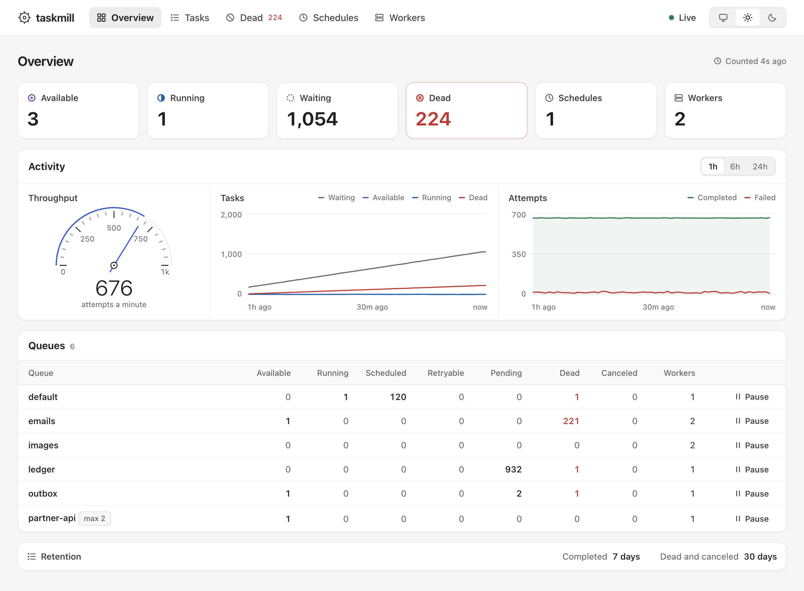

# taskmill

[](https://github.com/code19m/taskmill/actions/workflows/ci.yml)
[](https://scorecard.dev/viewer/?uri=github.com/code19m/taskmill)
[](https://pkg.go.dev/github.com/code19m/taskmill)
[](LICENSE)

Background tasks for Go, kept in your PostgreSQL database.

If your service already uses PostgreSQL, keep its tasks there too. You run
one less system, and each task commits or rolls back with your data.

- **In your transaction.** Add a task in the same transaction as your data,
  with pgx or `database/sql`. If the transaction rolls back, the task never
  existed.
- **No lost tasks.** Every task runs at least once. When a worker crashes,
  another worker runs its tasks. A task that keeps failing is kept as a
  dead task, so that you can fix the cause and retry it.
- **In order when you need it.** Tasks with the same key, such as one
  customer's, run one at a time, in order.
- **Outbox included.** Publish events to Kafka, NATS, or RabbitMQ only if
  your transaction commits, in order per key.
- **Dashboard included.** Watch queues and tasks, and retry, cancel, or
  delete them. Mount it in your app, or run it on its own.

It also has delays, priorities, cron schedules, deduplication, limits across
all workers, batch handlers, logs through `log/slog`, and OpenTelemetry. Its
only direct dependency is pgx. One worker runs about 26,000 tasks a second,
with handlers that do nothing, on 4 CPUs: see
[Performance](docs/reference/performance.md).

Start with the [quickstart](docs/start/quickstart.md): your first task, in
the dashboard, in about 15 minutes.

<picture>
  <source media="(prefers-color-scheme: dark)" srcset="docs/images/dashboard-dark.png">
  
</picture>

The dashboard, showing the [shop example](examples/shop).

## Install

```sh
go get github.com/code19m/taskmill
```

You need Go 1.26 or newer, and PostgreSQL 15 or newer.

## A quick look

You add a task in your own transaction, and a worker runs its handler:

```go
// SendReceipt is a task: a Go struct with a kind. taskmill stores it as JSON.
type SendReceipt struct {
	OrderID int64 `json:"order_id"`
}

// Kind names the task, so that a worker finds its handler.
func (SendReceipt) Kind() string { return "email.send_receipt" }

// placeOrder saves an order and its task in tx, so both commit or neither does.
func placeOrder(ctx context.Context, tx pgx.Tx, client *taskmill.Client, email string) error {
	var orderID int64
	row := tx.QueryRow(ctx, "INSERT INTO orders (email) VALUES ($1) RETURNING id", email)
	if err := row.Scan(&orderID); err != nil {
		return err
	}

	_, err := client.EnqueueTx(ctx, taskmill.Pgx(tx), SendReceipt{OrderID: orderID}, nil)
	return err
}

// ReceiptSender is the handler of SendReceipt tasks.
type ReceiptSender struct{ mailer Mailer }

// Handle returns nil when the work is done, or an error to try again later.
func (s *ReceiptSender) Handle(ctx context.Context, t *taskmill.Task[SendReceipt]) error {
	return s.mailer.SendReceipt(ctx, t.Args.OrderID)
}

// runWorker runs tasks until ctx ends.
func runWorker(ctx context.Context, client *taskmill.Client, mailer Mailer) error {
	var handlers taskmill.Handlers
	taskmill.AddHandler(&handlers, &ReceiptSender{mailer: mailer}, nil)

	worker, err := taskmill.NewWorker(client, &taskmill.WorkerConfig{Handlers: &handlers})
	if err != nil {
		return err
	}
	return worker.Run(ctx)
}
```

`Mailer` is your own code that sends emails. The
[tutorial](docs/tutorial/README.md) builds a small shop like this, step by
step.

## Learn more

- [Why taskmill](docs/start/why-taskmill.md): whether it fits your project, and how it compares with other tools
- [Fit taskmill to your architecture](docs/start/architectures.md): a monolith, modules, services, serverless functions, several regions, or many tenants
- [Documentation](docs/README.md): concepts, guides, recipes, and running in production
- [Packages](docs/reference/packages.md): which package to import for what
- [API reference](https://pkg.go.dev/github.com/code19m/taskmill): every type and function, on pkg.go.dev
- [Shop example](examples/shop): a small shop that uses most features, with its dashboard
- [Changelog](CHANGELOG.md): what changed in each release, and how to upgrade

## Contributing

Contributions are welcome: read [CONTRIBUTING.md](CONTRIBUTING.md) before
you open a pull request. Report security issues privately, as
[SECURITY.md](SECURITY.md) describes.

## License

taskmill is released under the [MIT License](LICENSE).
