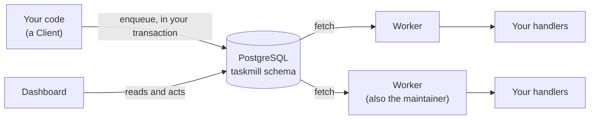
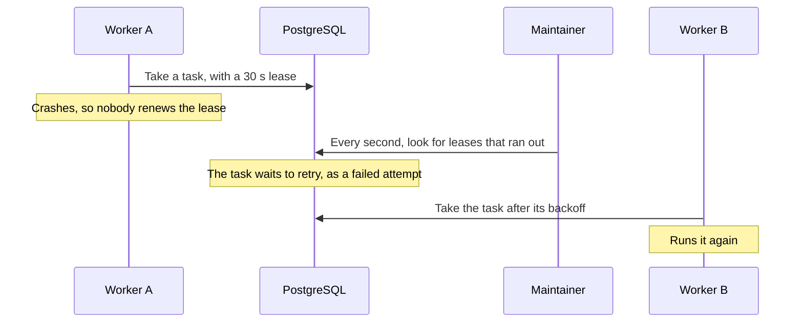

# How it works

This page shows the big picture: where your tasks live, who runs them, and
what happens when something fails. Read it once, and the other pages will be
easier to follow.

## The parts

taskmill has no server of its own. Your tasks are rows in your PostgreSQL
database, and your own program runs them.

This diagram shows the parts, and how a task moves between them:

| Part | What it does | Where it runs |
|---|---|---|
| [Client](glossary.md#client) | Adds tasks, and finds, retries, cancels, or deletes them | In every process that adds tasks |
| PostgreSQL | Stores the tasks in their own [schema](glossary.md#schema), `taskmill` by default | Your database |
| [Worker](glossary.md#worker) | Takes tasks from the database and runs your [handlers](glossary.md#handler) | In your app, or in a deployment of its own |
| [Maintainer](glossary.md#maintainer) | Does the shared work for all workers | Inside one of your workers, chosen for you |
| [Dashboard](glossary.md#dashboard) | Lets people watch and fix tasks | In your app, or on its own |

## The life of a task

1. **You enqueue it.** `EnqueueTx` writes the task as a row, in your own
   transaction. If you roll back, the task never existed.
2. **PostgreSQL wakes the workers.** When your transaction commits,
   PostgreSQL sends a [notification](glossary.md#notification) to the workers
   that read the task's [queue](glossary.md#queue).
3. **A worker takes it.** A worker with a free [slot](glossary.md#slot)
   fetches the task. The fetch locks the row, so no other worker takes the
   same task.
4. **The worker holds a lease.** The task belongs to that worker for a
   limited time: its [lease](glossary.md#lease), 30 seconds by default. The
   worker renews the lease while your handler runs, so long tasks keep it.
5. **Your handler runs.** It returns nil when the work is done, or an error
   to try again later.
6. **The worker saves the result.** The task becomes `completed`, waits to
   [retry](glossary.md#retry), or becomes [dead](glossary.md#dead-task).
   [Task lifecycle](task-lifecycle.md) shows every state.

## How soon does a task start?

Usually right away. Workers also [poll](glossary.md#polling) the database as
a backup, so a lost wake-up message delays a task, but never loses it.

| Situation | The task starts within |
|---|---|
| A worker has a free slot | a few milliseconds |
| A delayed task or a retry reaches its time | about 1 second |
| The wake-up message was lost | about 2 seconds |
| The maintainer, or a worker's connection for notifications, failed silently | about 16 seconds |
| All slots are busy | when a running task ends |

Idle workers cost the database little: while all is well, an idle queue
checks the database about once a minute. The exact timings are in
[Defaults and limits](../reference/defaults-and-limits.md).

## What if a worker crashes?

Nothing is lost: another worker runs its tasks.

This diagram shows a task whose worker crashes:

- The task runs again within about 30 seconds of the crash: the lease,
  plus a second or two.
- The crash counts as a failed [attempt](glossary.md#attempt). So a task that
  crashes its worker every time becomes dead in the end. It cannot crash your
  workers forever.
- A worker that loses the database stops its tasks once it cannot renew
  their leases. If it saves a result late, taskmill refuses it: only the
  attempt that holds the lease can save a result.

This is why a task can run twice. [Guarantees](guarantees.md) explains what
to do about it.

## The maintainer

One worker at a time is the maintainer. taskmill chooses it for you: every
worker takes part, unless you set `NoMaintainer` on it. The maintainer does
the shared work:

- it wakes queues whose tasks wait, and sends a
  [heartbeat](glossary.md#heartbeat) every few seconds, so workers know it is
  alive;
- it makes delayed tasks and retries ready when their time comes;
- it gives the tasks of crashed workers back to their queues;
- it enqueues [schedules](glossary.md#schedule), once for each time;
- it counts tasks for the dashboard and metrics, and deletes old tasks.

If the maintainer stops cleanly, another worker takes over right away. If it
crashes, another one takes over within about 12 seconds. While no maintainer
runs, delayed tasks, retries, and schedules wait.

> [!NOTE]
> The maintainer runs only the schedules defined in its own process. So give
> every worker the same schedules ([Run tasks on a schedule](../guides/schedules.md)).

## See also

- [Task lifecycle](task-lifecycle.md): every state a task can be in
- [Workers and queues](../guides/workers-and-queues.md): run workers, and stop them cleanly
- [Design: task lifecycle](../design/task-lifecycle.md): the exact rules, for contributors
- [`Worker`](https://pkg.go.dev/github.com/code19m/taskmill#Worker) on pkg.go.dev

**Next:** [Guarantees](guarantees.md)
