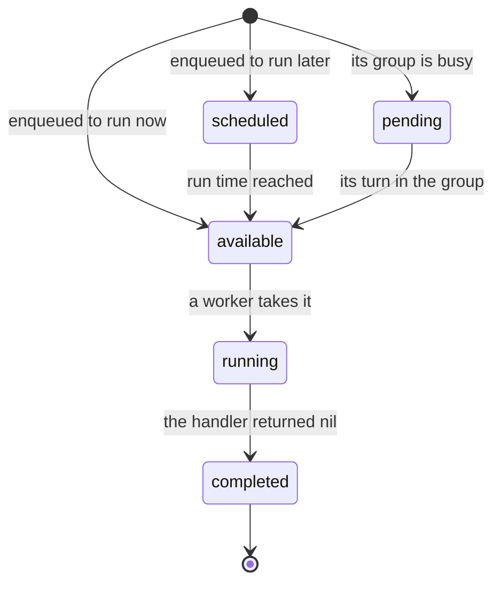
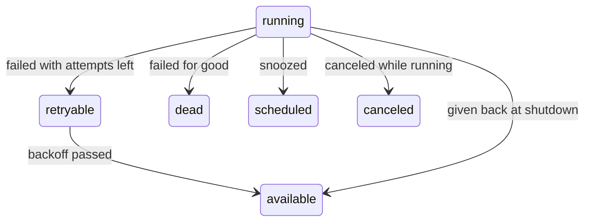

# Task lifecycle

A task moves through a few states, from the enqueue until it is finished.
This page shows each state, what moves a task from one to the next, and what
you can do to a task in each state.

## The eight states

| State | The task is… | Finished? |
|---|---|---|
| `scheduled` | waiting for its run time | |
| `pending` | waiting for its turn in a [FIFO group](glossary.md#fifo-group) | |
| `available` | ready, waiting for a free worker | |
| `running` | running on a worker, which holds its [lease](glossary.md#lease) | |
| `retryable` | waiting to run again after a failed attempt | |
| `completed` | done: its handler returned nil | Yes |
| `dead` | stopped for good, and waiting for you ([dead task](glossary.md#dead-task)) | Yes |
| `canceled` | stopped on request | Yes |

A [finished](glossary.md#finished) task does not run again, unless you retry
a dead or canceled one.

## The normal path

Most tasks take this path: they wait, a worker runs them, and they are done.

## When a task fails, snoozes, or stops

From `running`, a task can also take one of these paths:

- **Failed with attempts left.** The handler returned an error. The task
  waits for its [backoff](glossary.md#backoff), then runs again.
- **Failed for good.** No attempts are left, the handler returned a
  [permanent error](glossary.md#permanent-error), the payload does not
  decode, or no worker had a handler for the task's kind for an hour.
- **Snoozed.** The handler returned `taskmill.Snooze(d)`. The task runs
  again after `d`, and gets its attempt back.
- **Given back at shutdown.** The worker stopped before the handler
  finished. The task gets its attempt back, and another worker runs it
  ([release](glossary.md#release)).
- **Crashed.** A crash counts as a failed attempt. Once the lease runs out,
  the [maintainer](glossary.md#maintainer) moves the task to `retryable`, or
  to `dead` if no attempts are left.

## What you can do in each state

| State | Cancel | Retry | Delete |
|---|---|---|---|
| `scheduled`, `pending`, `available`, `retryable` | Yes, right away | No | Yes |
| `running` | Yes, when its attempt ends ([below](#cancel-a-running-task)) | No | No: cancel it first |
| `completed` | No | No: enqueue a new task | Yes |
| `dead`, `canceled` | No | Yes, with a new set of attempts | Yes |

Do this in the [dashboard](glossary.md#dashboard), or from code with
`Client.Cancel`, `Client.Retry`, and `Client.Delete`. To act on every task
that matches a filter, use `CancelMatching`, `RetryMatching`, or
`DeleteMatching` ([Manage tasks from code](../guides/operations-api.md)).

In a FIFO group, a retried task waits as `pending` while its group has other
unfinished tasks. If a dead task [halts its group](glossary.md#halted-group),
retry or delete it, and the group goes on.

## Cancel a running task

A waiting task is canceled right away. A running task is only asked to stop:
taskmill cancels its handler's context, and `context.Cause(ctx)` returns
`taskmill.ErrTaskCanceled`. The result depends on what the handler returns:

| The handler returns | The task becomes |
|---|---|
| anything but nil, such as the context's error | `canceled` |
| nil, because it finished the work first | `completed`, because the work was done |

> [!NOTE]
> A [batch handler](glossary.md#batch-handler) cannot see a cancel request
> for one of its tasks: the batch's context is not canceled. That task gets
> the result that the batch returns for it: `completed` if the batch returns
> nil for it, and `canceled` if it returns an error.

## How long finished tasks are kept

taskmill deletes finished tasks after a while. This is its
[retention](glossary.md#retention):

- completed tasks after 7 days;
- dead and canceled tasks after 30 days, so you have time to look at them.

A dead task that halts its FIFO group stays until you retry or delete it.
You can change both times with `Client.UpdateSettings`
([Defaults and limits](../reference/defaults-and-limits.md)).

## See also

- [Guarantees](guarantees.md): what taskmill promises along the way
- [Manage tasks from code](../guides/operations-api.md): find, retry, cancel, and delete tasks
- [Design: task lifecycle](../design/task-lifecycle.md): every transition, for contributors
- [`State`](https://pkg.go.dev/github.com/code19m/taskmill#State) on pkg.go.dev

**Next:** [Guarantees](guarantees.md)
