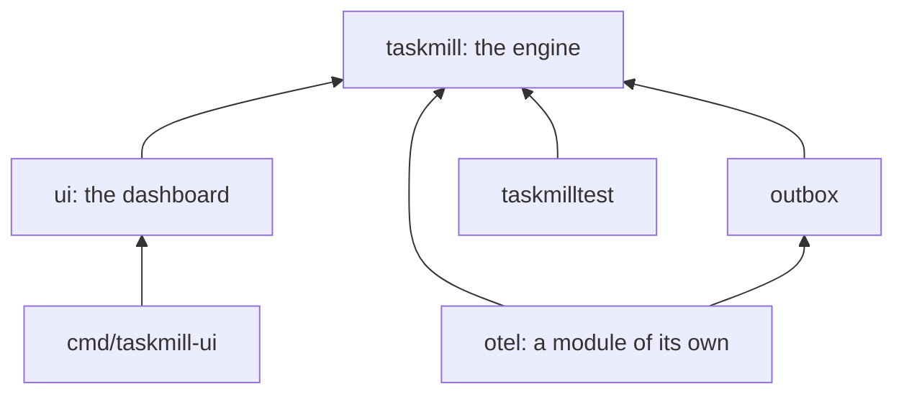

# How taskmill is built

This section is for contributors. It explains how taskmill works inside, what
it promises, and why it is built this way.

New to taskmill? Read [How it works](../concepts/how-it-works.md) and
[Guarantees](../concepts/guarantees.md) first, then
[CONTRIBUTING.md](../../CONTRIBUTING.md) before your first pull request.

## What to read first

| Order | Page | Read it to learn |
|---|---|---|
| 1 | [Task lifecycle and guarantees](task-lifecycle.md) | The contract: every state change, the invariants, and how each guarantee is kept |
| 2 | [Storage schema](schema.md) | The tables and indexes, and the reasoning behind them |
| 3 | [Key statements](schema-statements.md) | The statements that enqueue, fetch, and complete tasks, and record their failures |
| 4 | [Lists and counts](schema-lists.md) | The statements that list and count tasks, and why dead and canceled tasks come by finish time |
| 5 | [Operator actions](schema-operations.md) | The statements that retry, cancel, and delete tasks, one or many |
| 6 | [FIFO groups and deduplication](schema-groups.md) | How a group keeps its order, and how a dedupe key admits one task |
| 7 | [Maintenance and notifications](schema-maintenance.md) | What the maintainer runs, and how workers are woken |
| 8 | [Queue statistics and health](schema-statistics.md) | How the maintainer counts the queues, what lag leaves out, and what probes and autoscalers read |
| 9 | [Rows that taskmill did not write](schema-rows.md) | Which values the tables refuse, and how the code survives the others |
| 10 | [The API's shape](api-shape.md) | Why each point of the API has its shape, and when we look at it again |
| 11 | [Dependencies and modules](dependencies.md) | Why pgx is the only dependency, why OpenTelemetry has a module of its own, and how to add a dependency |
| 12 | [Benchmarks](benchmarks.md) | The performance targets, how we measure them, and the latest results |
| 13 | [Releasing](releasing.md) | How the project team publishes a version |
| 14 | [Writing docs](writing-docs.md) | The style guide and the page templates |
| 15 | [Writing doc comments](writing-godoc.md) | What a doc comment holds, and how godoc and the pages share the work |

**Each page gives its decisions next to the mechanism that they explain:**
what is so, why, and the options that we rejected. These pages are the home
of "why", and there is no separate list of decisions. One reason lives with
its policy instead: [Compatibility](../reference/compatibility.md#supported-go-and-postgresql-versions)
says why taskmill supports the versions that it does.

## Change the docs with the code

A change to documented behavior updates the docs in the same pull request:
the user docs in `docs/`, the godoc, these design pages, and CHANGELOG.md. If
the change goes against a decision on a design page, change that page in the
same pull request, and say why in it. Teams run taskmill in production from
these docs, so they must match the code.

## The product shape

taskmill is one engine, the `taskmill` package, with focused packages on top
of it. The packages use only the engine's public API, plus small internal
helpers such as UUID generation.

In this diagram, each arrow points to a package that the other one uses:

- **One Go module, except `otel`.** Everything is in one module, except the
  OpenTelemetry integration, which has a module of its own. Integrations
  that need third-party modules, such as broker clients, live in separate
  modules too, never in the core. They build on the core's middleware for
  enqueues and attempts. [Dependencies and modules](dependencies.md) has
  the rule and its reasons.
- **The outbox is a package on the engine, not a project.** The section
  [below](#why-the-outbox-is-a-package-on-the-engine) explains why.
- **The tables are internal,** so that they can change. Only the
  `migrations` table is public, for teams that apply migrations with their
  own tools. A stable SQL function to enqueue from other languages or from
  triggers can come once users need it.

### Why the outbox is a package on the engine

A service that publishes to a message broker needs a transactional outbox:
it stores the message in the same transaction as the business data, and
then publishes it reliably and in order. An outbox needs almost everything
that the engine has: rows written in the caller's transaction, safe
concurrent fetching, leases and lease tokens, retries and dead tasks, order
per key, batching, notifications, the election of a maintainer, migrations,
and monitoring. These are the hardest parts to get right. But outbox users
think in topics, keys, and messages, not in tasks and handlers.

| Option | Why, or why not |
|---|---|
| A separate project with its own engine | The hardest parts would be built twice, and a service that needs both would run two systems |
| Outbox features mixed into the engine's API | One API would speak of tasks and handlers, and of topics, keys, and messages |
| **A package on top of the engine** | Chosen. `outbox` is built on the engine's public API, and speaks of topics, keys, and messages. Users implement a small publisher interface with the broker client of their choice |

What follows:

- **There is one engine to make correct.** A service that needs background
  tasks and an outbox runs one system, with one schema and one dashboard.
- **The outbox tests the engine's API.** If the outbox cannot be built
  cleanly on the public API, the API is wrong.
- **The engine provides what the outbox needs:** FIFO groups, batch
  handlers, permanent failures, and deleting tasks on completion.
- **It is a package of the core module, not a module of its own,** because
  it has no dependency of its own. It becomes a module only if that
  changes. Ready-made broker adapters need a broker's client, so they are
  separate modules.
- **Another storage model can come later.** At very high volumes, around
  100,000 messages per second, rows that are only appended and read in
  order are faster. The outbox API hides its storage, so such an engine can
  be added without changing users' code.

### How the dashboard is built

- **Server-rendered** with `html/template`, `embed`, and `net/http`. The
  charts and the dial are SVG, drawn on the server.
- **Two small scripts of our own,** `app.js` and `theme.js`, under a strict
  content security policy. They keep pages live, apply filters as they
  change, confirm actions in dialogs, show a chart's values under the
  pointer, show times in the reader's time zone, and apply the chosen
  theme. Every page also works without them.
  Nothing needs a JavaScript build step or third-party code.
- **The server renders every page, and the script only shows it in place.**
  For a link, the back button, or an action, the script fetches the page
  that the server would send to a browser, and swaps its content in. So
  there is one renderer and no second API, and whatever the script cannot
  show, such as a login page, the browser loads as a full page. We rejected
  a client-side framework: it needs a JSON API, a second set of templates,
  and a build step, for a dashboard of five pages.
- **A time is an instant, and each side words it in the zone it knows.**
  The server knows no reader's time zone, so it words a time in UTC, and
  puts the instant beside the words. The script words it again in the zone
  of the device, with the same words, before the page shows. A range of
  finish times is in the address as two instants: a preset is a link to a
  fixed instant, which the server computes when it renders the page, so
  presets need no script and no zone. We rejected a time zone in a cookie
  or in the address: a link would then show other tasks to another reader.
- **A custom range is picked in a calendar of the dashboard's own,** which
  the script draws, with a date and a time to type for each bound. The
  browser's `datetime-local` fields look different in every browser, none
  of them picks a range, and none shows which days a range holds. The
  calendar is one month of buttons and about 3 KB of script, with no
  dependency. Without the script, the browser's fields stand in, in UTC.
- **To is the last minute of a range, and the address holds the minute
  after it,** as `before`. A reader who picks 18 to 19 November sees
  00:00 and 23:59 in the fields and gets all of the 19th. We rejected
  showing the next midnight, "20 November 00:00": it is exact, but it names
  a day that the reader did not pick. `since` and `before` stay as they
  are, so ranges that follow each other share a bound, with no gap.
- **A schedule's timetable in words comes from the scheduler's own parser,**
  `internal/cron`, and from the values that each field matches, never from
  the expression's text. So the words cannot read an expression in another
  way than the scheduler does. The page shows no words where they would not
  be exact and short. We rejected words for every expression: "every 7
  minutes" for `*/7` is wrong at each full hour, and a wrong sentence is
  worse than none.
- **Two ways to run it:** mounted on an application's own router, behind
  the application's own authentication, or on its own with basic
  authentication, through the `taskmill-ui` command.
- **Safe on a busy database.** It reads only through the operations API and
  the statistics that the maintainer keeps. Its queries over tasks, groups,
  and activity stop after 5 seconds. The other pages read small tables or
  single rows. So it is safe to point at a busy database, even with pages
  that refresh every 5 seconds.

## Out of scope

Some features are out of scope on purpose: workflows, being a message
broker, exactly-once delivery across systems, users and roles in the
dashboard, databases other than PostgreSQL, and a command-line tool for
operations. [Why taskmill](../start/why-taskmill.md) lists them. Read it
before you propose a large feature.

## See also

- [CONTRIBUTING.md](../../CONTRIBUTING.md): set up, test, and send a change
- [How it works](../concepts/how-it-works.md): the user's view of the same
  design
- [Package docs on pkg.go.dev](https://pkg.go.dev/github.com/code19m/taskmill)

**Next:** [Task lifecycle and guarantees](task-lifecycle.md)
