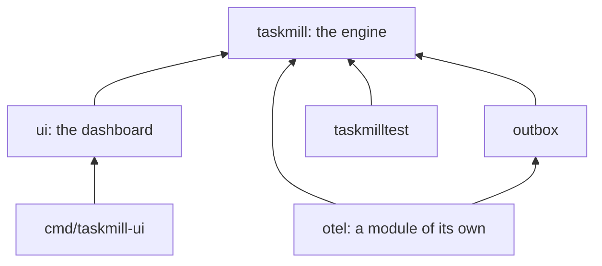

# How taskmill is built

This section is for contributors. It explains how taskmill works inside, what
it promises, and why it is built this way.

New to taskmill? Read [How it works](../concepts/how-it-works.md) and
[Guarantees](../concepts/guarantees.md) first, then
[CONTRIBUTING.md](../../CONTRIBUTING.md) before your first pull request.

## What to read first

| Order | Page | Read it to learn |
|---|---|---|
| 1 | [Task lifecycle and guarantees](task-lifecycle.md) | The contract: every state change, the invariants, and how each guarantee is kept |
| 2 | [Storage schema](schema.md) | The tables and indexes, the key statements, FIFO groups, deduplication, and notifications |
| 3 | [Benchmarks](benchmarks.md) | The performance targets, how we measure them, and the latest results |
| 4 | [Releasing](releasing.md) | How the project team publishes a version |
| 5 | [Writing docs](writing-docs.md) | The style guide and the page templates |

The [Architecture Decision Records](../adr/README.md) (ADRs) explain the big
choices: the dependency policy, the supported Go and PostgreSQL versions, the
outbox on the shared engine, pgx as the driver, OpenTelemetry in its own
module, and the health and scaling read paths. Their index also says how to
write a new one.

## Change the docs with the code

A change to documented behavior updates the docs in the same pull request:
the user docs in `docs/`, the godoc, these design pages, and CHANGELOG.md. If
the change goes against an ADR, write a new ADR that replaces it. Teams run
taskmill in production from these docs, so they must match the code.

## The product shape

taskmill is one engine, the `taskmill` package, with focused packages on top
of it. The packages use only the engine's public API, plus small internal
helpers such as UUID generation.

In this diagram, each arrow points to a package that the other one uses:

- **One Go module, except `otel`.** Everything is in one module, except the
  OpenTelemetry integration, which has a module of its own
  ([ADR 0005](../adr/0005-opentelemetry-in-a-module-of-its-own.md)).
  Integrations that need third-party modules, such as broker clients, live
  in separate modules too, never in the core
  ([ADR 0001](../adr/0001-dependency-policy.md)). They build on the core's
  middleware for enqueues and attempts.
- **The outbox is a package, not a project.**
  [ADR 0003](../adr/0003-outbox-on-the-shared-engine.md) explains why.
- **The tables are internal,** so that they can change. Only the
  `migrations` table is public, for teams that apply migrations with their
  own tools. A stable SQL function to enqueue from other languages or from
  triggers can come once users need it.

### How the dashboard is built

- **Server-rendered** with `html/template`, `embed`, and `net/http`. The
  charts are SVG, drawn on the server.
- **Two small scripts of our own,** `app.js` and `theme.js`, under a strict
  content security policy. They keep pages live, apply filters as they
  change, confirm actions in dialogs, and apply the chosen theme. Every page
  also works without them. Nothing needs a JavaScript build step or
  third-party code.
- **Two ways to run it:** mounted on an application's own router, behind
  the application's own authentication, or on its own with basic
  authentication, through the `taskmill-ui` command.
- **Safe on a busy database.** It reads only through the operations API and
  the statistics that the maintainer keeps. Its queries over tasks, groups,
  and activity stop after 5 seconds. The other pages read small tables or
  single rows. So it is safe to point at a busy database, even with pages
  that refresh every 5 seconds.

## Out of scope

Some features are out of scope on purpose: workflows, being a message
broker, exactly-once delivery across systems, users and roles in the
dashboard, databases other than PostgreSQL, and a command-line tool for
operations. [Why taskmill](../start/why-taskmill.md) lists them. Read it
before you propose a large feature.

## See also

- [CONTRIBUTING.md](../../CONTRIBUTING.md): set up, test, and send a change
- [How it works](../concepts/how-it-works.md): the user's view of the same
  design
- [Package docs on pkg.go.dev](https://pkg.go.dev/github.com/code19m/taskmill)

**Next:** [Task lifecycle and guarantees](task-lifecycle.md)
