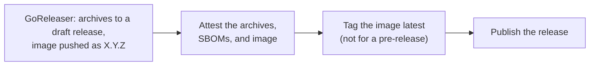

# Releasing

This page is for the project team. It lists the steps to publish a new
version of taskmill and of the `otel` module.

Release only from a green `main`. Pushing a tag publishes the release. The
steps before and after the tag are manual.

## Release the core module

1. **Check the pinned versions that Dependabot does not update.**
   - The tools at the top of the Makefile.
   - The base image in `.goreleaser.yaml`. This command shows its current
     digest:

     ```sh
     docker buildx imagetools inspect gcr.io/distroless/static-debian13:nonroot
     ```

   Update the stale ones in a pull request, and run `make snapshot` on it.

2. **Choose the version.** Use at least the version that the API check
   suggests for the release commit (`make api`, or the API job's summary in
   CI).

   | The release contains… | Release type |
   |---|---|
   | Only fixes | Patch |
   | Additions to the API | Minor |
   | Breaking changes, while the version is before v1.0.0 | Minor |

3. **Prepare the release in a pull request.**
   - In CHANGELOG.md, move `[Unreleased]` to a new section
     `## [X.Y.Z] - YYYY-MM-DD`. A pre-release, such as `v1.0.0-rc.1`, needs
     a section of its own: `## [1.0.0-rc.1] - YYYY-MM-DD`.
   - Update the links at the bottom of CHANGELOG.md. `[Unreleased]` compares
     `vX.Y.Z...HEAD`, and `[X.Y.Z]` compares the previous version with the
     new one:

     ```text
     [Unreleased]: https://github.com/code19m/taskmill/compare/vX.Y.Z...HEAD
     [X.Y.Z]: https://github.com/code19m/taskmill/compare/vA.B.C...vX.Y.Z
     ```

   - Check the notes. `make release-notes TAG=vX.Y.Z` prints the section as
     the release will show it, and fails if there is none.
   - Set the `taskmill-ui` image tag in the docs' examples to the new
     version, as in [Kubernetes](../production/kubernetes.md) and
     [The dashboard](../guides/dashboard.md).
     `grep -rn 'taskmill-ui:[0-9]' README.md docs` finds them all.

4. **Check the migration checksums.** `internal/migrations/released_test.go`
   must pin the checksum of every migration in the release.

5. **Tag the release.** Once the pull request is merged, tag the release
   commit on `main` with an annotated tag, and push it:

   ```sh
   git tag -a vX.Y.Z -m "vX.Y.Z" && git push origin vX.Y.Z
   ```

   A ruleset protects the tags: only the project team can create, move, or
   delete `v*` tags. The tag starts the
   [release workflow](#what-the-release-workflow-does).

6. **Make the Go module proxy fetch the version,** so that pkg.go.dev shows
   it:

   ```sh
   GOPROXY=https://proxy.golang.org go list -m github.com/code19m/taskmill@vX.Y.Z
   ```

7. **Point the checks at the new release.** In `internal/compat`, run this
   command, and merge the change:

   ```sh
   go get github.com/code19m/taskmill@vX.Y.Z && go mod tidy
   ```

   Until you do, the API check fails once the proxy knows the new version,
   because gorelease compares only with the newest release of a major
   version.

## What the release workflow does

The tag starts the [release workflow](../../.github/workflows/release.yml).
It runs [GoReleaser](https://goreleaser.com) as configured in
[.goreleaser.yaml](../../.goreleaser.yaml).

It refuses two kinds of tag:

- a tag that is not a version, such as `v1.0.0` or `v1.0.0-rc.1`;
- a tag that is not on `main`. This guards against mistakes. It is not a
  security control: the tag ruleset is.

It publishes these:

| What | Details |
|---|---|
| The GitHub release | Its notes are the release's CHANGELOG section. A tag with a suffix, such as `v1.0.0-rc.1`, makes a pre-release. |
| `taskmill-ui` archives | For Linux, macOS, and Windows, on amd64 and arm64, with `checksums.txt` and an SPDX SBOM for each archive. |
| The image `ghcr.io/code19m/taskmill-ui` | For linux/amd64 and linux/arm64. Tagged `X.Y.Z`, and also `latest` unless it is a pre-release. ko builds it on distroless `static`, running as user 65532, and attaches its SBOM in the registry. |
| Build provenance attestations | For every archive, every SBOM, and the image. `gh attestation verify` checks them. |

The workflow runs these steps in order:



The image `X.Y.Z` is public as soon as it is pushed. `latest` and the
published release come only after the attestations. If the run fails, run it
again: it replaces the draft, and pushes the same image again.

> [!NOTE]
> The first release creates the image's package on GitHub. If that package
> is private, make it public in the package's settings.

## Check that a build is reproducible

The binaries are built with the latest Go, so they carry its security fixes.
They are also reproducible:

1. Check out the release tag.
2. Run `go version -m` on a released binary. It shows the Go version,
   `GOOS`, and `GOARCH` that built it. Use the same ones.
3. Build:

   ```sh
   CGO_ENABLED=0 go build -trimpath -ldflags='-s -w' ./cmd/taskmill-ui
   ```

   You get the same bytes as the released binary.

`make snapshot` runs the release's build without publishing anything. It
loads the linux/amd64 image into Docker as `goreleaser.ko.local`. Run it
after you change `.goreleaser.yaml`.

## Release the otel module

A nested module, such as `otel`, has its own versions, with tags such as
`otel/vX.Y.Z`, and its own changelog,
[otel/CHANGELOG.md](../../otel/CHANGELOG.md). The release workflow ignores
these tags. The module ships no binaries, and pkg.go.dev shows its
versions, so it gets no GitHub release. That keeps the releases page about
taskmill.

1. **Release the core first, if needed.** `otel/go.mod` requires the oldest
   core release that the module works with. If the module uses core changes
   that are not released yet, release the core first.
2. **Update otel/CHANGELOG.md:** move `[Unreleased]` to a new section, and
   update the links at the bottom, as in step 3 for the core.
3. **Check the module against the core version it requires:**

   ```sh
   make otel-release-check RELEASING=1
   ```

   It builds and tests the module as its users build it, and fails if that
   core version is not released. Keep the `replace` line in `otel/go.mod`:
   users of the module ignore it.
4. **Tag the module, and push the tag:**

   ```sh
   git tag -a otel/vX.Y.Z -m "otel/vX.Y.Z" && git push origin otel/vX.Y.Z
   ```

5. **Make the Go module proxy fetch it:**

   ```sh
   GOPROXY=https://proxy.golang.org go list -m github.com/code19m/taskmill/otel@vX.Y.Z
   ```

## Fix a bad release

> [!WARNING]
> Never move or delete a published tag. The Go checksum database keeps every
> version forever, so a moved tag no longer matches what users already have.

Fix it forward instead:

1. Release a new patch version with the fix.
2. Mark the bad version with a `retract` directive in go.mod, in that same
   release:

   ```text
   retract vX.Y.Z // why users must not use it
   ```

## See also

- [CONTRIBUTING.md](../../CONTRIBUTING.md): checks, commits, and pull
  requests
- [Compatibility](../reference/compatibility.md): what each kind of release
  may change
- [Benchmarks](benchmarks.md): the targets that gate v1.0.0

**Next:** [Writing docs](writing-docs.md)
