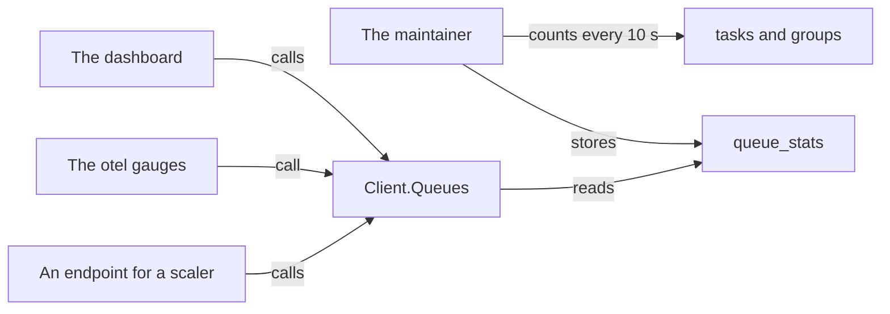

# Queue statistics and health

This page explains how the maintainer counts the queues, how the counts
show lag and stuck work, why dashboards, gauges, autoscalers, and health
probes never count the tasks themselves, and how workers add activity.
[Maintenance and notifications](schema-maintenance.md) has the maintainer's
other work.

## One writer, many readers

Every 10 seconds, in a loop of its own, the maintainer counts each queue's
tasks per state. It stores the counts in `queue_stats`, and in the current
minute of `activity`. Only the maintainer counts the tasks, and everything
that watches the queues reads what it stored:

So the database pays for one count every 10 seconds, however many watch
the queues: a dashboard tab, a gauge, or a scaler only reads a small table.

**One refresh stores at a time.** Two maintainers can refresh at the same
time, when their terms overlap. A refresh replaces every row, so it first
locks `queue_stats` in the mode that keeps other writers out and lets
everyone read. The second refresh waits for the first, and the table always
holds the counts of exactly one refresh.

| Option | Why, or why not |
|---|---|
| **A lock on the table** | Chosen. Only the maintainer writes the table, and only a role with rights on the table can take the lock |
| An insert that updates a row that is already there | A row that only the first refresh stored would stay beside the second one's counts, until the next refresh |
| An advisory lock | Any role of the database can take and hold one, and so stop every refresh |

## Every count is bounded

The count reads indexes, and every count is capped, so the cost stays
bounded however large the backlog:

- **Caps.** A count stops at 10,000 tasks per queue and state, and at
  100,000 scheduled and retryable tasks in all. The one exception,
  [below](#stuck-work-that-lag-leaves-out), reads up to 10,000 retryable
  tasks, and one more per queue.
- **JIT is off.** The count runs in the transaction that stores it. Its many
  subqueries make the planner think it costly, and compiling it would take
  longer than running it.
- **One probe per queue.** A recursive query finds the next queue name with
  one index probe each, a technique called a loose index scan. So finding
  the queues costs one probe per queue, not one row per task.
- **Scheduled and retryable tasks are counted together.** They are read from
  `tasks_due_idx`, which is ordered by run time, not by queue. Then each
  queue's count stops at 10,000 too.
- **A capped count is a lower bound.** Each cap is read one row past, so a
  count that stops at its cap with more tasks left is stored with
  `capped = true`. A count of exactly 10,000 is not capped. Once the shared
  cap is passed, every queue's scheduled and retryable counts are capped,
  stored as capped zeros where none were counted. Its other counts keep
  their own flags.

## Lag comes with the counts

The counts are capped, so on a large backlog they cannot say how far behind
a queue is. Lag can: it is how long a queue's oldest due task has waited
since its run time. Each row of `queue_stats` keeps, in `oldest_due_at`, the
run time of the oldest due task it counted:

- For `available`, it is the first entry of `tasks_fetch_idx` per priority:
  one more probe per queue and priority.
- For `scheduled` and `retryable`, it is the oldest task whose run time has
  passed. The count meets that task first, because it reads `tasks_due_idx`
  in run time order. So overdue retries, and a maintainer that stopped
  promoting, show in lag too.

A queue's lag is then the age of its oldest `oldest_due_at` by the
database's clock. `Client.Queues` computes it without touching `tasks`. Lag
keeps growing when no maintainer runs, and can be too high for up to one
refresh. The maintainer also stores a zero count for each known queue
without tasks, so every queue shows when it was last counted.

Only if more than 100,000 scheduled and retryable tasks are overdue can a
queue's overdue tasks fall past the cap. The oldest ones, which set the
largest lag, are always read.

## Stuck work that lag leaves out

Lag is the alert for a backlog. Two kinds of stuck work stay out of it:

- **Halted FIFO groups.** When a group's head becomes dead, the tasks behind
  it wait as `pending`. Lag leaves `pending` tasks out: they wait by design.
- **Tasks that keep failing.** A failed task waits for its next retry, so it
  is not due. During a broker outage, the first outbox message of each key
  is `retryable` with a run time minutes ahead, and the messages behind it
  are `pending`. Lag stays near zero for hours, until the messages die
  after about a month. The same holds for any queue whose tasks keep
  failing: with the default policy, a task retries for about 13 hours.

So the maintainer counts both with the counts that it already makes, in two
nullable columns of `queue_stats`. `Client.Queues` returns them as
`QueueInfo.HaltedGroups` and `QueueInfo.MostFailures`.

**Halted groups are counted per queue.** Each queue's `dead` row keeps, in
`halted_groups`, how many of its groups a dead head halts. They are counted
through the index of halted groups on `(queue, group_key)`, up to 10,000,
like the other counts: one more probe per queue with dead or canceled
tasks. The count is stored with the dead count, because the dead task that
halts a group is always in the group's queue.

**"Keeps failing" is measured in failures in a row.** Each queue's
`retryable` row keeps, in `most_failures`, the highest `attempt` of its
retryable tasks. Every attempt of a retryable task failed: a success
completes the task, a snooze gives its attempt back, and an operator's
retry starts again from 0. So the attempt number says how many times in a
row the task failed. The value ignores tasks that fail now and then, and it
catches both a whole queue that fails and one task that fails among many
that succeed.

With the default retry policy and the outbox's, the 10th failure comes
about 8.5 minutes after the first. So 10 is the threshold of the alert in
[Monitoring](../production/monitoring.md).

**The tasks that failed most are read first, and the cost stays bounded.**
`attempt` is not in `tasks_due_idx`, so the count reads it with one index
probe per task, for two sets of retryable tasks:

- **The 10,000 that retry last,** among the counted ones. A task's wait
  before its retry grows with its failures, so the tasks that failed most
  retry last. In an outage with steady traffic, more than 10,000 tasks can
  wait to retry. The new failures, with few attempts and short waits, retry
  first. Reading the tasks that retry first would miss the old ones exactly
  when the alert matters. The count reads `tasks_due_idx` backward, from the
  last retryable task it counted. So it reads no task past the counted
  ones, and no scheduled task after them.
- **Each queue's task that retries last,** which the count already knows.
  So a queue whose tasks all retry before 10,000 others is still read: the
  shared cap cannot leave it out.

Measured on PostgreSQL 18 with JIT off, with 1.7 million tasks, 150,000 of
them retryable: the count took about 15 ms longer, about 40 ms instead of
25 ms. With few retryable tasks it costs nothing more.

### The limits of the two values

- **Most failures counts failures, not time,** so the threshold depends on
  the retry policy. A kind whose tasks die after fewer attempts never
  reaches it, and the alert on new dead tasks covers it.
- **A task leaves the value while it runs its next attempt.** So an alert
  uses the maximum over some minutes, or it turns on and off.
- **The value may miss the single task that failed most.** Run time stops
  telling tasks apart once their waits reach the policy's maximum, such as
  1 hour by default and 5 minutes for the outbox. With more than 10,000
  tasks at that wait, the value can read lower than the most failures of
  any one task. But all of them have failed at least the times it takes to
  get there, about 13 by default and 10 for the outbox, so the value still
  reaches the threshold of 10. An exact value would need `attempt` in an
  index, which means a new index on `tasks`.
- **A maintainer of an older release leaves both columns `NULL`,** and they
  read 0, for example during a rolling deploy. Telling "not counted" apart
  would need another field in `QueueInfo` for a gap of minutes.

### Options we rejected

| Option | Why not |
|---|---|
| How long the oldest failing task has failed | taskmill stores no time when a task started to fail. `attempted_at` is the latest attempt. The errors keep the last 20 entries, which an outbox message passes in about an hour, and reading them means reading large JSON. `created_at` includes a task's delay and its wait in a backlog, so a task delayed by a day that fails once would look like it failed for a day. Storing the time needs a column on `tasks` that every failure writes, and an index to find the oldest. `Migrate` cannot build an index on a large table inside its transaction |
| A documented alert on the retryable count, such as "above 0 for 15 minutes" | It fires in any busy queue that always has a few failures that a retry fixes, and it cannot tell one task that failed 10 times from 10 tasks that failed once |
| The error rate from the `otel` middleware | It needs the middleware in every worker, and misses one task that keeps failing among many that succeed: for example one outbox message that the broker refuses, which blocks its key for a month |
| Count halted groups when `Client.Queues` reads | Every process that reports the gauges would read `groups` at each collection. The readers would then add load of their own |
| A cap of most failures per queue, not one shared cap | `tasks_due_idx` does not lead with the queue. So reading one queue's last tasks means reading through every other queue's tasks, or sorting the counted ones by queue in memory: up to 100,000 rows every 10 seconds, which spill to disk at the default `work_mem` |

## Scalers read `Client.Queues` or the gauges, never the tables

An autoscaler such as KEDA needs a scaling signal: how many tasks wait, or
the lag. KEDA can also run SQL against PostgreSQL itself, which invites
pointing it at taskmill's tables. But the tables, their columns, and the
statistics in them are internal: migrations change them in minor releases.

| Option | Why, or why not |
|---|---|
| **The `otel` gauges, through Prometheus** | Chosen. They report what `Client.Queues` returns |
| **`Client.Queues` behind a small JSON endpoint,** which KEDA's Metrics API scaler reads | Chosen, for applications without OpenTelemetry |
| A stable SQL view for scalers, such as KEDA's PostgreSQL scaler | It would make a part of the schema a public interface, which every later migration must keep, for a need that the two paths above meet |

The cost: an operator who wants SQL for scaling must write a small endpoint
instead. In return, upgrades never break their scaler.
[Autoscaling](../production/autoscaling.md) shows both paths.

## Health is a method that reads memory

A worker can be up but cut off from the database, and then it cannot keep
its tasks' leases. `Worker.Health` is the signal for a probe. It returns
nil while `Run` runs and the worker's last check-in succeeded within
`LeaseDuration`, and an error that says why otherwise.

| Decision | Why |
|---|---|
| It reads only memory | A probe costs the database nothing, however often it runs |
| It is a method, not an HTTP handler | Applications already run an HTTP server or a health aggregator, and choose its port, path, status codes, and the other checks that it combines. A handler in the core would fix those choices for them, and add a transport to a package that has none |
| It is for readiness, not for liveness | It fails while the database is out of reach, which a restart does not fix. A liveness probe on it would restart every worker during an outage |

The cost: an application without an HTTP server must add one, or a few
lines to an existing one, to expose health.
[Kubernetes](../production/kubernetes.md) shows those lines.

## Activity per minute

`activity` has a row per minute and queue, kept for 24 hours, behind
`Client.Activity` and the dashboard's charts. Two writers share a row,
each with its own columns:

- **The maintainer** copies the counts it stores in `queue_stats` into the
  current minute, every 10 seconds, with zeros for known queues without
  tasks. A minute keeps the most that it counted in each state. One with
  `NULL` counts had no maintainer: a chart shows a gap, not an empty queue.
- **Each worker** counts the attempts it ends, completed and failed, in
  memory, and adds them to their minutes every 10 seconds, in a loop of its
  own so that a slow write never delays a check-in. Counting in the
  statements that record attempts would make every worker update the same
  row with every result; adding them every 10 seconds costs one small upsert
  per worker. A worker that crashes loses the counts of its last few
  seconds, and one that stops tries to write them before it returns.

Both writers lock rows in the order of minute, then queue name in byte
order, so they cannot deadlock. `fillfactor = 70` keeps the repeated updates
HOT, and the primary key leads with the minute, which serves both reading a
period and deleting old rows.

**A write tried again adds its counts once.** A write that fails may have
committed all the same, as a commit that outlasts its deadline while it
waits for a synchronous standby does. So a worker tries it again, with the
same counts, before any other. Each write has a number, one more than the
worker's last, and adds its counts only if it raises the number in the
worker's row of `activity_writes`. The number commits with the counts, so
it holds after a failover, where a transaction ID would not: a promoted
standby hands out the same IDs again. A try made while the first still
commits waits for that row.

## See also

- [Storage schema](schema.md): the tables `queue_stats`, `activity`, and `activity_writes`
- [Monitoring](../production/monitoring.md): the alerts on these values, and the limits of each signal
- [Metrics and traces](../reference/metrics.md): the gauges that report them
- [`QueueInfo` on pkg.go.dev](https://pkg.go.dev/github.com/code19m/taskmill#QueueInfo): what `Client.Queues` returns

**Next:** [Rows that taskmill did not write](schema-rows.md)
