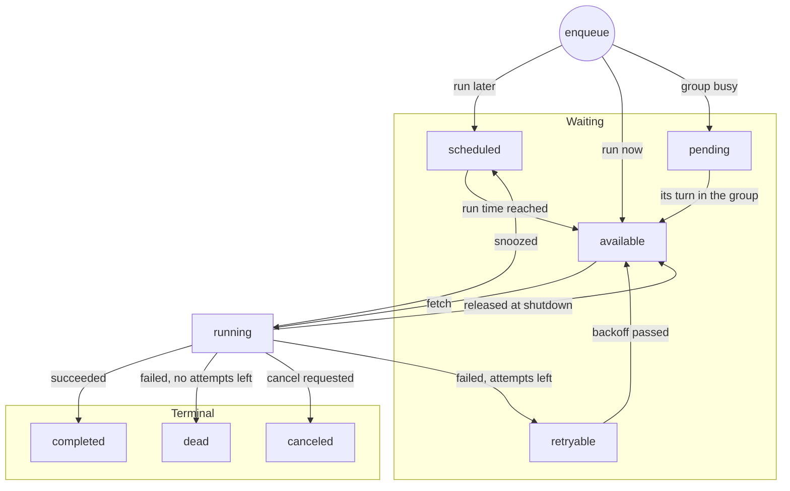

# Task lifecycle and guarantees

- Status: Accepted
- Milestone: M1

This document defines the states a task moves through, what moves it from one
state to another, and what taskmill guarantees along the way. It is the
contract that the implementation and its tests are written against.

## Terms

| Term | Meaning |
|---|---|
| Task | A unit of work: a kind, a JSON payload, and options such as priority. |
| Kind | The name that selects the handler for a task, such as `email.send`. |
| Queue | A named stream of tasks. A worker fetches from the queues it is configured for. |
| Attempt | One run of a task's handler. |
| Lease | The right of one attempt to run a task. It expires unless the worker renews it with heartbeats. |
| Lease token | A number that grows by one every time a task is fetched. Every update a worker makes must present it. |
| FIFO group | Tasks that share a group key. They run one at a time, in enqueue order. |
| Run time | The earliest time a task may start (`run_at`). |
| Deadline | Optional. The latest time a task may start. |
| Client | The API an application uses to enqueue, cancel, and retry tasks. |
| Worker | The process component that fetches tasks and runs their handlers. |
| Maintainer | Background work done by one elected worker process: promoting due tasks, rescuing expired leases, deleting old tasks. |

## States

| State | Meaning | Terminal |
|---|---|---|
| `scheduled` | Waiting for its run time. | |
| `pending` | Waiting for the tasks ahead of it in its FIFO group to finish. | |
| `available` | Due, and waiting for a worker. | |
| `running` | Leased by an attempt. | |
| `retryable` | An attempt failed; waiting for its backoff to pass. | |
| `completed` | The handler succeeded. | Yes |
| `dead` | Will not run again: its attempts are used up, it failed with a permanent error, its deadline passed, or no worker with a handler for its kind appeared in time. Dead tasks form the dead-letter queue: they are kept for operators to inspect and retry. | Yes |
| `canceled` | Stopped on request. | Yes |

A terminal task stays terminal unless an operator retries it. Terminal tasks
are deleted when their retention period ends.

Workers fetch only `available` tasks. Keeping `scheduled`, `pending`, and
`retryable` as separate states means the fetch index holds only tasks that can
run now, so millions of future or waiting tasks do not slow fetching down.
Keeping `retryable` apart from `scheduled` shows operators at a glance how many
tasks are failing.

## Transitions

The diagram shows the main flow. For readability it leaves out a few edges:
a waiting task can also be canceled or pass its deadline, an expired lease is
rescued, an operator can retry a dead or canceled task, and `Worker.RunTask`
can start a scheduled or retryable task at once. The table below is complete
and is the authoritative definition.

Each transition is atomic. Most are a single SQL statement. Those that
involve a FIFO group, and those that an operator starts (cancel, retry,
delete), take a few statements in one transaction (see
[FIFO groups](schema.md#fifo-groups) in the schema document).

| # | From | To | Trigger | By |
|---|---|---|---|---|
| 1 | | `available` | Enqueued with a run time that is now or in the past. | Client |
| 2 | | `scheduled` | Enqueued with a future run time. | Client |
| 3 | | `pending` | Enqueued into a FIFO group that already has an unfinished task, or that a dead task halts. | Client |
| 4 | `scheduled`, `retryable` | `available` | The run time is reached. | Maintainer |
| 5 | `pending` | `available` or `scheduled` | The task ahead of it in its group finished. It becomes `scheduled` if its run time is still in the future, and `dead` if its deadline passed (transition 14). | Whoever finished that task |
| 6 | `available`; also `scheduled` or `retryable` through `Worker.RunTask` | `running` | Fetched, or run at once by `Worker.RunTask`, which ignores the run time. Uses one attempt, issues a new lease token, and starts a lease. | Worker |
| 7 | `running` | `running` | A heartbeat extends the lease. | Worker |
| 8 | `running` | `completed` | The handler returned no error. | Worker |
| 9 | `running` | `retryable` | The handler failed and attempts remain. The run time becomes now plus a backoff. | Worker |
| 10 | `running` | `dead` | The handler failed with no attempts left, or returned a permanent error, or no worker with a handler for the kind appeared within `UnknownKindTimeout`. | Worker |
| 11 | `running` | `scheduled`, or `available` for a snooze of zero or less | The handler asked to run again later (snooze), or the worker has no handler for the kind and waits for one that has. Gives the attempt back. | Worker |
| 12 | `running` | `available` | The worker released the task during graceful shutdown. Gives the attempt back. | Worker |
| 13 | `running` | `retryable`, `dead`, or `canceled` | The lease expired: the worker crashed or lost the database. Counts as a failed attempt. | Maintainer |
| 14 | `scheduled`, `available`, `retryable`; `pending` | `dead` | The deadline passed before the task started. A `pending` task becomes `dead` only when its group promotes it (transition 5): it is then the group's head, so it halts its group if the queue halts groups on dead tasks. | Maintainer; for a `pending` task, whoever finished the task ahead of it |
| 15 | `scheduled`, `pending`, `available`, `retryable` | `canceled` | Cancellation was requested. | Client |
| 16 | `running` | `canceled` | Cancellation was requested. The attempt's context is canceled, and the task becomes `canceled` when the attempt ends, however it ends, unless the handler completed it. | Worker |
| 17 | `dead`, `canceled` | `available` or `pending` | An operator retried the task. It gets a fresh set of attempts, and waits in `pending` if other tasks of its group are unfinished. | Client |
| 18 | Any terminal state | Deleted | The retention period ended. A dead task that halts its FIFO group is kept. | Maintainer |

Notes on specific transitions:

- **3 and 5.** Only the head of a FIFO group can be fetched. The tasks behind it
  wait in `pending`, which no fetch reads, so a long group never slows fetching
  down. When the head finishes (transitions 8, 10, 13, 14, 15, or 16), the next
  task of its group is promoted, unless the head became dead in a queue that
  halts groups: then nothing is promoted until an operator retries or deletes
  the dead head.
- **6 and 14.** The fetch query skips tasks whose deadline has passed, and so
  does `Worker.RunTask`, so a worker never starts a task late, even before the
  maintainer marks it dead.
- **8.** A completed task moves to a history table, where transition 18
  deletes it after the retention period. A queue can keep no history at all
  (requirement R10 in the [scope document](scope.md)); transition 8 then
  deletes the task at once.
- **11.** A worker that has no handler for a task's kind snoozes it without
  using an attempt, until a time limit passes, and then makes it dead. The
  limit counts from the first time a worker met the task without a handler;
  that first snooze records a note with the code `no_handler`, and the final
  error has the code `unknown_kind`. A retry starts a new wait. This keeps
  tasks safe during rolling deploys, when some workers do not know a new kind
  yet (requirement R5).
- **13.** A lease that expires counts as a failed attempt on purpose. A task
  that crashes its worker every time (a "poison" task) must eventually stop
  being retried, not crash workers forever. A task whose cancellation was
  requested becomes `canceled` instead.
- **14.** The maintainer's deadline sweep handles `scheduled`, `available`,
  and `retryable` tasks. It never locks a `pending` task, because a pending
  task's row is locked only after its group's row, which prevents deadlocks.
  Such a task stays `pending`, and never starts, until its group promotes it;
  the promotion then makes it `dead`.
- **16.** If the handler succeeds before it notices the cancellation, the task
  becomes `completed`, because the work was done.

## Invariants

These hold at all times. The schema's `CHECK` constraints enforce some of
them, and every test checks the FIFO group invariants when it ends.

1. A task is in exactly one state.
2. Only the attempt that holds the current lease token can move a task out of
   `running`. The one exception is transition 13, which applies only after the
   lease has expired.
3. A task in `running` always has a lease expiry time, and a task in any other
   state has none. A task's lease token only grows, so it never repeats.
4. Attempts used never exceed the maximum attempts, and the maximum is at
   least 1.
5. Every time taskmill sets itself, such as an attempt's start or a retry's
   run time, comes from the database clock (`now()`), never from an
   application server's clock. Times the application passes in, such as a run
   time or a deadline, come from its own clock.
6. In a FIFO group, at most one task is neither `pending` nor finished: the
   group's head.

## Guarantees

Each guarantee names the mechanism that provides it.

1. **Enqueue is transactional and durable.** A task enqueued inside a database
   transaction exists only if that transaction commits, and workers cannot see
   it before then. Once committed, it is as durable as any other row in
   PostgreSQL. *Mechanism: the task is an ordinary row written in the caller's
   transaction.*

2. **No task is silently dropped.** A committed task keeps being run, at least
   once, until it completes or becomes dead, unless it is canceled first. A
   task ends without running only when its deadline passes before it starts,
   or when no worker with a handler for its kind appears in time, and it then
   becomes dead, where operators can see it. *Mechanism:
   leases, rescue of expired leases (transition 13), and retries.*

3. **A lost worker does not lose tasks.** If a worker crashes or loses its
   connection, its tasks are rescued within one lease duration plus one
   maintainer interval, and then retried like any failed attempt. If the lost
   worker was the maintainer, add up to about 12 seconds for another worker to
   take over. *Mechanism: transition 13.*

4. **A stale attempt cannot change a task.** An attempt that lost its lease
   cannot complete, fail, or snooze the task, and its result is discarded. The
   worker learns this at its next heartbeat and cancels the attempt's context.
   *Mechanism: every worker update requires the current lease token.*

5. **Database writes can be exactly-once.** A handler that writes only to the
   same PostgreSQL database can complete the task inside its own transaction.
   The writes and the completion then commit together or not at all. This is
   opt-in: a handler that does not use it is completed by its worker as usual.
   *Mechanism: transition 8 runs in the handler's transaction and checks the
   lease token.*

6. **Retries are bounded and spread out.** A failed task is retried with
   exponential backoff and random jitter, up to its maximum attempts, and then
   becomes dead. The error of every attempt is kept with the task (the most
   recent ones, up to a fixed limit). *Mechanism: transitions 9, 10, and 13.*

7. **Tasks start in a predictable order.** Within a queue, workers fetch tasks
   by priority (higher first), then by run time, then by enqueue order. This is
   the order in which tasks *start*. Tasks run concurrently, so they may finish
   in any order. Strict one-at-a-time ordering per key is provided by FIFO
   groups (milestone M4).

8. **No task starts after its deadline.** *Mechanism: the fetch query filters
   on the deadline, and transition 14.*

9. **Delayed tasks start on time, within limits.** While a maintainer is
   running, a task becomes available within one maintainer interval after its
   run time (target: one second or less), and starts as soon as a worker has
   capacity. This is not a real-time guarantee.

10. **Payloads arrive exactly as they were sent.** The payload is stored as
    JSON and decoded directly into the handler's type. Values such as large
    integers are never converted to floating point on the way.

### What taskmill does not guarantee

- **Exactly-once execution in general.** A handler can finish its work and then
  crash before the completion is recorded; the task then runs again. Handlers
  must be idempotent, or use transactional completion (guarantee 5).
- **No overlap between attempts.** If a worker is cut off from the database
  long enough for its lease to expire, a second attempt can start while the
  first is still running. Guarantee 4 ensures that only one of them can record
  a result.
- **A global order across workers.** See guarantee 7.
- **Survival of an unsynchronized failover.** With asynchronous replication, a
  PostgreSQL failover can lose recently committed transactions, including
  enqueued tasks. This is a property of the database setup, not of taskmill.

## Handler contract

taskmill's guarantees hold only if handlers follow these rules:

- **Be idempotent.** Running a task twice must be safe, or the handler must use
  transactional completion.
- **Respect the context.** Stop promptly when the context is canceled. A
  canceled context means the task was canceled, its lease was lost, its
  attempt timed out, or the worker is shutting down.
- **Return errors, do not panic.** taskmill recovers panics and records them as
  failed attempts, but a returned error carries better information.
- **Mark permanent failures.** Return a permanent error when retrying cannot
  help, such as a payload that fails validation, so the task does not use up
  its attempts for nothing.

## Decisions

These questions were settled while drafting this document.

1. **A dead task in a FIFO group.** By default the rest of the group continues
   with its next task. An option halts the group instead, until an operator
   retries or deletes the dead task. The option is set per queue; see the
   [schema document](schema.md#fifo-groups). Use it for streams where
   skipping a task would corrupt data, such as ledger events.
2. **A passed deadline makes a task `dead`, not `canceled`.** Missed deadlines
   then show up in the dead-letter queue and in alerts, because they usually
   signal a backlog that operators should know about.
3. **Completed tasks cannot be retried in v1.** Only `dead` and `canceled`
   tasks can (transition 17). To run the same work again, enqueue a new task.
   This keeps re-running work an explicit choice.
