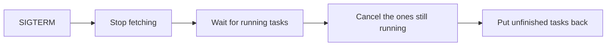

# Writing docs

This is the style guide for taskmill's docs, for people and for agents. Read
it before you add or change a page, and start new pages from the
[templates](#templates).

Many readers know Go well but read English as a second language. So every
page must be easy to read, friendly, visual, opinionated, and correct.
Contributor pages follow this guide too, but may be more precise.

| Target | Limit |
|---|---|
| Sentence | 20 words or fewer on average, one idea each |
| Paragraph | 4 sentences or fewer |
| Page | 250 lines or fewer (only `reference/log-messages.md` may be longer) |

**Check every claim in the code first.** The code is the source of truth.
Never describe behavior that you have not seen in the code or in a test. If
the code and a doc disagree, write what the code does, and say in the pull
request if you think the code is wrong.

## The 15 rules

Each "before" comes from the old docs.

**1. Lead with the answer:** what to do, then why, then the exceptions.
- Before: "`Worker.Health` returns nil while `Run` runs and its last
  heartbeat reached the database within `LeaseDuration`…"
- After: "Use `Worker.Health` for the readiness probe, not for liveness."

**2. One idea per sentence.** Repeat the subject when "it" could confuse.
- Before: "If the context ends first, they finish the batch they are in, for
  at most 5 seconds, and return what they did, with an error; …"
- After: "If your context ends, the bulk action stops after this batch."

**3. Use plain, literal words,** with no idioms and no rare phrasal verbs:
"without a word" → "silently"; "mind" → "check"; "goes on" → "continues";
"holds up" → "blocks"; "give or take 6 seconds" → "± 6 seconds"; "by a
hair" → "just". Split a sentence with "whose" and two "that" clauses in two.

**4. One name for one thing.** Use only these names, everywhere:

| Use | Not | Notes |
|---|---|---|
| dashboard | "web interface", "web UI" | The package is `ui`; the command is `taskmill-ui`. |
| task | "job" | Unless you compare taskmill with other tools. |
| maintainer | | Only the worker chosen to do upkeep: wake queues, promote due tasks, take back the tasks of lost leases, and run schedules. For the people who run the project, write "the project team", and only in contributor docs. |
| heartbeat | | Only the maintainer's signal to the workers, every few seconds. |
| check-in | "heartbeat" | Only a worker's own report to the database, every third of the lease: it renews its leases and notes that it is alive. For one task, the worker "renews its lease". |
| schema | "installation" | One taskmill schema, with its own tasks, queues, and workers (`taskmill` by default). Godoc says "installation". |
| "immediately", "right away", "in one go" | "at once" | "At once" can also mean "at the same time". |

Text that the code prints, such as a log message, an error, or a label in
the dashboard, stays exactly as the code writes it, even when it breaks this
table. Explain it in plain words where you quote it.

**5. Define a term where you first use it,** in a few words, and link it to
the [glossary](../concepts/glossary.md) the first time on each page. Define
every other term in the glossary.
- Before: "Everything works through PgBouncer in transaction mode except
  notifications, which need a session."
- After: "In *transaction mode*, PgBouncer gives your connection to another
  client after each transaction."

**6. Talk to the reader:** "you", active voice, present tense, the
instruction before the reason. Contractions such as "don't" are fine.
- Before: "So the role that runs workers must own taskmill's tables."
- After: "Run your workers as the owner of taskmill's tables. Why: …"

**7. Use a table for situations, options, and values.**
- Before: "…within about 2 seconds while heartbeats arrive, within about 16
  seconds if the maintainer … fails, and within `PollInterval` while…"
- After: a table with the columns "Situation" and "The task starts within".

**8. Draw flows; don't narrate them.** Use Mermaid `flowchart`,
`sequenceDiagram`, or `stateDiagram-v2`, with about 12 nodes at most and
verbs on the arrows. Quote labels that contain anything but letters, digits,
and spaces. Use no styles, colors, `classDef`, or HTML except `<br/>`. Put
one plain sentence above each diagram, like this: a worker shuts down in
four steps.



**9. Use alerts with fixed meanings,** at most 3 per page. Don't use
`[!IMPORTANT]` or `[!CAUTION]`.

| Alert | Use it for |
|---|---|
| `> [!TIP]` | The recommended way, or a shortcut |
| `> [!NOTE]` | Good to know |
| `> [!WARNING]` | You can lose data, run work twice by surprise, or break production |

**10. Round numbers in prose,** and link to
[Defaults and limits](../reference/defaults-and-limits.md) for exact values.
Contributor pages, such as [Benchmarks](benchmarks.md), keep exact numbers.
- Before: "One worker drained a backlog at over 31,000 tasks per second…"
- After: "One worker runs about 30,000 tasks a second on a laptop."

**11. Put rare edge cases in godoc,** and link the identifier on pkg.go.dev,
as `https://pkg.go.dev/github.com/code19m/taskmill#ErrInvalidArgument`.
- Before: nine lines on NUL characters and unpaired surrogates in payloads.
- After: "Payloads must be valid UTF-8 JSON", and a link.

**12. Name headings after the reader's task or question.**
- Before: "Operating taskmill", "Old snapshots".
- After: "Retry, cancel, or delete tasks", "Keep transactions short".

**13. When there is a choice, say which one to pick.** Put a "Which should I
use?" table near the top, with the columns situation, what to use, and why.
Name the recommended way, and say when to choose another.
- Before: "To limit a queue across all workers, … set `MaxRunning`."
- After: a table that picks `Concurrency`, `MaxRunning`, or a pause.

**14. Write for now.** No "since v0.2.0", "before 2026-10-27", or "revised
from": history goes in [CHANGELOG.md](../../CHANGELOG.md). The version
status lives in one place: [Compatibility](../reference/compatibility.md).
- Before: "Entries recorded before v0.3.0 name a lost lease `lease_expired`."
- After: nothing. The changelog says it.

**15. One page, one topic, with a way forward,** in the shape below.

## Page shape

- **First line:** `# Title`, in plain words, with no "taskmill" prefix, such
  as `# Retries and errors`. Then one or two sentences: what the page helps
  you do.
- **Code:** `go` code blocks with only what the point needs, valid against
  the current API. Compile anything longer than a few lines. Use names from
  a shop: orders, emails, receipts.
- **Links:** relative, with `.md`. Link to another page's anchor only when
  its heading is unlikely to change. `go test ./internal/docs/` fails on a
  broken link or a missing anchor.
- **End:** `## See also` with 2 to 4 links (related pages and pkg.go.dev),
  then, as the last line, `**Next:** [Page title](page.md)`:
  - Within a section, follow the order of the section's `README.md`.
  - On the learning path, follow the path instead.
  - The last page of a section points to the next section's `README.md`.
    The last page of the last section, and of `design/`, points to the
    [documentation home](../README.md).
  - A section's `README.md` needs no See also. Its Next is its first page.

## Where content lives

Each fact has one home; other places summarize it in a line and link. Docs
never copy godoc, and godoc links to pages, never to anchors, which move.

| Content | Home |
|---|---|
| Pitch, install, a short taste, links | `README.md` |
| Learning, how-to, choices, production | `docs/` |
| The exact contract of one identifier, and its edge cases | Its godoc comment |
| Runnable code for one API | Godoc `Example` functions |
| Exact defaults and limits | `docs/reference/defaults-and-limits.md`, and the field's godoc |
| What changed, and how to migrate | `CHANGELOG.md` |
| Why taskmill is built this way | `docs/design/`, `docs/adr/` |

## Templates

A guide page. "Quick example" and "Which should I use?" come first, in
either order; leave out the table when there is no choice:

```markdown
# <Feature, in plain words>
<One or two sentences: what this helps you do, and when you need it.>
## Quick example
<The smallest code that works, in a go block. Mark omitted parts with // ...>
## Which should I use?
| Situation | What to use | Why |
## <A task or question, such as: Run a task later>
<Short paragraphs, a table, or a diagram with one sentence above it.>
## See also
<2 to 4 links: related pages, and the identifiers on pkg.go.dev.>
**Next:** [<Next page>](<next-page>.md)
```

A recipe page. Add "Which should I use?" after the situation when there is
a choice:

```markdown
# <The situation, in plain words>
**Situation.** "<2 or 3 sentences, as the reader would say them.>"
## The recommended way
<Code first, then the steps.>
## Why
<2 to 4 sentences, or a short list.>
## Other options
| Option | When it fits | The cost |
## Watch out
<Bullets, or one alert.>
## See also
<2 to 4 links: related pages, and the identifiers on pkg.go.dev.>
**Next:** [<Next page>](<next-page>.md)
```

A troubleshooting entry starts with what the reader sees. With several
causes, use a table, most likely cause first. With one cause, use the
bullets **Cause:**, **Check:**, and **Do:** instead of the table:

```markdown
### <The symptom, such as: Tasks wait in `pending`>
**You see:** <the metric, log line, or page that shows it.>

| Likely cause | Check | Do |
|---|---|---|
| <The most likely cause> | <Where to look> | <The fix, with a link> |
```

A section's `README.md`:

```markdown
# <Section name>
<One sentence: who this section is for.>

| Page | Read this when… |
|---|---|
| [<Page>](<page>.md) | <you want to …> |

**Next:** [<First page>](<first-page>.md)
```

## See also

- [CONTRIBUTING.md](../../CONTRIBUTING.md): how changes get merged
- [Glossary](../concepts/glossary.md): every term the docs use
- [How taskmill is built](README.md): the design pages

**Next:** [Documentation home](../README.md)
