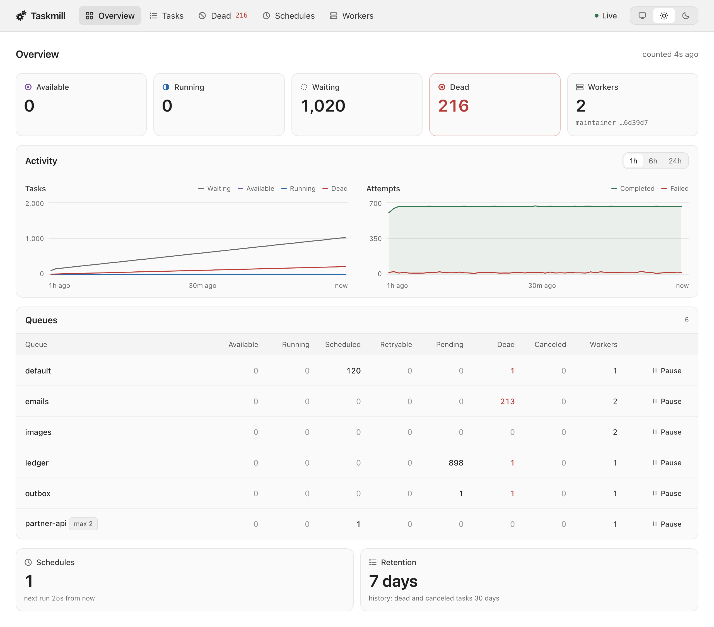

# The dashboard

The dashboard is a web page for your queues, tasks, schedules, and workers.
Use it to see what taskmill is doing, and to retry, cancel, or delete
tasks. This page shows how to run it, how to protect it, and what it can do.

<picture>
  <source media="(prefers-color-scheme: dark)" srcset="../images/dashboard-dark.png">
  
</picture>

## Which should I use?

| Situation | What to use | Why |
|---|---|---|
| Your app has a Go HTTP server (most apps) | Mount `ui.New` in your app | It runs the same taskmill version as your schema, uses your login, and needs nothing new to deploy |
| Your app has no Go HTTP server, or your admin app is in another language | The `taskmill-ui` command, or its container image | It runs on its own, and you set it up with environment variables |
| An admin panel must show the dashboard inside its own page | Either of the above, in an `<iframe>` | You list the panel's origin in `FrameAncestors` |
| You have several services | Mount it in each service, and let one admin app forward a path to each | See [One dashboard for many services](../recipes/one-dashboard-for-many-services.md) |

Mount it in your app unless you have a reason not to.

## Mount it in your app

`ui.New` returns an `http.Handler`. Mount it behind your own login:

```go
dashboard, err := ui.New(client, &ui.Config{Prefix: "/taskmill", Logger: logger})
if err != nil {
    return err
}
mux.Handle("/taskmill/", requireAdmin(dashboard)) // requireAdmin: your own login check
```

- `Prefix` is the path where you mount it. The dashboard removes it from
  requests itself, so don't wrap it in `http.StripPrefix`.
- It is safe on a busy production database. It reads only through the
  [`Client`](operations-api.md)'s queries, which have time limits. An open
  tab updates itself every few seconds, and only while it is visible.

## Run it on its own

The `taskmill-ui` command runs the dashboard with no code to write. Each
[release](https://github.com/code19m/taskmill/releases) has it as binaries
for Linux, macOS, and Windows, and as a small container image:

```sh
docker run -p 8080:8080 \
  -e TASKMILL_UI_ADDR=:8080 \
  -e TASKMILL_DATABASE_URL=postgres://... \
  -e TASKMILL_UI_PASSWORD=... \
  ghcr.io/code19m/taskmill-ui:0.3.0
```

Or install it with Go: `go install github.com/code19m/taskmill/cmd/taskmill-ui@latest`.
It reads its settings from environment variables:

| Variable | What it sets | Default |
|---|---|---|
| `TASKMILL_DATABASE_URL` | The PostgreSQL connection string | None: required |
| `TASKMILL_SCHEMA` | The taskmill [schema](../concepts/glossary.md#schema) | `taskmill` |
| `TASKMILL_UI_ADDR` | The address to listen on | `localhost:8080`. In a container, set `:8080` |
| `TASKMILL_UI_PASSWORD` | The login password | None: anyone who reaches it can use it |

The next section lists the rest.

- **Pin the image tag** to the taskmill version your apps run. A newer
  dashboard refuses to start on an older schema, with `ErrSchemaOutdated`.
  So upgrade the dashboard after your apps have migrated.
- It never changes the schema. Your apps create and migrate it.
- It writes text logs to standard error.
- To check that a download is genuine, see [Security](../production/security.md).

## Protect it

> [!WARNING]
> The dashboard has **no login** by default. Anyone who reaches it can
> retry, cancel, and delete every task. Always put it behind a login.

Each setting means the same in both ways of running it:

| You want to… | In your app (`ui.Config`) | With `taskmill-ui` |
|---|---|---|
| Ask for a login | Your own login in front of it, or `BasicAuth` | `TASKMILL_UI_PASSWORD`, and `TASKMILL_UI_USERNAME` (default `admin`) |
| Let people look, but not change anything | `ReadOnly: true` | `TASKMILL_UI_READ_ONLY=true` |
| Put it under a path that a proxy forwards, such as `/admin/tasks` | `Prefix` | `TASKMILL_UI_PREFIX` |
| Show it in another site's frame | `FrameAncestors` | `TASKMILL_UI_FRAME_ANCESTORS` |
| Log who did what | `Logger` | Logs go to standard error. With one shared login, they can't say who |

- **Use HTTPS with a password.** *Basic authentication* is a username and
  password that the browser asks for. It sends the password with every
  request, and knows only one user. For single sign-on, put your own login
  in front.
- **Read-only** hides every action and refuses it. To let some people act
  and others only look, mount two handlers, one with `ReadOnly`, and pick
  one per request.
- **Every action is logged** to `Logger` at Info level. Use a log handler
  that adds the signed-in user, and you know who did it.
- **Forms are protected** against cross-site request forgery: another site
  can't make a signed-in browser click a button for it.

## Show it inside another app

Browsers refuse to show the dashboard in a frame. This protects it from
*clickjacking*: a site that hides it under its own buttons. To allow a
frame, list the origins of the pages that may show it:

```go
dashboard, err := ui.New(client, &ui.Config{
    Prefix:         "/taskmill",
    FrameAncestors: []string{"https://admin.example.com"}, // or "'self'" for your own pages
})
```

To match your app's theme, add `?theme=light`, `?theme=dark`, or
`?theme=system` to the frame's address, such as
`https://shop.example.com/taskmill/?theme=dark`.

## What people can do in it

| Page | What you see | What you can do |
|---|---|---|
| **Overview** | Task counts per queue and state, charts of tasks and attempts over the last 1, 6, or 24 hours, and the number of workers | Pause and resume a queue |
| **Tasks** | Tasks filtered by state, queue, kind, and FIFO group | Retry, cancel, or delete every task that matches the filters |
| **A task** | Its payload, metadata, error history, and details. A banner says when it halts its [FIFO group](ordering.md), or waits in one | Retry, cancel, or delete it. Open its group |
| **Schedules** | Each schedule, with its next and last run | Pause, resume, or run it now |
| **Workers** | Each worker, with its host, version, and queues, and which one is the maintainer. The **Kinds** column counts the kinds that the worker has handlers for; click the count to list them. The **Heartbeat** column says when the worker last reported to the database | Nothing: this page is for looking |

Before an action on many tasks, the dashboard shows the filters and how many
tasks will change, and you confirm. With very many tasks, it works in steps,
and offers to continue where it stopped. If some tasks were busy at that
moment, it says how many, and offers to try them again.

The dashboard has light and dark themes, works on phones, and works without
JavaScript. It can't change a queue's `MaxRunning` or the retention times:
do that [from code](operations-api.md).

## See also

- [One dashboard for many services](../recipes/one-dashboard-for-many-services.md): forward paths, viewers and operators, who did what
- [Kubernetes](../production/kubernetes.md): a Deployment for `taskmill-ui`
- [Package `ui`](https://pkg.go.dev/github.com/code19m/taskmill/ui) and [command `taskmill-ui`](https://pkg.go.dev/github.com/code19m/taskmill/cmd/taskmill-ui) on pkg.go.dev

**Next:** [Manage tasks from code](operations-api.md)
