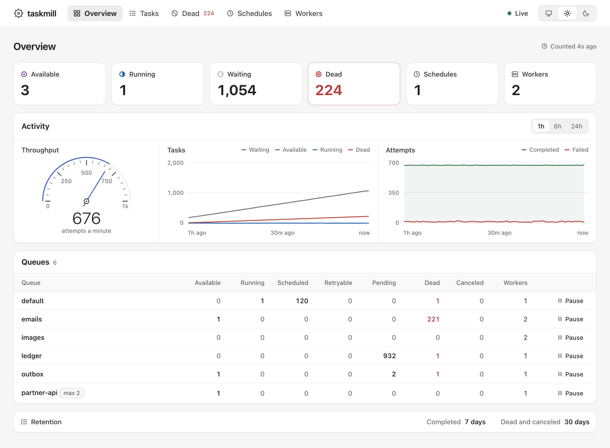

# The dashboard

The dashboard is a web page for your queues, tasks, schedules, and workers.
Use it to see what taskmill is doing, and to retry, cancel, or delete
tasks. This page shows how to run it, how to protect it, and what it can do.

<picture>
  <source media="(prefers-color-scheme: dark)" srcset="../images/dashboard-dark.png">
  
</picture>

## Which should I use?

| Situation | What to use | Why |
|---|---|---|
| Your app has a Go HTTP server (most apps) | Mount `ui.New` in your app | It runs the same taskmill version as your schema, uses your login, and needs nothing new to deploy |
| Your app has no Go HTTP server, or your admin app is in another language | The `taskmill-ui` command, or its container image | It runs on its own, and you set it up with environment variables |
| An admin panel must show the dashboard inside its own page | Either of the above, in an `<iframe>` | You list the panel's origin in `FrameAncestors` |
| You have several services | Mount it in each service, and let one admin app forward a path to each | See [One dashboard for many services](../recipes/one-dashboard-for-many-services.md) |

Mount it in your app unless you have a reason not to.

## Mount it in your app

`ui.New` returns an `http.Handler`. Mount it behind your own login:

```go
dashboard, err := ui.New(client, &ui.Config{Prefix: "/taskmill", Logger: logger})
if err != nil {
    return err
}
mux.Handle("/taskmill/", requireAdmin(dashboard)) // requireAdmin: your own login check
```

- `Prefix` is the path where you mount it. The dashboard removes it from
  requests itself, so don't wrap it in `http.StripPrefix`.
- It is safe on a busy production database. It reads only through the
  [`Client`](operations-api.md)'s queries, which have time limits. An open
  tab updates every few seconds while it is visible, and less often while
  the server fails: a page that failed tries again by itself.
- A request can take 10 seconds when the database is slow. Then the page
  says "Taking too long". So set the `WriteTimeout` of your `http.Server`
  above 10 seconds, or leave it unset: a shorter one closes the connection
  before that page arrives. For a shorter limit, set a deadline in the
  request's context: the dashboard answers with the same page then.

## Run it on its own

The `taskmill-ui` command runs the dashboard with no code to write. Each
[release](https://github.com/code19m/taskmill/releases) has it as binaries
for Linux, macOS, and Windows, and as a small container image:

```sh
docker run -p 8080:8080 \
  -e TASKMILL_UI_ADDR=:8080 \
  -e TASKMILL_DATABASE_URL=postgres://... \
  -e TASKMILL_UI_PASSWORD=... \
  ghcr.io/code19m/taskmill-ui:0.13.0
```

Or install it with Go: `go install github.com/code19m/taskmill/cmd/taskmill-ui@latest`.
It reads its settings from environment variables. A first setup needs these:

| Variable | What it sets | Default |
|---|---|---|
| `TASKMILL_DATABASE_URL` | The PostgreSQL connection string | None: required |
| `TASKMILL_SCHEMA` | The taskmill [schema](../concepts/glossary.md#schema) | `taskmill` |
| `TASKMILL_UI_ADDR` | The address to listen on | `localhost:8080`. In a container, set `:8080` |
| `TASKMILL_UI_PASSWORD` | The login password | None: anyone who reaches it can use it |

[The `taskmill-ui` reference](../reference/taskmill-ui.md) lists every
variable, with its values and its default.

- **Pin the image tag** to the taskmill version your apps run. A newer
  dashboard refuses to start on an older schema, with `ErrSchemaOutdated`.
  So upgrade the dashboard after your apps have migrated.
- It never changes the schema. Your apps create and migrate it.
- For probes, it answers `/livez` and `/readyz` with no login. See
  [Kubernetes](../production/kubernetes.md) for what each one checks.
- It exports no metrics. Export the queue gauges from your apps, with the
  `otel` module ([Logs, traces, and metrics](observability.md)). A metrics
  library in `taskmill-ui` would become a dependency of every app that uses
  taskmill.
- To check that a download is genuine, see [Security](../production/security.md).

## Protect it

> [!WARNING]
> The dashboard has **no login** by default. Anyone who reaches it can
> retry, cancel, and delete every task. Always put it behind a login.

Each setting means the same in both ways of running it:

| You want to… | In your app (`ui.Config`) | With `taskmill-ui` |
|---|---|---|
| Ask for a login | Your own login in front of it, or `BasicAuth` | `TASKMILL_UI_PASSWORD`, and `TASKMILL_UI_USERNAME` |
| Let people look, but not change anything | `ReadOnly: true` | `TASKMILL_UI_READ_ONLY=true` |
| Put it under a path that a proxy forwards, such as `/admin/tasks` | `Prefix` | `TASKMILL_UI_PREFIX` |
| Show it in another site's frame | `FrameAncestors` | `TASKMILL_UI_FRAME_ANCESTORS` |
| Log who did what | `Logger` | Logs go to standard error. With one shared login, they can't say who |

- **Use HTTPS with a password.** *Basic authentication* is a username and
  password that the browser asks for. It sends the password with every
  request, and knows only one user. For single sign-on, put your own login
  in front.
- **Read-only** hides every action and refuses it. To let some people act
  and others only look, mount two handlers, one with `ReadOnly`, and pick
  one per request.
- **Every action is logged** to `Logger` at Info level. Use a log handler
  that adds the signed-in user, and you know who did it.
- **Forms are protected** against cross-site request forgery: another site
  can't make a signed-in browser click a button for it.

## Show it inside another app

Browsers refuse to show the dashboard in a frame. This protects it from
*clickjacking*: a site that hides it under its own buttons. To allow a
frame, list the origins of the pages that may show it:

```go
dashboard, err := ui.New(client, &ui.Config{
    Prefix:         "/taskmill",
    FrameAncestors: []string{"https://admin.example.com"}, // or "'self'" for your own pages
})
```

To match your app's theme, add `?theme=light`, `?theme=dark`, or
`?theme=system` to the frame's address, such as
`https://shop.example.com/taskmill/?theme=dark`. The browser remembers the
theme for the pages that the reader opens next. Some browsers block storage
in a frame of another site: there, only the page with the parameter has the
theme, and the next pages follow the device.

## What people can do in it

| Page | What you see | What you can do |
|---|---|---|
| **Overview** | Task counts per queue and state, a dial of the attempts a minute, charts of tasks and attempts over the last 1, 6, or 24 hours, the number of workers, and the retention periods | Pause and resume a queue |
| **Tasks** | Tasks filtered by state, queue, kind, FIFO group, and time: when they were created, or for dead and canceled tasks when they finished | Retry, cancel, or delete every task that matches the filters |
| **A task** | Its payload, metadata, error history, and details, with a timeline: when it was created, due, started, and finished, and how long it waited and ran, which counts each second while it waits or runs. A banner says when it halts its [FIFO group](ordering.md), or waits in one | Retry, cancel, or delete it. Open its group |
| **Schedules** | Each schedule, with its timetable in words and its next and last run | Pause, resume, or run it now |
| **Workers** | Each worker, with its host, version, queues, kinds, and schedules, and which one is the [maintainer](../concepts/glossary.md#maintainer). *schedules differ* marks a worker whose schedule names differ from the maintainer's: press it to see which | Nothing: this page is for looking |

On the **Overview**, the **Activity** card shows the last 1, 6, or 24 hours,
in steps of 1, 5, or 15 minutes. To read the values of one step, point at a
chart, or press and drag on a touch screen: a note shows them, with the
step's time on your clock. From the keyboard, a chart is a slider that a
screen reader reads step by step: the arrow keys, Home, and End move it, and
Escape hides the values. While a chart has the focus, the page waits with
its updates. The **Throughput** dial reads like this:

| Part of the dial | What it shows |
|---|---|
| The needle and the number | The attempts a minute, completed and failed together, in the newest step whose count is complete. In the longer periods, that is the mean of 5 or 15 minutes |
| The scale | From 0 to the smallest round number that holds the highest rate of the period: 1, 2, or 5 times a power of ten, and at least 10 |
| A dash in place of the number | No worker recorded anything in that step |

So the needle reads against the busiest step of the period that you chose:
near the top of the scale, the workers are as busy as at their peak. Workers
write their counts every 10 seconds, so the dial reads a step 15 seconds
after it ends, not sooner, and the **Attempts** chart draws it then.

On the **Schedules** page, the **Cron** column says each timetable in
words, such as "Weekdays at 09:00", above the cron expression. The times are
in the schedule's time zone, which stands beside the expression. The words
are there only when they say exactly what the expression does, in a few
words: an expression with both day fields set, or with more than three
times, shows alone. [Write the timetable](schedules.md#write-the-timetable)
says how an expression is read, and what happens when the clocks change.

On the **Workers** page, the **Worker** column shows a worker's ID without its
host name, which the **Host** column has: the tooltip has the whole ID. A row
shows a worker's first queues, and counts the rest and its kinds. Press a count
to list them all, each a link to its tasks: that needs a browser with popovers.
**Checked in** is the worker's last [check-in](../concepts/glossary.md#check-in):
a yellow dot and the word "stale" mark a worker that made none for longer
than its `LeaseDuration`, because it has stopped or cannot reach the database.

At the end of the **Overview**'s top bar, "Counted 4s ago" says when the
maintainer last counted the tasks, which it does every 10 seconds. After a
minute, it turns amber: check that a worker runs as the maintainer
([Monitoring](../production/monitoring.md) has an alert). Such times keep
counting each second, by the server's clock. A count that ends in "+"
stopped at its cap, as its tooltip says. A chart with nothing to draw says
why behind a hint, an "i" button: without popovers, its text is on the page.

Before an action on many tasks, a dialog shows the filters and how many
tasks will change, and you confirm. With very many tasks, it works in steps,
and offers to continue where it stopped. If some tasks were busy at that
moment, it says how many, and offers to try them again.

A task list shows the newest tasks first, and a list of only dead tasks,
only canceled tasks, or both shows the tasks that finished last first, with
the time of each: the task that died a minute ago is at the top of the
**Dead** page. An arrow in the header marks the column that orders the
list: **ID**, **Finished**, or **Created** while a range of creation times
is set. The row under a list shows more of it: click anywhere in it. A list
that starts after other tasks has a row at its top that leads to its start.
Every state has an icon in its color, and the two states that need you also
have their name in color: `dead` in red, and `retryable` in amber. A badge
beside the state marks a priority that is not normal, without a state color:
`high` is bolder than `low`, and `critical` is filled.

Every task list has a filter by time: **Finished** on a list of only dead
or canceled tasks, and **Created** on any other. It shows a range of time:

| You want… | Do this |
|---|---|
| The tasks of the last hours or days | Choose a preset, such as **Last 6 hours**. The list starts at that time and has no end, so it shows new tasks as they come |
| Whole days, or a precise period such as last night | Click the first and the last day in the calendar: **From** and **To** show the range, from 00:00 to 23:59. Type other times, or dates, if you need them, or empty one for a range with one end. Then choose **Apply**. The range holds the minute of **To**: in the address, `before` is the minute after it |
| Every task again | Choose **Any time** |

The dashboard shows times in your time zone, and names the zone: the range
on the button, the calendar's fields, and the exact time in a tooltip.
Without JavaScript, the browser's own fields take the range, in UTC. The
address holds instants, `since` and `before`, so a link shows the same tasks
to everyone ([Dashboard routes](../reference/taskmill-ui.md#dashboard-routes)
has the forms of a time). While a range is set, the list hides **Retry all**,
**Cancel all**, and **Delete all**: they act on every task that the other
filters match, also outside the range. The range is of the time that the
button names: change the states, and it can become one of the other time.

A task list has 5 seconds to read its tasks. A list of dead or canceled
tasks never reads tasks of other states. But with no queue in the filters,
as on the **Dead** page, it reads up to as many tasks as it shows from each
queue that has such tasks: with hundreds of queues, choose a queue. A list
with a range of creation times reads from each queue in the same way. Other
lists can read many tasks that they do not show, such as the available
tasks of all queues in a very large table. If a list runs out of time, the
page says "Taking too long", and what may help: a queue and a state in the
filters, or fewer filters ([Manage tasks from code](operations-api.md#find-tasks)
says which lists are fast).

A retry of a canceled task takes the task's
[dedupe key](../concepts/glossary.md#dedupe-key) back. If another task holds
that key now, the dashboard does not retry the task, and says which task
holds the key. A retry of many tasks says how many it left for that reason
([Avoid duplicate tasks](deduplication.md#retry-a-canceled-task-that-has-a-key)).

The dashboard has light and dark themes, works on phones, and works without
JavaScript. It can't change a queue's `MaxRunning` or the retention times:
do that [from code](operations-api.md).

## See also

- [One dashboard for many services](../recipes/one-dashboard-for-many-services.md): forward paths, viewers and operators, who did what
- [Kubernetes](../production/kubernetes.md): a Deployment for `taskmill-ui`
- [Package `ui`](https://pkg.go.dev/github.com/code19m/taskmill/ui) and [command `taskmill-ui`](https://pkg.go.dev/github.com/code19m/taskmill/cmd/taskmill-ui) on pkg.go.dev

**Next:** [Manage tasks from code](operations-api.md)
