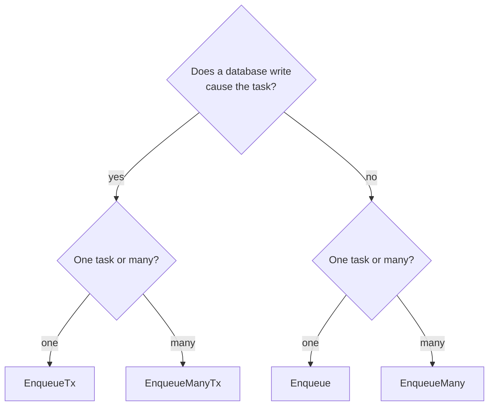

# Enqueue tasks

Add tasks to a queue: one or many, to run now, later, or before others.

## Quick example

```go
res, err := client.Enqueue(ctx, SendReceipt{OrderID: 42}, nil)
if err != nil {
    return err
}
log.Printf("enqueued task %d", res.ID)
```

When `Enqueue` returns, the task is saved in PostgreSQL. A worker that
reads its [queue](../concepts/glossary.md#queue) then picks it up.

## Which should I use?

Start with one question: does a write to your database cause the task?



| Situation | Use | Why |
|---|---|---|
| The task comes from a database write: an order, a payment, a sign-up | `EnqueueTx`, in the same transaction | The task exists only if your write commits. You never send a receipt for an order that rolled back |
| Nothing is written, or the write is in another database | `Enqueue` | It saves the task in a transaction of its own |
| Many tasks: a fan-out, a backfill, an import | `EnqueueManyTx` or `EnqueueMany` | One database call for up to 10,000 tasks |

We recommend `EnqueueTx` whenever your code also writes data. See
[Use your own transactions](transactions.md).

## Run a task later

```go
_, err := client.Enqueue(ctx, RemindCustomer{OrderID: 42}, &taskmill.EnqueueOptions{
    RunAt: time.Now().Add(48 * time.Hour),
})
```

- The task waits as `scheduled` until `RunAt`, then runs. It can start up
  to about a second late.
- A `RunAt` in the past means "now".
- Use `RunAt` for times that depend on your data, such as two days after
  each order. For a fixed timetable, such as every night at 03:00, use a
  [schedule](schedules.md).

## Run a task before others

```go
_, err := client.Enqueue(ctx, SendReceipt{OrderID: 42}, &taskmill.EnqueueOptions{
    Priority: taskmill.PriorityHigh,
})
```

- There are four levels: `PriorityLow`, `PriorityNormal` (the default),
  `PriorityHigh`, and `PriorityCritical`.
- In a queue, waiting tasks with a higher priority start first.
- Priority does not keep places free for urgent work. For work that must
  never wait behind other work, use a queue of its own: see
  [Workers and queues](workers-and-queues.md).
- [Task order and FIFO groups](ordering.md) explains the full start order.

## Options

| Option | What it does | Default |
|---|---|---|
| `Queue` | The queue to add the task to: 1 to 128 characters | `"default"` |
| `Priority` | Which waiting task of the queue starts first | `PriorityNormal` |
| `RunAt` | The earliest time the task may start | Now |
| `MaxAttempts` | How many times the task may run: 1 to 10,000 | 25 |
| `GroupKey` | Runs the tasks of one key in one queue one at a time, in order ([ordering](ordering.md)) | None |
| `DedupeKey` | Creates no new task if this kind already used this key in this queue within `DedupeWindow` ([deduplication](deduplication.md)) | None |
| `DedupeWindow` | How long the key blocks duplicates, counted from the enqueue | 24 hours |
| `Metadata` | Text tags saved with the task and passed to its handler, such as a trace ID | None |

A zero value means "not set". For each option, the first value that is set
wins:

1. the option in the enqueue call;
2. the kind's `EnqueueDefaults` ([Define tasks](define-tasks.md#set-defaults-per-kind));
3. taskmill's default.

`Metadata` merges key by key: the call's keys win, and the other keys of
both are kept.

Invalid options and payloads fail with `ErrInvalidArgument`. The exact
limits are in [Defaults and limits](../reference/defaults-and-limits.md).

Each enqueue call returns an `EnqueueResult` per task. `ID` is the task's
ID. `Duplicate` is true when a dedupe key was already taken: then no task
was created, and `ID` is the task that holds the key.

## Enqueue many tasks in one call

```go
params := make([]taskmill.EnqueueParams, 0, len(orders))
for _, o := range orders {
    params = append(params, taskmill.EnqueueParams{Args: SendReceipt{OrderID: o.ID}})
}
for chunk := range slices.Chunk(params, 10_000) { // each chunk commits on its own
    if _, err := client.EnqueueMany(ctx, chunk); err != nil {
        return err
    }
}
```

- One call takes up to 10,000 tasks and 64 MiB of payload and metadata. A
  bigger call fails with `ErrInvalidArgument`, and saves nothing. So split
  big sets into chunks.
- One call is one transaction: it saves all of its tasks, or none.
- Several chunks are several transactions. If they must commit together,
  pass the same transaction to `EnqueueManyTx` for each chunk.
- Results come back in the same order as `params`.
- Batches are much faster than one call per task: batches of 100 enqueue
  more than 20 times as many tasks per second
  ([performance](../reference/performance.md)).

## See also

- [Use your own transactions](transactions.md): `EnqueueTx` with pgx,
  `database/sql`, bun, or sqlx
- [Avoid duplicate tasks](deduplication.md) and
  [Task order and FIFO groups](ordering.md)
- [`EnqueueOptions`](https://pkg.go.dev/github.com/code19m/taskmill#EnqueueOptions)
  on pkg.go.dev

**Next:** [Use your own transactions](transactions.md)
