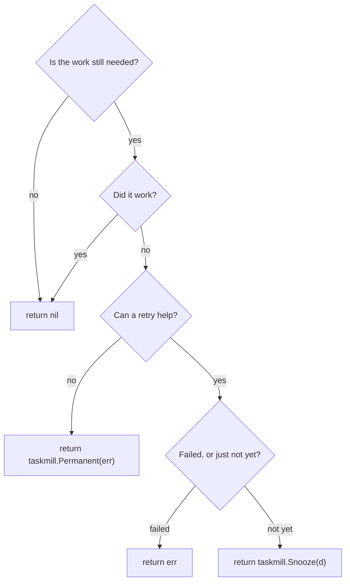

# Handle tasks

A handler is the code that runs a task. This page shows how to write one,
what it should return, and why its context can end.

## Quick example

```go
type ReceiptSender struct{ mailer Mailer }

func (s *ReceiptSender) Handle(ctx context.Context, t *taskmill.Task[SendReceipt]) error {
    return s.mailer.SendReceipt(ctx, t.Args.OrderID)
}

var handlers taskmill.Handlers
taskmill.AddHandler(&handlers, &ReceiptSender{mailer: mailer}, nil)
```

Then pass `&handlers` to a worker: see
[Workers and queues](workers-and-queues.md). To use a plain function, wrap
it: `taskmill.HandlerFunc[SendReceipt](sendReceipt)`.

## How it works

- A handler runs the tasks of one kind. Register one handler per kind.
- The worker decodes the payload into `t.Args`.
- `t` also holds the task's `ID`, its `Attempt` number (from 1),
  `MaxAttempts`, `Metadata`, and the `Errors` of earlier attempts.
- One run of a handler is one [attempt](../concepts/glossary.md#attempt). Each
  attempt has a time limit: 1 minute by default.

> [!WARNING]
> A task can run more than once. For example, a worker can crash after the
> work is done, but before it saves the result. Make every handler safe to
> run twice: [Do work once](../recipes/do-work-once.md) shows how.

## What should my handler return?

Follow the questions from the top:



| Situation | Return | What happens |
|---|---|---|
| It worked | `nil` | The task is completed |
| The work is no longer needed, such as for a refunded order | `nil` | The task is completed. Log it if you like |
| It failed, and a retry may help | The error | The task is retried later. It becomes dead when its attempts run out |
| It failed, and a retry can't help, such as for bad input | `taskmill.Permanent(err)` | The task becomes dead right away, for a person to look at |
| It can't run yet: a rate limit, or data that isn't ready | `taskmill.Snooze(d)` | The task runs again after `d`. The snooze uses no attempt |
| Its context ended | The context's error | taskmill decides, by the reason: see [below](#why-did-my-context-end) |

The same rules in code:

```go
func (s *ReceiptSender) Handle(ctx context.Context, t *taskmill.Task[SendReceipt]) error {
    order, err := s.orders.Get(ctx, t.Args.OrderID)
    if err != nil {
        return err // retried later
    }
    if order.Refunded {
        return nil // no longer needed
    }
    if order.Email == "" {
        return taskmill.Permanent(errors.New("the order has no email address"))
    }
    if wait, limited := s.mailer.Limited(); limited {
        return taskmill.Snooze(wait) // not yet
    }
    return s.mailer.SendReceipt(ctx, order.ID)
}
```

- A [dead task](../concepts/glossary.md#dead-task) waits for a person. Return
  `Permanent` only when a person must look.
- `Permanent(nil)` returns nil, so
  `return taskmill.Permanent(validate(t.Args))` is safe.
- Snoozes never use attempts, so a task that always snoozes never becomes
  dead. Set a limit yourself: for example, return `Permanent` once
  `time.Since(t.CreatedAt)` passes a day.

[Retries and errors](retries-and-errors.md) shows how long retries wait.

## What happens on a panic or a timeout?

| The handler | What happens |
|---|---|
| Panics | Like an error: the task is retried. The stack trace is saved in its error history |
| Runs longer than its `Timeout` | Its context is canceled. If it then returns an error, the attempt fails and the task is retried. If it returns nil, the task is completed |
| Never runs, because the payload does not decode | The task becomes dead right away, with the code `invalid_payload` |

## Why did my context end?

`context.Cause(ctx)` tells you why. What happens next depends on what your
handler then returns:

| `context.Cause(ctx)` | Why | You return an error | You return nil |
|---|---|---|---|
| `ErrTaskCanceled` | Someone canceled the task | It becomes canceled | It is completed |
| `ErrAttemptTimeout` | The attempt ran longer than `Timeout` | The attempt fails; retried later | It is completed |
| `ErrShutdown` | The worker is stopping, and its drain time passed | It goes back to its queue, and the attempt is not counted | It is completed |
| `ErrLeaseLost` | The worker lost the task's lease, for example because it lost the database | Ignored: taskmill counts a failed attempt, with the code `lease_lost` | Ignored, the same way |

Return soon after the context ends. taskmill can't stop your code: a
handler that ignores its context keeps running, and keeps one of its
queue's `Concurrency` places. At shutdown, the worker gives such a task
back to the queue 5 seconds after it cancels the context.
[Stop a worker cleanly](workers-and-queues.md#stop-a-worker-cleanly) shows
the whole shutdown.

## Options per kind

```go
taskmill.AddHandler(&handlers, &ReportBuilder{}, &taskmill.HandlerOptions{
    Timeout:          10 * time.Minute,
    DiscardCompleted: true,
})
```

| Option | What it does | Default |
|---|---|---|
| `Timeout` | The time limit of each attempt, or each batch. You can't turn it off | 1 minute |
| `Retry` | The wait before each retry: see [Retries and errors](retries-and-errors.md) | `ExponentialBackoff{}` |
| `BatchSize` | The most tasks per call of a batch handler: see [Batch handlers](batch-handlers.md) | 100, at most 1,000 |
| `DiscardCompleted` | Deletes completed tasks right away, instead of keeping them in history | `false` |

- **`Timeout`:** set it a little above the slowest normal run. For tasks
  that take minutes or hours, see [Run long tasks](../recipes/run-long-tasks.md).
- **`DiscardCompleted`:** use it for busy kinds when nobody looks at
  their finished tasks. It saves one history row per task.
- **Max attempts** is not a handler option. It is saved with each task when
  it is enqueued: set it per kind, as
  [Retries and errors](retries-and-errors.md#set-the-number-of-attempts-per-kind)
  shows.

## See also

- [Guarantees](../concepts/guarantees.md): what taskmill promises, and what
  your handler must do
- [Use your own transactions](transactions.md): complete a task in the
  transaction that does its work
- [`Handler`](https://pkg.go.dev/github.com/code19m/taskmill#Handler) and
  [`HandlerOptions`](https://pkg.go.dev/github.com/code19m/taskmill#HandlerOptions)
  on pkg.go.dev

**Next:** [Workers and queues](workers-and-queues.md)
