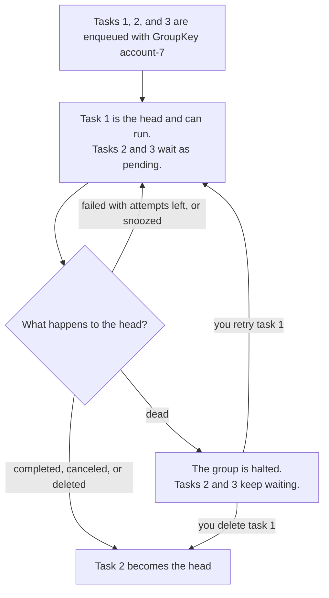

# Task order and FIFO groups

This page shows in which order tasks start, and how to make urgent tasks
start first. It also shows how to run the tasks of one account one at a
time, in order.

## Which should I use?

| Situation | What to use | Why |
|---|---|---|
| Nothing special about the order | Nothing | Plain tasks are the cheapest. Most apps need no more |
| Some tasks of a queue are more urgent, such as receipts for VIP customers | `Priority` | They start before the others |
| Some work must never wait behind other work | A queue of its own | A queue has its own [slots](../concepts/glossary.md#slot). See [Workers and queues](workers-and-queues.md) |
| The tasks of one thing, such as one account, must run one at a time, in order | `GroupKey` (a FIFO group) | Only one task of the group runs at a time, in enqueue order |

## In which order do tasks start?

Within one [queue](../concepts/glossary.md#queue), a worker takes the
waiting tasks in this order:

1. Higher `Priority` first ([Enqueue tasks](enqueue.md#options)).
2. Then the task that has waited longest since its run time.
3. Then the task that was enqueued first.

This is only the order in which tasks **start**. A worker runs many tasks at
the same time, so they can finish in any order. If the order of the work
matters, use a FIFO group.

> [!NOTE]
> A priority doesn't keep slots free. If slow, low-priority tasks fill every
> slot, an urgent task waits until one of them ends. And a steady stream of
> urgent tasks can make low-priority tasks wait for a long time.

## Run tasks one at a time per key

Give tasks the same `GroupKey` to put them in a
[FIFO group](../concepts/glossary.md#fifo-group) ("first in, first out"):

```go
_, err := client.EnqueueTx(ctx, taskmill.Pgx(tx), entry, &taskmill.EnqueueOptions{
    GroupKey: "account-" + strconv.FormatInt(entry.AccountID, 10),
})
```

- A group is all the tasks with the same `GroupKey` **in the same queue**.
  Groups need no setup, and millions of keys work fine.
- Only the group's first unfinished task, its
  [head](../concepts/glossary.md#head), can run. The tasks behind it wait in
  the `pending` state. Priority doesn't change the order inside a group.
- A head that fails with attempts left, or snoozes, stays the head.

The diagram shows a group of three tasks, and what happens to the head:



A group costs one or two more row writes per task. Producers that enqueue
into the same group also wait for each other's transactions, so keep those
transactions short.

> [!WARNING]
> When the head of a group becomes **dead**, the whole group stops. taskmill
> never skips the dead task, because that would break the order. The tasks
> behind it wait until you retry or delete it. If a stuck group is worse for
> you than a skipped task, don't use a group.

## Fix a halted group

A group whose head is dead is a
[halted group](../concepts/glossary.md#halted-group). The dead task stays
until you act, for as long as it takes. To fix it:

1. **Find it.** In the [dashboard](dashboard.md), the dead task's page says
   "This task halts its FIFO group", with a **View group** button. From
   code, list the halted groups:

   ```go
   page, err := client.Groups(ctx, &taskmill.GroupParams{Halted: true})
   // ...
   for _, g := range page.Groups {
       log.Printf("group %s in queue %s is halted by task %d", g.Key, g.Queue, g.HaltedBy)
   }
   ```

2. **Fix the cause.** The dead task's errors say what went wrong.
3. **Retry or delete the dead task.**

| Action | What happens | When to choose it |
|---|---|---|
| `client.Retry(ctx, id)` | The dead task runs again as the head. Then the rest of the group runs, in order | Usually: every step still happens, in order |
| `client.Delete(ctx, id)` | The next task becomes the head. The dead task's work never happens | Only when that step must be skipped for good |

Did one bug halt many groups? Fix it, then retry them all with
`RetryMatching`, which keeps each group in order. See
[Recover from an incident](../recipes/recover-from-an-incident.md).

## See also

- [Keep order per key](../recipes/keep-order-per-key.md): a full example, and why not a queue with one slot
- [Manage tasks from code](operations-api.md#look-at-fifo-groups): list groups and their tasks
- [`EnqueueOptions`](https://pkg.go.dev/github.com/code19m/taskmill#EnqueueOptions) and [`Client.Groups`](https://pkg.go.dev/github.com/code19m/taskmill#Client.Groups) on pkg.go.dev

**Next:** [Avoid duplicate tasks](deduplication.md)
