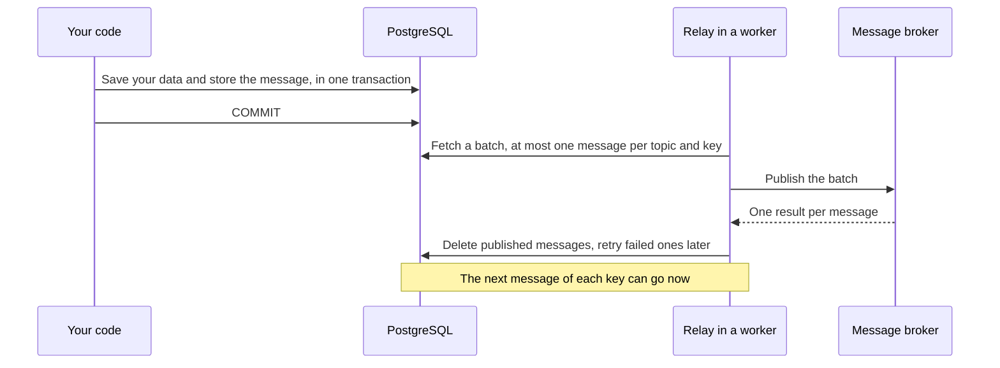

# Publish events with the outbox

The outbox sends messages to a broker, such as Kafka, NATS, or RabbitMQ,
only if your transaction commits. You save each message together with your
data, and a [relay](../concepts/glossary.md#relay) on your workers publishes
it.

## Which should I use?

| Situation | What to use | Why |
|---|---|---|
| Your own service does the work: send an email, call an API | A task | It is the simplest |
| Other systems must receive an event through a broker | The outbox | It keeps the order per key, gives each message an ID for consumers, and retries for about a month |
| Messages arrive from a broker, and the work must not happen twice | The inbox: one task per message, with the message ID as its dedupe key | See [Consume from a broker](../recipes/consume-from-a-broker.md) |
| Another service in the same database must do some work | `EnqueueTx` with a `Client` for that service's schema | See [Split across services](../recipes/split-across-services.md) |

Use the outbox whenever an event leaves your service. A task that publishes
by itself gives you none of the above.

## How it works

The diagram shows one message, from your transaction to the broker.



If your transaction rolls back, the message never existed, and nothing is
published.

## Store messages in your transaction

Create one `Outbox` and share it. Call `Store` in the same transaction as
the change that the event is about:

```go
ob := outbox.New(client) // once, at start

err := pgx.BeginFunc(ctx, pool, func(tx pgx.Tx) error {
    if err := markPaid(ctx, tx, orderID); err != nil {
        return err
    }
    return ob.Store(ctx, taskmill.Pgx(tx), outbox.Message{
        Topic: "orders",
        Key:   []byte(strconv.FormatInt(orderID, 10)), // messages with the same key stay in order
        Value: event,
    })
})
```

`Store` only writes to PostgreSQL, so your app keeps working while the
broker is down. A `Value` can be up to about 750 KiB:
see [Defaults and limits](../reference/defaults-and-limits.md#outbox).

## Relay messages to your broker

Register the relay on your workers. It calls your `Publisher`, which wraps
your broker client:

```go
var handlers taskmill.Handlers
ob.AddRelay(&handlers, outbox.PublisherFunc(func(ctx context.Context, ds []outbox.Delivery) []error {
    errs := make([]error, len(ds)) // one result per delivery, in the same order
    for i, d := range ds {
        errs[i] = broker.Publish(ctx, d.Topic, d.Key, d.Value, d.Headers, d.ID) // your broker client
    }
    return errs
}), nil) // nil: the default RelayOptions
worker, err := taskmill.NewWorker(client, &taskmill.WorkerConfig{Handlers: &handlers})
```

Stored messages wait in the queue `outbox` (`outbox.Queue`). A worker with
no `Queues` set reads it. If you set `Queues`, add `outbox.Queue`.

| Your publisher returns for a delivery | What happens |
|---|---|
| `nil` | The message is published. taskmill deletes it, and keeps no history of it |
| An error, or no result | The message is retried later |
| `taskmill.Permanent(err)` | The message is dead right away. Use it for a message that can never succeed |

`RelayOptions` sets how many deliveries one call gets (`BatchSize`, 100 by
default), and how long one call may take (`Timeout`, 1 minute by default).
When the time is up, the call's context is canceled, and every message
without a `nil` result is retried.

## In which order are messages published?

- Messages with the same topic and key are published **one at a time, in
  the order you stored them**, even with the relay on many workers.
- Messages with different keys, or without a key, go in any order, at the
  same time.

So choose the key by what must stay in order: the order ID, or the account
ID.

## Let consumers drop duplicates

Publishing is **at least once**. For example, a worker can crash after the
broker accepted a message, but before taskmill recorded it. Then the
message is published again.

Each delivery has an `ID`, a UUIDv7. It stays the same when a message is
retried, and is unique across services. Send it with the message, and let
consumers skip an ID they have seen. If the consumer uses taskmill too, use
the inbox: see [Consume from a broker](../recipes/consume-from-a-broker.md).

## What if the broker is down?

The relay retries each message that fails:

| Time after the first failure | What the relay does |
|---|---|
| The first minutes | Tries again after 1 s, 2 s, 4 s, and so on |
| After about 10 minutes | Tries again every 5 minutes |
| After about a month (10,000 tries) | Gives up: the message becomes dead |

While the broker is down, messages wait in the database. The dashboard shows them in the
`outbox` queue as `retryable`, or as `pending` when they wait behind an
earlier message with the same key. When the broker is back, the messages go
out within about 5 minutes, still in order per key.

> [!WARNING]
> A dead message stops its key: later messages with the same topic and key
> wait, so they are never published before it. Fix the cause, then retry the dead
> message, or delete it. See [Fix a halted group](ordering.md#fix-a-halted-group).

## See also

- [Consume from a broker](../recipes/consume-from-a-broker.md): the inbox, on the receiving side
- [Logs, traces, and metrics](observability.md): trace each message with `tel.Publisher`
- [Package `outbox`](https://pkg.go.dev/github.com/code19m/taskmill/outbox) on pkg.go.dev

**Next:** [The dashboard](dashboard.md)
