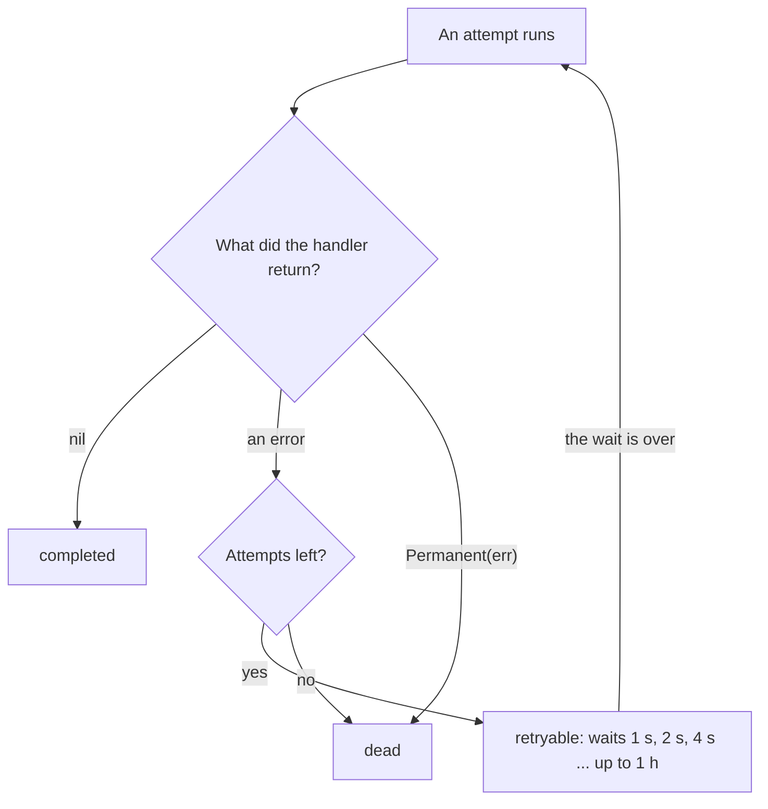

# Retries and errors

When a handler fails, taskmill runs the task again later. This page shows
how long it waits, how to change that, and what to do with a task that
fails for good.

## How retries work

Each failed attempt leads to a wait, or to a dead task:



The wait, or [backoff](../concepts/glossary.md#backoff), doubles after each
failure. A random change of ±10% spreads the retries out, so failed tasks
don't all come back at the same moment. With the defaults:

| After failed attempt | Wait before the next attempt |
|---|---|
| 1, 2, 3 | 1, 2, and 4 seconds |
| 4, 5, 6 | 8, 16, and 32 seconds |
| 7, 8, 9 | About 1, 2, and 4 minutes |
| 10, 11, 12 | About 9, 17, and 34 minutes |
| 13 to 24 | 1 hour each |
| 25 | None: the task is dead |
| **In total** | **About 13 hours** |

The [maintainer](../concepts/glossary.md#maintainer) puts each task back in
its queue when the wait is over, up to about a second late.

A task that waits to retry doesn't count in the queue's
[lag](../concepts/glossary.md#lag). To learn that a task keeps failing,
alert on `taskmill_queue_failed_attempts`: with the defaults, it reaches 10
about 9 minutes after the first failure. See
[Monitoring](../production/monitoring.md).

## Which should I use?

| Situation | What to use | Why |
|---|---|---|
| The work must happen, even if late: a receipt, a sync with a partner | The defaults | The task keeps trying through an outage of several hours |
| Late work is useless: a login code, a "your order shipped" email | A lower `MaxAttempts` for the kind, such as 3 or 5 | The task stops trying after seconds |
| The work must never run again after a failure | `MaxAttempts: 1` | One try, then dead |
| A retry can't help: bad input | `return taskmill.Permanent(err)` | Dead right away, with no attempts wasted |
| What you call recovers on a known time scale | `ExponentialBackoff` with your own `Base` and `Max` | Retries match the recovery time |

Most kinds need only the defaults.

## Set the number of attempts per kind

Set `MaxAttempts` in the kind's `EnqueueDefaults`:

```go
func (SendLoginCode) EnqueueDefaults() taskmill.EnqueueOptions {
    return taskmill.EnqueueOptions{MaxAttempts: 3} // a late code is useless
}
```

`MaxAttempts` is saved with each task when it is enqueued, from 1 to 10,000.
One enqueue call can still change it. A dead task that someone retries gets
all its attempts again.

## Change the wait between retries

Set `Retry` in the kind's `HandlerOptions`:

```go
taskmill.AddHandler(&handlers, &PartnerSync{}, &taskmill.HandlerOptions{
    Retry: taskmill.ExponentialBackoff{Base: 10 * time.Second, Max: 30 * time.Minute},
})
```

For a fixed wait, or a timetable of your own, implement
[`RetryPolicy`](https://pkg.go.dev/github.com/code19m/taskmill#RetryPolicy).
Its `Backoff` method gets the number of the attempt that failed, from 1.

> [!NOTE]
> If a task's worker crashes or loses its lease, the task waits by the
> default backoff, not by your policy. The maintainer retries such a task,
> and it doesn't know your handler's options.

## What is a dead task?

A [dead task](../concepts/glossary.md#dead-task) failed for good: its
attempts ran out, its handler returned `Permanent`, or its payload does not
decode. It doesn't run again unless someone retries it. Dead tasks are your
dead-letter queue.

- taskmill logs `attempt failed; the task is dead` at the Error level.
- A dead task is kept for 30 days by default, then deleted.
- In a FIFO group, a dead task stops the tasks behind it, and is kept until
  you retry or delete it. See [Task order and FIFO groups](ordering.md).

What to do with a dead task:

1. Read its error history (below) to find the cause.
2. Fix the cause: deploy a fix, or correct the data.
3. Retry the task with `client.Retry` or in the [dashboard](dashboard.md).
   Or delete it, if the work is no longer needed.

For many dead tasks, follow
[Recover from an incident](../recipes/recover-from-an-incident.md).

> [!TIP]
> Alert when the number of dead tasks grows, not when it is above zero.
> Dead tasks stay for 30 days, so "above zero" stays red for a month. See
> [Monitoring](../production/monitoring.md).

## Where do I see a task's errors?

Open the task in the dashboard, or read it with `client.Get`.
`TaskInfo.Errors` holds the 20 most recent entries, oldest first. Each has
the `Attempt`, the time (`At`), the error's `Message`, and a `Code`. The
code is empty for an error that your handler returned in time. Otherwise it says
what happened, such as `timeout`, `panic`, or `lease_lost`:
[Errors](../reference/errors.md) lists every code.

## See also

- [Handle tasks](handle-tasks.md): what a handler returns, and what each result does
- [Recover from an incident](../recipes/recover-from-an-incident.md): retry thousands of dead tasks safely
- [`RetryPolicy`](https://pkg.go.dev/github.com/code19m/taskmill#RetryPolicy) and [`ExponentialBackoff`](https://pkg.go.dev/github.com/code19m/taskmill#ExponentialBackoff) on pkg.go.dev

**Next:** [Handle tasks in batches](batch-handlers.md)
