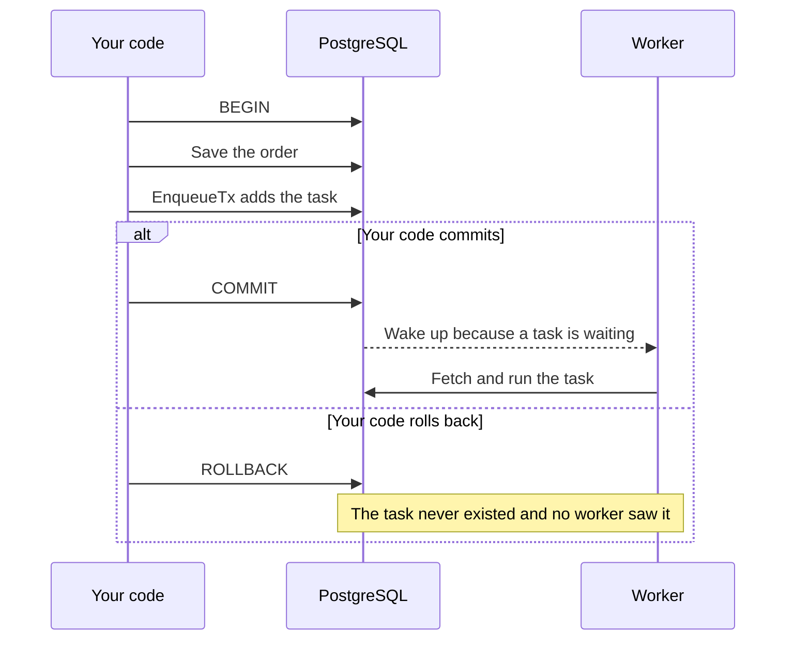
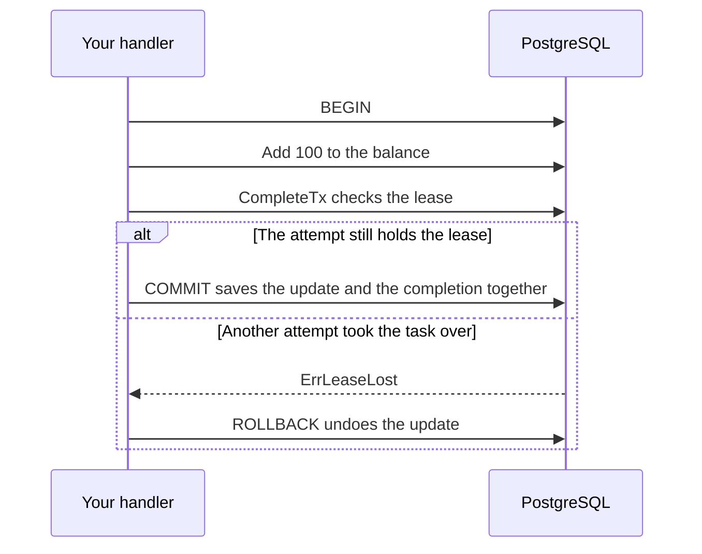

# Use your own transactions

Save a task in the same transaction as your own data, so both are saved or
neither is. A handler can also finish its task in the transaction that does
its work.

## Quick example

```go
err := pgx.BeginFunc(ctx, pool, func(tx pgx.Tx) error {
    orderID, err := saveOrder(ctx, tx, order)
    if err != nil {
        return err
    }
    _, err = client.EnqueueTx(ctx, taskmill.Pgx(tx), SendReceipt{OrderID: orderID}, nil)
    return err
})
```

`taskmill.Pgx(tx)` wraps your pgx transaction, so taskmill can run its
statements in it.

## What happens on commit and on rollback

The task is an ordinary row in your transaction. This diagram shows both
endings:



- Workers can't see the task before your transaction commits.
- The message that wakes the workers is sent at commit, too.
- So a rolled-back order never gets a receipt.

## Which should I use?

Keep the database library your app already uses. Wrap its transaction like
this:

| Your code uses | Pass | Why |
|---|---|---|
| pgx | `taskmill.Pgx(tx)` | taskmill is built on pgx |
| `database/sql` with pgx's driver, `github.com/jackc/pgx/v5/stdlib` | `taskmill.SQL(tx)` | Works with any `*sql.Tx` on that driver |
| sqlx | `taskmill.SQL(tx)` | A `*sqlx.Tx` works as it is |
| bun | `taskmill.SQL(tx.Tx)` | Pass the `*sql.Tx` inside: bun rewrites query placeholders itself |
| lib/pq | Not supported | Switch to pgx's `database/sql` driver |

With `database/sql`, the quick example's enqueue becomes:

```go
_, err := client.EnqueueTx(ctx, taskmill.SQL(tx), SendReceipt{OrderID: orderID}, nil)
```

[`ExampleSQL`](https://pkg.go.dev/github.com/code19m/taskmill#example-SQL)
shows it with the whole transaction.

taskmill itself always needs a pgx pool for `Migrate`, `NewClient`, and its
workers ([Setup](setup.md#size-the-pool)). A `database/sql` app can open its
`*sql.DB` on that same pool with `stdlib.OpenDBFromPool(pool)`. Then one
pool works for both.

## Which calls need a transaction?

| Call | Accepts |
|---|---|
| `EnqueueTx`, `EnqueueManyTx` | A transaction, a connection, or a pool |
| `CancelTx`, `Task.CompleteTx` | A transaction only, because they run several statements that must commit together. Anything else fails with `ErrInvalidArgument` |

A transaction is a `pgx.Tx`, a `*sql.Tx`, or a type with `Commit` and
`Rollback` methods, such as `*sqlx.Tx`.

## Complete a task in the same transaction

Sometimes a handler's work is in the same database as taskmill. Then the
handler can finish its task inside its own transaction. The work and the
completion commit together, so the work happens exactly once, even if the
task runs twice.

```go
func (a *PaymentApplier) Handle(ctx context.Context, t *taskmill.Task[ApplyPayment]) error {
    return pgx.BeginFunc(ctx, a.pool, func(tx pgx.Tx) error {
        _, err := tx.Exec(ctx, "UPDATE accounts SET balance = balance + $1 WHERE id = $2",
            t.Args.Cents, t.Args.AccountID)
        if err != nil {
            return err
        }
        return t.CompleteTx(ctx, taskmill.Pgx(tx)) // ErrLeaseLost rolls the update back
    })
}
```

`CompleteTx` checks that this attempt still holds the task's
[lease](../concepts/glossary.md#lease):



The rules, which `pgx.BeginFunc` follows for you:

- If `CompleteTx` returns `ErrLeaseLost`, another attempt took the task
  over. Return that error, so your transaction rolls back.
- After `CompleteTx`, commit, then return nil.
- If your transaction fails, return its error. The attempt then fails, and
  the task is retried as usual.

[Do work once](../recipes/do-work-once.md) compares `CompleteTx` with the
other ways to make a task safe to run twice.

## Start a follow-up task exactly once

To start step B only when step A is done, enqueue B in A's transaction,
next to `CompleteTx`:

```go
func (c *OrderConfirmer) Handle(ctx context.Context, t *taskmill.Task[ConfirmOrder]) error {
    return pgx.BeginFunc(ctx, c.pool, func(tx pgx.Tx) error {
        if err := markConfirmed(ctx, tx, t.Args.OrderID); err != nil {
            return err
        }
        next := ShipOrder{OrderID: t.Args.OrderID}
        if _, err := c.client.EnqueueTx(ctx, taskmill.Pgx(tx), next, nil); err != nil {
            return err
        }
        return t.CompleteTx(ctx, taskmill.Pgx(tx))
    })
}
```

`ShipOrder` exists only if `ConfirmOrder` completed. If `ConfirmOrder` runs
twice, only one run can commit, so there is only one `ShipOrder`.

## Keep these transactions short

- A task with a `GroupKey` or a `DedupeKey` makes other producers of the
  same group or key wait until your transaction ends.
- Any long transaction slows down the queue for everyone: see
  [Database](../production/database.md).

## Which isolation level may I use?

- **Your transactions** may use any isolation level. At REPEATABLE READ or
  SERIALIZABLE, PostgreSQL may stop a transaction with a serialization
  failure. Retrying it is up to you.
- **taskmill's pool** must use READ COMMITTED, PostgreSQL's default.
  `NewClient` checks this: see [Setup](setup.md#why-does-newclient-fail).

## See also

- [Do work once](../recipes/do-work-once.md): `CompleteTx`, an idempotency
  key, or a check before you act
- [Guarantees](../concepts/guarantees.md): why a task can run twice
- [`Executor`](https://pkg.go.dev/github.com/code19m/taskmill#Executor) and
  [`Task.CompleteTx`](https://pkg.go.dev/github.com/code19m/taskmill#Task.CompleteTx)
  on pkg.go.dev

**Next:** [Handle tasks](handle-tasks.md)
