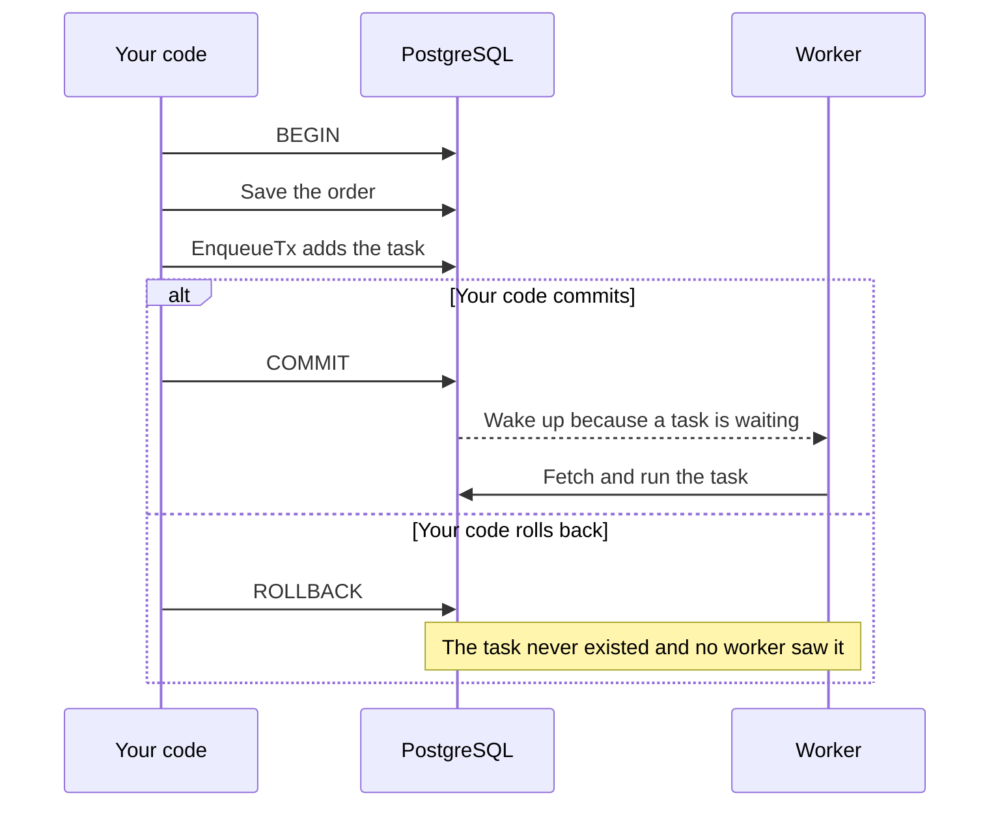

# Use your own transactions

Save a task in the same transaction as your own data, so both are saved or
neither is. A handler can also finish its task in the transaction that does
its work.

## Quick example

```go
err := pgx.BeginFunc(ctx, pool, func(tx pgx.Tx) error {
    orderID, err := saveOrder(ctx, tx, order)
    if err != nil {
        return err
    }
    _, err = client.EnqueueTx(ctx, taskmill.Pgx(tx), SendReceipt{OrderID: orderID}, nil)
    return err
})
```

`taskmill.Pgx(tx)` wraps your pgx transaction, so taskmill can run its
statements in it.

## What happens on commit and on rollback

The task is an ordinary row in your transaction. This diagram shows both
endings:



Workers can't see the task before your transaction commits, and the
[notification](../concepts/glossary.md#notification) that wakes them is sent
at commit, too.

## Which should I use?

Keep the database library your app already uses, and wrap its transaction:

| Your code uses | Pass | Why |
|---|---|---|
| pgx | `taskmill.Pgx(tx)` | taskmill is built on pgx |
| `database/sql` with pgx's driver, `github.com/jackc/pgx/v5/stdlib` | `taskmill.SQL(tx)` | Any `*sql.Tx` on that driver works |
| sqlx | `taskmill.SQL(tx)` | A `*sqlx.Tx` works as it is |
| bun | `taskmill.SQL(tx.Tx)` | Pass the `*sql.Tx` inside: bun rewrites query placeholders itself |
| lib/pq | Not supported | Switch to pgx's `database/sql` driver |

The quick example again, with `database/sql`:

```go
db := stdlib.OpenDBFromPool(pool) // once, at start: taskmill's pool also serves database/sql

tx, err := db.BeginTx(ctx, nil)
if err != nil {
    return err
}
defer tx.Rollback() // does nothing after Commit

var orderID int64
err = tx.QueryRowContext(ctx, "INSERT INTO orders (email) VALUES ($1) RETURNING id", email).Scan(&orderID)
if err != nil {
    return err
}
if _, err := client.EnqueueTx(ctx, taskmill.SQL(tx), SendReceipt{OrderID: orderID}, nil); err != nil {
    return err
}
return tx.Commit()
```

- taskmill itself still needs a pgx pool
  ([Set up the database and client](setup.md#size-the-pool)).
  `stdlib.OpenDBFromPool` opens your `*sql.DB` on that same pool, so both
  use the same connections.
- The enqueue calls also accept a connection or a pool. `CancelTx` and
  `Task.CompleteTx` need a transaction, because they run several statements
  that must commit together. If you pass them a connection or a pool, they
  return `ErrInvalidArgument`.

## Complete a task in the same transaction

When a handler's work is in the same database as taskmill, the handler can
finish its task inside its own transaction. The work and the completion
commit together, so the work happens exactly once, even if the task runs
twice.

```go
func (a *PaymentApplier) Handle(ctx context.Context, t *taskmill.Task[ApplyPayment]) error {
    return pgx.BeginFunc(ctx, a.pool, func(tx pgx.Tx) error {
        _, err := tx.Exec(ctx, "UPDATE accounts SET balance = balance + $1 WHERE id = $2",
            t.Args.Cents, t.Args.AccountID)
        if err != nil {
            return err
        }
        return t.CompleteTx(ctx, taskmill.Pgx(tx)) // ErrLeaseLost rolls the update back
    })
}
```

`CompleteTx` checks that this attempt still holds the task's
[lease](../concepts/glossary.md#lease). Follow these rules. With
`pgx.BeginFunc`, as above, your code already does:

- If `CompleteTx` returns `ErrLeaseLost`, another attempt took the task
  over. Return that error, so your transaction rolls back.
- After `CompleteTx`, commit, then return nil.
- If your transaction fails, return its error. The task is retried as usual.

[Do work once](../recipes/do-work-once.md) compares `CompleteTx` with the
other ways to make a task safe to run twice.

## Start a follow-up task exactly once

To start step B only when step A is done, enqueue B in A's transaction,
next to `CompleteTx`:

```go
func (c *OrderConfirmer) Handle(ctx context.Context, t *taskmill.Task[ConfirmOrder]) error {
    return pgx.BeginFunc(ctx, c.pool, func(tx pgx.Tx) error {
        if err := markConfirmed(ctx, tx, t.Args.OrderID); err != nil {
            return err
        }
        next := ShipOrder{OrderID: t.Args.OrderID}
        if _, err := c.client.EnqueueTx(ctx, taskmill.Pgx(tx), next, nil); err != nil {
            return err
        }
        return t.CompleteTx(ctx, taskmill.Pgx(tx))
    })
}
```

`ShipOrder` exists only if `ConfirmOrder` completed. If `ConfirmOrder` runs
twice, only one run can commit, so there is only one `ShipOrder`.

## Cancel a task in the same transaction

`CancelTx` cancels a task only if your transaction commits. Here, a paid
order needs no reminder. The order's row holds the ID of its reminder task,
saved from `EnqueueResult.ID` when the reminder was enqueued:

```go
err := pgx.BeginFunc(ctx, pool, func(tx pgx.Tx) error {
    var reminderID int64
    err := tx.QueryRow(ctx,
        "UPDATE orders SET paid = true WHERE id = $1 RETURNING reminder_task_id", orderID).Scan(&reminderID)
    if err != nil {
        return err
    }
    err = client.CancelTx(ctx, taskmill.Pgx(tx), reminderID)
    if errors.Is(err, taskmill.ErrInvalidState) || errors.Is(err, taskmill.ErrNotFound) {
        return nil // the reminder already finished, or was deleted: nothing to cancel
    }
    return err
})
```

Often you need no cancel at all: let the handler check the order, and
return nil when the reminder is no longer needed
([Handle tasks](handle-tasks.md#what-should-my-handler-return)).

> [!NOTE]
> PostgreSQL may end your transaction with `deadlock detected` (SQLSTATE
> `40P01`) when another transaction changes the same task, or its
> [FIFO group](ordering.md), at the same moment as `CancelTx`: for example,
> a retry of the task, or the end of the task ahead of it in its group.
> Nothing was saved, so run your transaction again. `Cancel` does that by
> itself, because the transaction is its own.

## Keep transactions short

- A task with a `GroupKey` or a `DedupeKey` makes other
  [producers](../concepts/glossary.md#producer) of the same group or key
  wait until your transaction ends.
- Any long transaction slows down the queue for everyone: see
  [Database](../production/database.md).

## Use REPEATABLE READ or SERIALIZABLE

Your transactions may use any isolation level. Only taskmill's own pool must
use READ COMMITTED
([Set up the database and client](setup.md#why-does-newclient-fail)).

At REPEATABLE READ and SERIALIZABLE, PostgreSQL stops a transaction that
changes a row which another transaction changed after yours began. The
statement fails with a serialization failure, SQLSTATE `40001`.

> [!WARNING]
> At these levels, call `CompleteTx` as the **first** statement of your
> transaction. The worker renews the task's lease every 10 seconds by
> default, and each renewal changes the task's row. So a `CompleteTx` that
> comes after a renewal fails with `40001`. A transaction that runs longer
> than those 10 seconds fails on every attempt, until the task is dead.

```go
func (a *PaymentApplier) Handle(ctx context.Context, t *taskmill.Task[ApplyPayment]) error {
    opts := pgx.TxOptions{IsoLevel: pgx.Serializable}
    return pgx.BeginTxFunc(ctx, a.pool, opts, func(tx pgx.Tx) error {
        if err := t.CompleteTx(ctx, taskmill.Pgx(tx)); err != nil { // first: it locks the task's row
            return err
        }
        _, err := tx.Exec(ctx, "UPDATE accounts SET balance = balance + $1 WHERE id = $2",
            t.Args.Cents, t.Args.AccountID)
        return err
    })
}
```

- As the first statement, `CompleteTx` locks the task's row before a renewal
  can change it. The work after it still commits together with the
  completion, or not at all.
- `EnqueueTx` and `CancelTx` can fail with `40001` at these levels too.
  Nothing was saved, so it is safe to run your transaction again.

## See also

- [Do work once](../recipes/do-work-once.md): `CompleteTx`, an idempotency key, or a check before you act
- [Guarantees](../concepts/guarantees.md): why a task can run twice
- [`ExampleSQL`](https://pkg.go.dev/github.com/code19m/taskmill#example-SQL): the same enqueue, with a `*sql.DB` from `sql.Open`
- [`Executor`](https://pkg.go.dev/github.com/code19m/taskmill#Executor) and [`Task.CompleteTx`](https://pkg.go.dev/github.com/code19m/taskmill#Task.CompleteTx) on pkg.go.dev

**Next:** [Handle tasks](handle-tasks.md)
