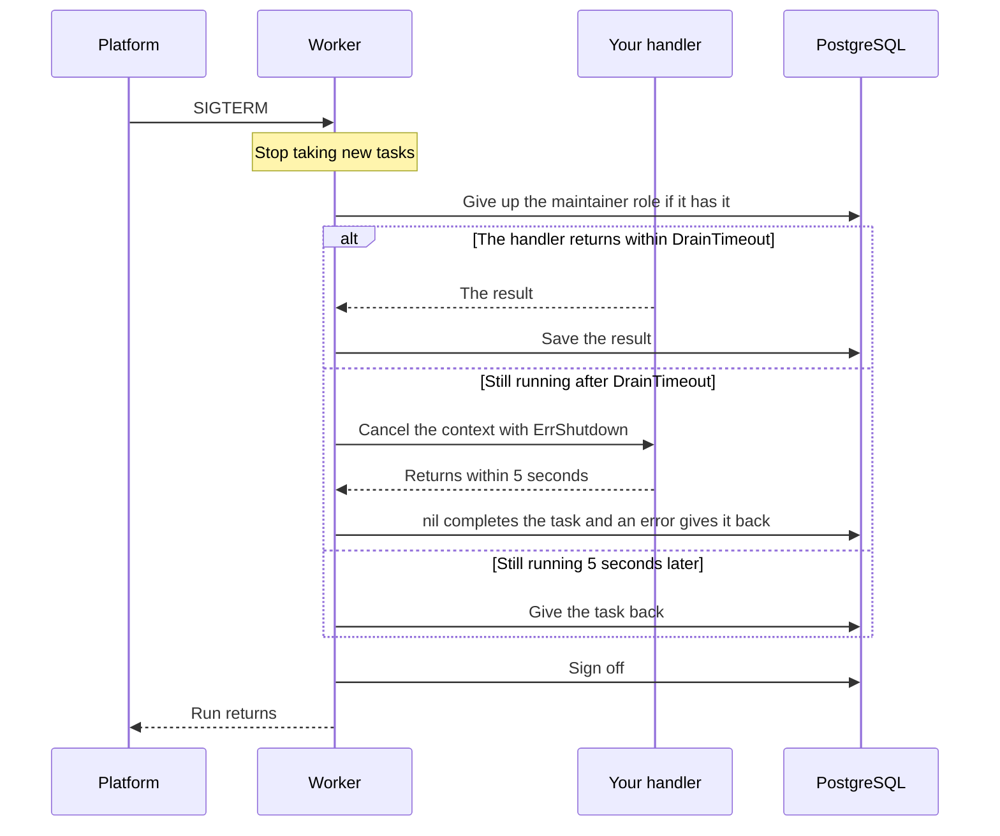

# Workers and queues

Run a worker, choose the queues it reads, and limit how many tasks run at
the same time. This page also shows how a worker stops without losing work.

## Quick example

```go
worker, err := taskmill.NewWorker(client, &taskmill.WorkerConfig{Handlers: &handlers})
if err != nil {
    return err
}
ctx, stop := signal.NotifyContext(ctx, os.Interrupt, syscall.SIGTERM)
defer stop()
return worker.Run(ctx) // on SIGTERM, it stops cleanly, then returns
```

- A [worker](../concepts/glossary.md#worker) takes tasks from its queues and
  runs their handlers. Run one `Worker` per process. It can read many queues.
- `Run` blocks until its context ends. It returns an error only if the
  worker can't start.
- Any worker can also become the
  [maintainer](../concepts/glossary.md#maintainer): the one worker per
  schema that does shared work, such as retries, delayed tasks, and
  schedules.
- `WorkerConfig` has more fields, such as `LeaseDuration`, `PollInterval`,
  and `ListenConfig`. Its doc comment on
  [pkg.go.dev](https://pkg.go.dev/github.com/code19m/taskmill#WorkerConfig)
  has them all, with their defaults.

> [!TIP]
> In production, run workers as their own deployment, from the same image
> as your app, and let your web servers only enqueue. For a small app, one
> process that does both is fine. See [Deploys](../production/deploys.md).

## Which should I use?

To control how many tasks run:

| Situation | What to use | Why |
|---|---|---|
| Fit the work to one machine's CPU, memory, and connections | `Concurrency` per queue, in `WorkerConfig.Queues` | It limits one process |
| Protect a partner API or another shared resource | `MaxRunning`, set with `UpdateQueue` | It limits all workers together |
| Stop a queue for a while, such as during an incident | `PauseQueue` | Tasks wait, and nothing is lost |

Most apps need only `Concurrency`. Add `MaxRunning` when something outside
taskmill has a limit.

## Choose the queues a worker reads

By default, a worker reads the queue of each kind it has a handler for: the
queue from the kind's `EnqueueDefaults`, or else `default`. It runs up to 10
tasks from each queue at the same time. To choose the queues and their
concurrency, set `Queues`:

```go
worker, err := taskmill.NewWorker(client, &taskmill.WorkerConfig{
    Handlers: &handlers,
    Queues: map[string]taskmill.QueueOptions{
        "default":     {Concurrency: 20},
        "emails":      {Concurrency: 5},
        "partner-api": {}, // 10, the default
    },
})
```

- With `Queues`, the worker reads only those queues. If it leaves out the
  queue of a kind it handles, `Run` logs a warning.
- A batch counts as one task toward `Concurrency`.
- Give the pool the sum of all `Concurrency` values plus 5 connections: see
  [Size the connection pool](../production/database.md#size-the-connection-pool).

> [!WARNING]
> A worker takes every task from its queues, whatever its kind. If it has
> no handler for the kind, it [snoozes](../concepts/glossary.md#snooze) the
> task for a minute at a time. If no worker with a handler takes it within
> the worker's `NoHandlerWait`, an hour by default, the task becomes dead
> with the code `unknown_kind`. So every worker that reads a queue needs the
> handlers for all kinds in it. For a rollout that takes longer, see
> [Add a new kind during a rollout](../production/deploys.md#add-a-new-kind-during-a-rollout).

## How many queues do I need?

Start with one queue: `default`. Many kinds can share it. A queue's
concurrency, limit, pause, [lag](../concepts/glossary.md#lag) alert, and
autoscaling apply to all its tasks. So add a queue only for work that needs
its own settings, such as each partner API with a rate limit, or slow bulk
work.

Is some work only more urgent? Give it a higher `Priority` in the same
queue. But a priority only changes which waiting task starts next: slow
tasks can still fill every [slot](../concepts/glossary.md#slot). For work
that must never wait, use a queue of its own.

## Limit how many tasks run

`Concurrency` limits one process. To limit a queue across all workers, set
`MaxRunning`. Do it when your app starts:

```go
err := client.UpdateQueue(ctx, "partner-api", func(s *taskmill.QueueSettings) {
    s.MaxRunning = 4
})
```

- The limit is saved in the database, so setting it again at every start is
  fine. Zero removes the limit.
- Workers apply a change right away when
  [notifications](../concepts/glossary.md#notification) reach them, and
  within 10 seconds otherwise.
- Your function may run more than once, so only set fields in it.
- `MaxRunning` counts tasks, not batches, so it also limits how full a
  batch gets. A limit costs a little: workers take turns to fetch from
  that queue.
- The limit holds also for a handler that ignores its context. In a queue
  without a limit, the worker gives up on such a handler 5 seconds after
  its context ended, and the task runs again. In a queue with a limit, the
  task stays running, and counts, until the handler returns: the worker
  only logs a warning. The exception is an attempt that lost its lease: its
  task may run again anyway, so the worker gives up on it too.

For a partner API, combine a small `MaxRunning` with `Snooze`: see
[Call a rate-limited API](../recipes/call-a-rate-limited-api.md).

## Pause a queue

```go
if err := client.PauseQueue(ctx, "emails"); err != nil { // workers stop taking its tasks
    return err
}
// ... fix the problem ...
return client.ResumeQueue(ctx, "emails")
```

- Running tasks finish normally. Waiting tasks stay, and you can still
  enqueue new ones.
- Workers apply a pause as fast as a limit: right away, or within 10
  seconds.
- A pause holds through a deploy. A worker that starts takes no task
  before it has read the pauses and limits of its queues.
- While the queue is paused, its lag grows, so lag alerts fire.
- The [dashboard](dashboard.md) can pause and resume queues, too.

## Stop a worker cleanly

When `Run`'s context ends, the worker stops in this order:



- `DrainTimeout` is 20 seconds by default.
- The worker gives up the maintainer role first, so another worker does the
  shared work while this one finishes its tasks.
- A task given back uses no attempt. Another worker runs it again from the
  start. Tasks that the worker fetched but did not start go back too.
- Then the worker has 5 seconds to save the results that are left and sign
  off. A result that it can't save by then, for example because the
  database doesn't answer, is
  [rescued](../concepts/glossary.md#rescue) once its lease runs out, and
  the task runs again. So `Run` returns at most about `DrainTimeout` plus
  10 seconds after its context ended.
- Give the process a grace period that covers this: see
  [Deploys](../production/deploys.md#stop-workers-without-losing-work).
- For tasks that run longer than `DrainTimeout`, see
  [Run long tasks](../recipes/run-long-tasks.md).

## Run one task now

`worker.RunTask(ctx, id)` runs one task right away, in your goroutine, and
returns the task when it is done. It ignores the task's
[run time](../concepts/glossary.md#run-time), paused queues, and limits, but
it keeps FIFO order. `Run` doesn't need to be running. Use it in
[tests](testing.md) and in admin tools.

## Which worker does the shared work?

taskmill chooses one worker per schema as the maintainer, and replaces it
when it stops or crashes: see
[How it works](../concepts/how-it-works.md#the-maintainer). `client.Workers`
and the dashboard show which worker it is.

Every worker can become the maintainer, unless it sets `NoMaintainer`.
Leave `NoMaintainer` off, except in these cases:

- **A worker that doesn't define your `Schedules`.** The maintainer runs
  only the schedules it defines, so your schedules would stop while this
  worker is the maintainer.
- **Workers that scale down to zero.** Keep a worker always on, with every
  schedule and no handlers, and set `NoMaintainer` on the workers that
  scale: see [Autoscaling](../production/autoscaling.md).

> [!WARNING]
> Without any maintainer, retries, delayed tasks, and schedules stop, and
> the tasks of crashed workers don't run again.

## See also

- [Deploys](../production/deploys.md): stop workers without losing work
- [Call a rate-limited API](../recipes/call-a-rate-limited-api.md): a queue with `MaxRunning`
- [`WorkerConfig`](https://pkg.go.dev/github.com/code19m/taskmill#WorkerConfig) and [`Client.UpdateQueue`](https://pkg.go.dev/github.com/code19m/taskmill#Client.UpdateQueue) on pkg.go.dev

**Next:** [Task order and FIFO groups](ordering.md)
