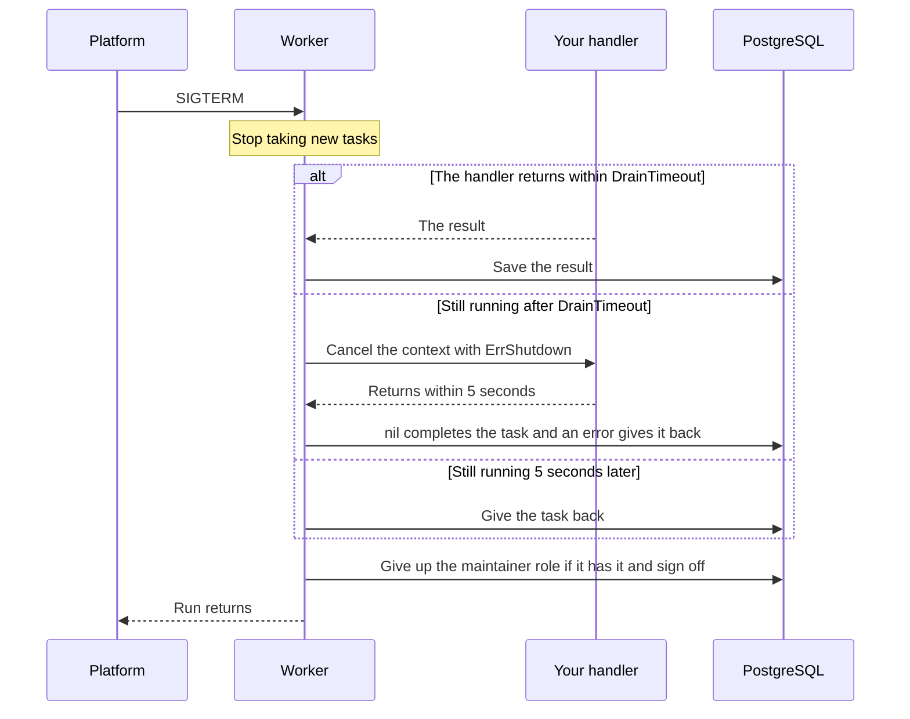

# Workers and queues

Run a worker, choose the queues it reads, and limit how many tasks run at
the same time. This page also shows how a worker stops without losing work.

## Quick example

```go
worker, err := taskmill.NewWorker(client, &taskmill.WorkerConfig{Handlers: &handlers})
if err != nil {
    return err
}
ctx, stop := signal.NotifyContext(ctx, os.Interrupt, syscall.SIGTERM)
defer stop()
return worker.Run(ctx) // on SIGTERM, it stops cleanly, then returns
```

- A [worker](../concepts/glossary.md#worker) takes tasks from its queues and
  runs their handlers. Run one `Worker` per process. It can read many queues.
- `Run` blocks until its context ends. It returns an error only if the
  worker can't start.
- Any worker can also become the
  [maintainer](../concepts/glossary.md#maintainer): the one worker per
  schema that does shared work, such as retries, delayed tasks, and
  schedules.

> [!TIP]
> In production, run workers as their own deployment, from the same image
> as your app, and let your web servers only enqueue. For a small app, one
> process that does both is fine. See [Deploys](../production/deploys.md).

## Which should I use?

To control how many tasks run:

| Situation | What to use | Why |
|---|---|---|
| Fit the work to one machine's CPU, memory, and connections | `Concurrency` per queue, in `WorkerConfig.Queues` | It limits one process |
| Protect a partner API or another shared resource | `MaxRunning`, set with `UpdateQueue` | It limits all workers together |
| Stop a queue for a while, such as during an incident | `PauseQueue` | Tasks wait, and nothing is lost |

Most apps need only `Concurrency`. Add `MaxRunning` when something outside
taskmill has a limit.

## Choose the queues a worker reads

By default, a worker reads the queue of each kind it has a handler for: the
queue from the kind's `EnqueueDefaults`, or else `default`. It runs up to 10
tasks from each queue at the same time. To choose the queues and their
concurrency, set `Queues`:

```go
worker, err := taskmill.NewWorker(client, &taskmill.WorkerConfig{
    Handlers: &handlers,
    Queues: map[string]taskmill.QueueOptions{
        "default":     {Concurrency: 20},
        "emails":      {Concurrency: 5},
        "partner-api": {}, // 10, the default
    },
})
```

- With `Queues`, the worker reads only those queues. If it leaves out the
  queue of a kind it handles, `Run` logs a warning.
- A batch counts as one task toward `Concurrency`.
- Size the pool for the sum of all `Concurrency` values, plus 5: see
  [Setup](setup.md#size-the-pool).

> [!WARNING]
> A worker takes every task from its queues, whatever its kind. If it has
> no handler for the kind, it snoozes the task for a minute at a time.
> After an hour, the task becomes dead with the code `unknown_kind`. So
> every worker that reads a queue needs the handlers for all kinds in it.

## How many queues do I need?

Start with one queue: `default`. Many kinds can share it. A queue's
concurrency, limit, pause, lag alert, and autoscaling apply to all its
tasks. So add a queue only for work that needs its own, such as each
partner API with a rate limit, or slow bulk work.

Is some work only more urgent? Give it a higher `Priority` in the same
queue. But a priority only changes which waiting task starts next: slow
tasks can still fill every place. For work that must never wait, use a
queue of its own.

## Limit how many tasks run

`Concurrency` limits one process. To limit a queue across all workers, set
`MaxRunning`. Do it when your app starts:

```go
err := client.UpdateQueue(ctx, "partner-api", func(s *taskmill.QueueSettings) {
    s.MaxRunning = 4
})
```

- The limit is saved in the database, so setting it again at every start is
  fine. Zero removes the limit.
- Workers apply a change right away when notifications reach them, and
  within 10 seconds otherwise.
- Your function may run more than once, so only set fields in it.
- `MaxRunning` counts tasks, not batches, so it also limits how full a
  batch gets. A limit costs a little: workers take turns to fetch from
  that queue.

For a partner API, combine a small `MaxRunning` with `Snooze`: see
[Call a rate-limited API](../recipes/call-a-rate-limited-api.md).

## Pause a queue

```go
if err := client.PauseQueue(ctx, "emails"); err != nil { // workers stop taking its tasks
    return err
}
// ... fix the problem ...
return client.ResumeQueue(ctx, "emails")
```

Running tasks finish normally. Waiting tasks stay, and you can still enqueue
new ones. Workers apply a pause as fast as a limit. While the queue is
paused, its lag grows, so lag alerts fire. The dashboard can pause and
resume queues, too.

## Stop a worker cleanly

When `Run`'s context ends, the worker stops in this order:



- `DrainTimeout` is 20 seconds by default.
- A task given back uses no attempt. Another worker runs it again from the
  start. Tasks that the worker fetched but did not start go back too.
- Give the process a grace period of at least `DrainTimeout` plus 10
  seconds: 30 seconds with the defaults, which is Kubernetes' default. See
  [Kubernetes](../production/kubernetes.md).
- For tasks that run longer than `DrainTimeout`, see
  [Run long tasks](../recipes/run-long-tasks.md).

## Run one task now

`worker.RunTask(ctx, id)` runs one task right away, in your goroutine, and
returns the task when it is done. It ignores the task's run time, paused
queues, and limits, but it keeps FIFO order. `Run` doesn't need to be
running. Use it in [tests](testing.md) and in admin tools.

## Which worker does the shared work?

Every worker takes part in choosing the maintainer, unless it sets
`NoMaintainer`. If the maintainer stops, another worker takes over right
after its drain. If it crashes, another takes over within about 12 seconds.
`client.Workers` and the dashboard show which worker is the maintainer.

Leave `NoMaintainer` off, except in these cases:

- A worker that doesn't define your `Schedules`. The maintainer runs only
  the schedules it defines, so your schedules would stop while it leads.
- Workers that scale down to zero. Keep one worker always on, with every
  schedule and no handlers, and set `NoMaintainer` on the others.

Without any maintainer, retries, delayed tasks, and schedules stop.

## See also

- [Deploys](../production/deploys.md): stop workers without losing work
- [Call a rate-limited API](../recipes/call-a-rate-limited-api.md): a queue with `MaxRunning`
- [`WorkerConfig`](https://pkg.go.dev/github.com/code19m/taskmill#WorkerConfig) and [`Client.UpdateQueue`](https://pkg.go.dev/github.com/code19m/taskmill#Client.UpdateQueue) on pkg.go.dev

**Next:** [Test your code](testing.md)
