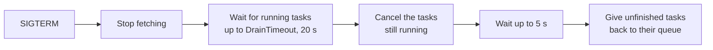
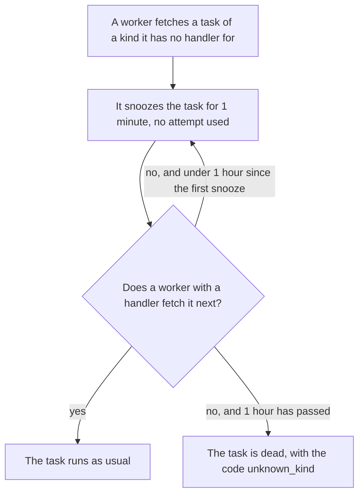

# Deploys

This page shows how to ship a new version without losing work: how workers
stop, when migrations run, and what happens while old and new code run
together.

## Stop workers without losing work

When your platform stops a worker, the worker finishes what it can, and gives
the rest back to the queue. This is what happens after `SIGTERM`:



| A running task… | Ends as | Uses an attempt |
|---|---|---|
| finishes within `DrainTimeout` | its normal result | Yes |
| returns nil after the cancel | completed | Yes |
| returns an error after the cancel | given back: another worker runs it | No |
| does not return within 5 seconds | given back, while the handler keeps running until the process exits | No |

Tasks that the worker fetched but did not start yet go back too.

Do three things:

1. End `Run`'s context on `SIGTERM`:

   ```go
   ctx, stop := signal.NotifyContext(context.Background(), os.Interrupt, syscall.SIGTERM)
   defer stop()
   // ...
   err = worker.Run(ctx) // returns once running tasks are drained
   ```

2. Give the process a grace period of at least `DrainTimeout` plus 10
   seconds: 30 seconds with the defaults, which is Kubernetes' default too.
3. If tasks often run longer than `DrainTimeout`, raise both, or split the
   work into shorter tasks. See [Run long tasks](../recipes/run-long-tasks.md).

## Run migrations

### Which should I use?

| Situation | What to use | Why |
|---|---|---|
| Most apps | **Call `Migrate` at the start of every process**, before `NewClient` | Safe when many pods run it at the same time: one migrates, and the others wait, then find nothing to do |
| Your deploys change the schema before new code starts, such as a Helm `pre-upgrade` hook or an Argo CD sync wave | A Job that runs your image and calls `Migrate` | The schema is ready before any new pod starts. See [Migrate in a Job](kubernetes.md#migrate-in-a-job) |
| You manage every schema change with goose, Atlas, or Flyway | Apply `taskmill.Migrations` with your tool | One tool for all changes. See [Use your migration tool](../recipes/use-your-migration-tool.md) |

```go
if err := taskmill.Migrate(ctx, pool, &taskmill.MigrateConfig{Logger: logger}); err != nil {
    return err
}
client, err := taskmill.NewClient(ctx, pool, &taskmill.ClientConfig{Logger: logger})
```

- Migrations only go forward. There are no down migrations.
- A migration waits at most 5 seconds for a lock on a busy taskmill table,
  so it never blocks your workers for long. If it gives up, run it again: a
  pod restart, or the Job's next try, does that.
- `taskmill-ui` never migrates. Until the schema is migrated, it exits at
  start, and Kubernetes starts it again.

## Run two versions side by side

During a rolling deploy, old and new pods run together. That is safe across
one release: each release's schema still works with the previous release's
code.

| Your code | The schema | Result |
|---|---|---|
| Same release | Same release | Works |
| The previous release | One release newer | Works: old pods keep running during the rollout |
| Newer | Older | `NewClient` fails with `ErrSchemaOutdated`, and `taskmill-ui` exits, until you migrate |
| Two or more releases older | Newer | It starts, but this is not supported: nothing tests it |

So upgrade one release at a time, or stop all old pods before new ones start.
Rolling back one release is safe too. See [Upgrading](upgrading.md).

**Schedules.** The [maintainer](../concepts/glossary.md#maintainer) runs only the
schedules that it defines itself. So define the same `Schedules` on every
worker that can become the maintainer. A schedule that only the new version
defines starts once a new worker becomes the maintainer. If a worker without
your schedules becomes the maintainer, they stop without a warning: give such
a worker `NoMaintainer: true`.

## Add a new kind during a rollout

A worker takes any task from the queues it reads, whatever its kind. If it
has no handler for the kind, it waits for a worker that has one:



The first [snooze](../concepts/glossary.md#snooze) of each task logs
`no handler for task kind; snoozing` at Warn level, and adds a `no_handler`
note to the task's errors.

- Deploy the workers that handle a new kind before the code that enqueues it.
- Every worker that reads a queue needs a handler for every kind in it.
  Otherwise, give those kinds a queue of their own.
- Never rename a kind. And never change a payload in a way that the old
  handler cannot decode: such a task becomes dead right away, with the code
  `invalid_payload`. Add a new kind instead, as
  [Change a task safely](../recipes/change-a-task-safely.md) shows.

> [!WARNING]
> If code enqueues a new kind, and no worker with its handler runs for an
> hour, those tasks become dead. This happens, for example, when the
> workers' rollout fails. Fix the rollout, then retry the tasks: see
> [Recover from an incident](../recipes/recover-from-an-incident.md).

## See also

- [Kubernetes](kubernetes.md): grace period, probes, and a migration Job
- [Workers and queues](../guides/workers-and-queues.md): which queues a worker reads
- [`Worker.Run`](https://pkg.go.dev/github.com/code19m/taskmill#Worker.Run) and [`Migrate`](https://pkg.go.dev/github.com/code19m/taskmill#Migrate) on pkg.go.dev

**Next:** [Kubernetes](kubernetes.md)
