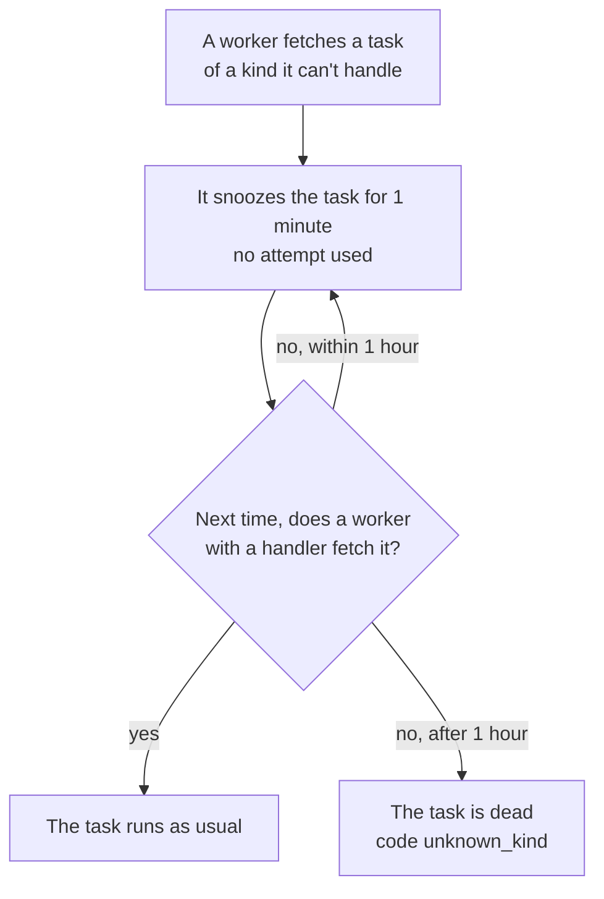

# Change a task safely

This recipe shows how to change a task's payload, kind, or queue while old
and new versions of your code run side by side, as they do during a rolling
deploy.

**Your situation:** "I need to add a field to a task, change its payload,
rename its kind, move it to another queue, or remove it. We deploy with
rolling updates, so old and new workers run together for a while."

## Which change needs what?

| Change | What to do | Deploys |
|---|---|---|
| Add an optional field | Change the struct, and handle the field's zero value | 1 |
| Remove a field | Stop reading it in the handler first, then stop setting it | 2 |
| Rename a field, or change its type or meaning | [A new kind](#make-an-incompatible-change-with-a-new-kind) | 3 |
| Rename a kind | [A new kind](#rename-a-kind) with the new name | 3 |
| Move a kind to another queue | [Workers serve both queues](#move-a-kind-to-another-queue) until the old one is empty | 2 |
| Remove a kind | [Stop enqueueing it](#remove-a-kind), wait, then remove the handler | 2 |

## What old and new code do with each other's tasks

Two rules decide what is safe:

- **A worker takes any task from the queues it serves, of any kind.** If it
  has no handler for the kind, it snoozes the task for 1 minute, and records
  a `no_handler` note. The snooze uses no attempt. If no worker with a
  handler runs the task within 1 hour, the task becomes dead with the code
  `unknown_kind`.
- **Payloads are decoded with `encoding/json`.** The handler ignores fields
  that its struct doesn't have, and fields that the payload lacks get their
  zero value. A field whose type changed doesn't decode: the task becomes
  dead right away, with the code `invalid_payload`.

This is what happens to a task that a worker has no handler for:



## Add an optional field

Add the field, and give its zero value a meaning. Tasks enqueued before the
change don't have it:

```go
type SendReceipt struct {
    OrderID int64  `json:"order_id"`
    Email   string `json:"email"`
    Locale  string `json:"locale"` // new: empty in tasks enqueued before the change
}

// In the handler:
locale := cmp.Or(t.Args.Locale, "en") // "en" for an older task
```

One deploy is enough. During the rollout, an old worker may run a new task:
it ignores the field, and sends the receipt in English. If that matters,
deploy twice: first the handler that reads the field, then the code that
sets it.

## Make an incompatible change with a new kind

Add a new kind with its own type, such as `email.send_receipt.v2`. Keep the
old handler: it converts the old payload and does the same work.

```go
// SendReceiptV2 replaces SendReceipt: an order can have several addresses.
type SendReceiptV2 struct {
    OrderID int64    `json:"order_id"`
    Emails  []string `json:"emails"`
}

func (SendReceiptV2) Kind() string { return "email.send_receipt.v2" }

func (SendReceiptV2) EnqueueDefaults() taskmill.EnqueueOptions {
    return taskmill.EnqueueOptions{Queue: "emails", MaxAttempts: 5} // as before
}
```

```go
taskmill.AddHandler(&handlers, taskmill.HandlerFunc[SendReceiptV2](
    func(ctx context.Context, t *taskmill.Task[SendReceiptV2]) error {
        return sendReceipt(ctx, t.Args)
    }), nil)
// The old kind, until no task of it is left: convert, then do the same work.
taskmill.AddHandler(&handlers, taskmill.HandlerFunc[SendReceipt](
    func(ctx context.Context, t *taskmill.Task[SendReceipt]) error {
        return sendReceipt(ctx, SendReceiptV2{OrderID: t.Args.OrderID, Emails: []string{t.Args.Email}})
    }), nil)
```

Then ship it in three deploys:

1. **Add the new handler.** Producers still enqueue the old kind. Wait until
   every worker runs this version: `Client.Workers` lists the `Kinds` that
   each worker handles.
2. **Switch the producers** to the new kind. No worker needs to snooze a
   task now.
3. **Remove the old handler and type,** once no unfinished task of the old
   kind is left. Retry or delete the old kind's dead tasks before this
   deploy, while the handler still exists.

To count the old kind's unfinished tasks, use `Count`, or filter the
dashboard's task list by kind:

```go
// unfinished counts the tasks of a kind in a queue that may still run.
func unfinished(ctx context.Context, client *taskmill.Client, queue, kind string) (int64, error) {
    counts, err := client.Count(ctx, &taskmill.TaskFilter{
        Queues: []string{queue},
        Kinds:  []string{kind},
        States: []taskmill.State{
            taskmill.StateScheduled, taskmill.StatePending, taskmill.StateAvailable,
            taskmill.StateRunning, taskmill.StateRetryable,
        },
    })
    if err != nil {
        return 0, err
    }
    var n int64
    for _, c := range counts.States {
        n += c.N
    }
    return n, nil
}
```

## Rename a kind

A rename is a new kind with the same fields, in the same three deploys.
Give the new type the same fields and the same `EnqueueDefaults` as the old
one. Then a plain Go conversion turns an old payload into a new one:

```go
// ReceiptEmail has SendReceipt's fields and EnqueueDefaults, and a new kind.
func (ReceiptEmail) Kind() string { return "orders.receipt_email" }

// Next to the handler for ReceiptEmail: the old kind, converted.
taskmill.AddHandler(&handlers, taskmill.HandlerFunc[SendReceipt](
    func(ctx context.Context, t *taskmill.Task[SendReceipt]) error {
        return sendReceiptEmail(ctx, ReceiptEmail(t.Args)) // same fields: a plain conversion
    }), nil)
```

## Move a kind to another queue

1. If the new queue needs settings, such as `MaxRunning`, set them with
   `UpdateQueue` first.
2. **Deploy:** change the queue in the kind's `EnqueueDefaults`, and list
   both queues in `WorkerConfig.Queues`. Old workers still serve the old
   queue, and new workers serve both. Tasks in the new queue wait for a new
   worker, so none is snoozed.
3. **Deploy again** once the old queue has no unfinished task of the kind:
   remove the old queue from `WorkerConfig.Queues`, if no other kind uses it.

```go
worker, err := taskmill.NewWorker(client, &taskmill.WorkerConfig{
    Handlers: &handlers,
    Queues: map[string]taskmill.QueueOptions{
        "emails":      {}, // the old queue, until it has no task of the kind
        "emails-bulk": {}, // the new queue
        "default":     {}, // and every other queue this worker served before
    },
})
```

You must list the queues: without `Queues`, a worker serves only each kind's
default queue, and no worker would run the old queue's tasks.

If the kind uses a `GroupKey`, pause the new queue with `PauseQueue` before
the first deploy, and resume it once the old queue is empty. A
[FIFO group](../concepts/glossary.md#fifo-group) lives in one queue, so
otherwise two tasks of one group, one in each queue, could run at the same
time.

## Remove a kind

1. **Deploy:** stop enqueueing the kind. Also remove every `Schedule` that
   enqueues it.
2. Wait until no unfinished task of the kind is left. Retry or delete its
   dead tasks now, while the handler still exists.
3. **Deploy again:** remove the handler and the type.

## Other options

| Option | Choose it when | The cost |
|---|---|---|
| One deploy for a new kind: handler and producers together | Your rollouts take minutes, and a short delay is fine | Old workers snooze each new task for a minute, and log a warning for each. If the rollout stops for over an hour, those tasks die |
| Stop the producers, wait until the queue is empty, then deploy | You can turn the feature off for a while | That feature is down meanwhile |
| Delete the old tasks instead of waiting | Their work is no longer needed | That work never happens |

## Watch out

> [!WARNING]
> Never rename a kind, or change a field's type, in place. Tasks that wait
> in the database die: after an hour with `unknown_kind`, or right away with
> `invalid_payload`.

- **Renaming a JSON field loses data silently.** Old tasks still decode, but
  the renamed field is empty. Treat it as an incompatible change.
- **A new kind or a new queue starts with fresh dedupe keys and groups.** A
  dedupe key belongs to one queue and kind, and a FIFO group to one queue. So
  the old keys don't catch a repeat that arrives under the new kind or
  queue.

## See also

- [Define tasks](../guides/define-tasks.md): kinds, payloads, and defaults
- [Deploys](../production/deploys.md): rolling deploys and migrations
- [`Client.Count`](https://pkg.go.dev/github.com/code19m/taskmill#Client.Count) on pkg.go.dev

**Next:** [Run long tasks](run-long-tasks.md)
