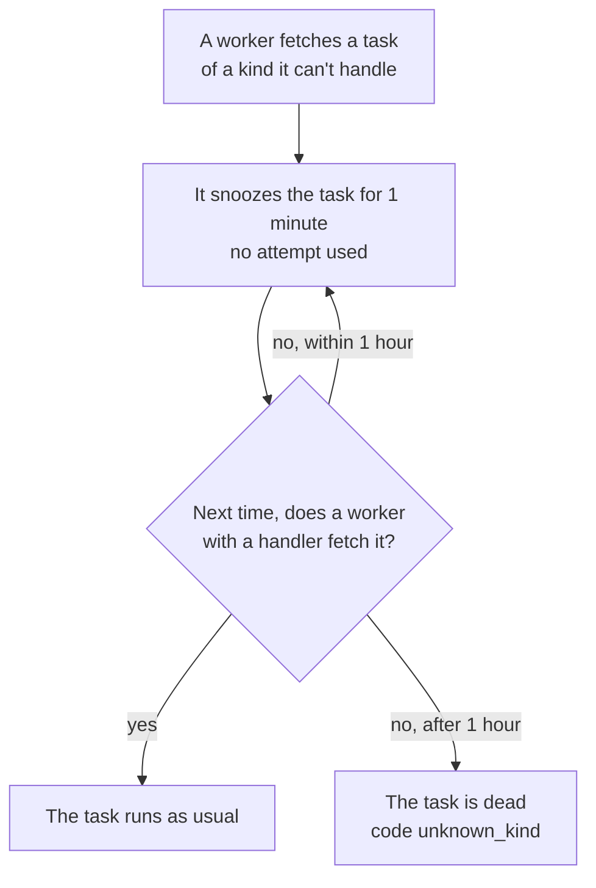

# Change a task safely

**Situation.** "I need to change a task's payload, rename its kind, move it
to another queue, or remove it. We deploy with rolling updates, so old and
new workers run side by side for a while."

## Which change needs what?

| Change | What to do | Deploys |
|---|---|---|
| Add an optional field | Give the field's zero value a meaning: older tasks don't have it. Old workers ignore it during the rollout | 1 |
| Remove a field | Stop reading it, then stop setting it | 2 |
| Rename a field, or change its type or meaning | [A new kind](#the-recommended-way-a-new-kind) | 3 |
| Rename a kind | [A new kind](#rename-a-kind) with the new name | 3 |
| Move a kind to another queue | [Workers read both queues](#move-a-kind-to-another-queue) until the old one is empty | 2 |
| Remove a kind | [Stop enqueueing it](#remove-a-kind), wait, then remove the handler | 2 |

## The recommended way: a new kind

For a change that old code can't read, add a new kind with its own type.
Here `SendReceiptV2`, with the kind `email.send_receipt.v2`, has a list of
`Emails` instead of one `Email`. Keep the old handler: it converts the old
payload and does the same work.

```go
taskmill.AddHandler(&handlers, taskmill.HandlerFunc[SendReceiptV2](
    func(ctx context.Context, t *taskmill.Task[SendReceiptV2]) error {
        return sendReceipt(ctx, t.Args)
    }), nil)
// The old kind, until no task of it is left: convert, then do the same work.
taskmill.AddHandler(&handlers, taskmill.HandlerFunc[SendReceipt](
    func(ctx context.Context, t *taskmill.Task[SendReceipt]) error {
        return sendReceipt(ctx, SendReceiptV2{OrderID: t.Args.OrderID, Emails: []string{t.Args.Email}})
    }), nil)
```

Give the new type the same `EnqueueDefaults` as the old one. Then ship the
change in three deploys:

1. **Add the new handler.** Producers still enqueue the old kind. Wait until
   every worker runs this version: `Client.Workers` lists each worker's
   `Kinds`.
2. **Switch the producers** to the new kind. Every worker can run it, so no
   task waits.
3. **Remove the old handler and type,** once no unfinished task of the old
   kind is left. Retry or delete its dead tasks before this deploy.

To check step 3, filter the dashboard's task list by kind, or count:

```go
counts, err := client.Count(ctx, &taskmill.TaskFilter{
    Queues: []string{"emails"},
    Kinds:  []string{"email.send_receipt"},
    States: []taskmill.State{taskmill.StateScheduled, taskmill.StatePending,
        taskmill.StateAvailable, taskmill.StateRunning, taskmill.StateRetryable},
})
// Remove the old handler once every count in counts.States is 0.
```

### Rename a kind

A rename is a new kind with the same fields, in the same three deploys. Copy
the old type to a new name, and change only its `Kind`. In the old handler,
a plain Go conversion, such as `ReceiptEmail(t.Args)`, turns an old payload
into a new one.

## Why: what old workers do with new tasks

Two rules decide what is safe during a rollout:

- **A worker takes every task from the queues it reads, of any kind.** If it
  has no handler for the kind, the task waits for a worker that has one, as
  the diagram below shows.
- **Payloads are decoded with `encoding/json`.** Unknown fields are ignored,
  and missing fields get their zero value. A field whose type changed
  doesn't decode: the task is dead right away, with the code
  `invalid_payload`.

A new kind avoids both problems: every task keeps a handler that can read
it. This is what happens to a task that no handler of the worker can run:



## Move a kind to another queue

1. If the new queue needs settings, such as `MaxRunning`, set them with
   `UpdateQueue`.
2. **Deploy:** change the queue in the kind's `EnqueueDefaults`, and list
   both queues in `WorkerConfig.Queues`. New tasks wait in the new queue
   until a new worker reads it.
3. **Deploy again** once the old queue has no unfinished task of the kind.
   Remove the old queue from `Queues`, if no other kind uses it.

```go
worker, err := taskmill.NewWorker(client, &taskmill.WorkerConfig{
    Handlers: &handlers,
    Queues: map[string]taskmill.QueueOptions{
        "emails":      {}, // the old queue, until it has no task of the kind
        "emails-bulk": {}, // the new queue
        "default":     {}, // and every other queue it read before: list them all
    },
})
```

If the kind uses a `GroupKey`, pause the new queue until the old one is
empty. A [FIFO group](../concepts/glossary.md#fifo-group) lives in one
queue, so two tasks of one group could otherwise run at the same time.

## Remove a kind

1. **Deploy:** stop enqueueing the kind. Remove every `Schedule` that
   enqueues it too.
2. Wait until no unfinished task of the kind is left. Retry or delete its
   dead tasks now, while the handler still exists.
3. **Deploy again:** remove the handler and the type.

## Other options

| Option | When it fits | The cost |
|---|---|---|
| A new kind in one deploy: handler and producers together | Rollouts take minutes, and a short delay is fine | Old workers snooze each new task for a minute. If the rollout stops for over an hour, those tasks die |
| Stop the producers, wait until the queue is empty, then deploy | You can turn the feature off for a while | That feature is down meanwhile |

## Watch out

> [!WARNING]
> Never rename a kind, or change a field's type, in place. Waiting tasks
> die: after an hour with `unknown_kind`, or right away with
> `invalid_payload`.

- **Renaming a JSON field loses data silently.** Old tasks still decode,
  but the renamed field is empty. Treat it as a type change.
- **A new kind or queue starts with fresh dedupe keys and groups.** Old keys
  don't catch a repeat that arrives under the new kind or queue.

## See also

- [Define tasks](../guides/define-tasks.md): kinds, payloads, and defaults
- [Deploys](../production/deploys.md): rolling deploys and migrations
- [`Client.Count`](https://pkg.go.dev/github.com/code19m/taskmill#Client.Count) on pkg.go.dev

**Next:** [Run long tasks](run-long-tasks.md)
