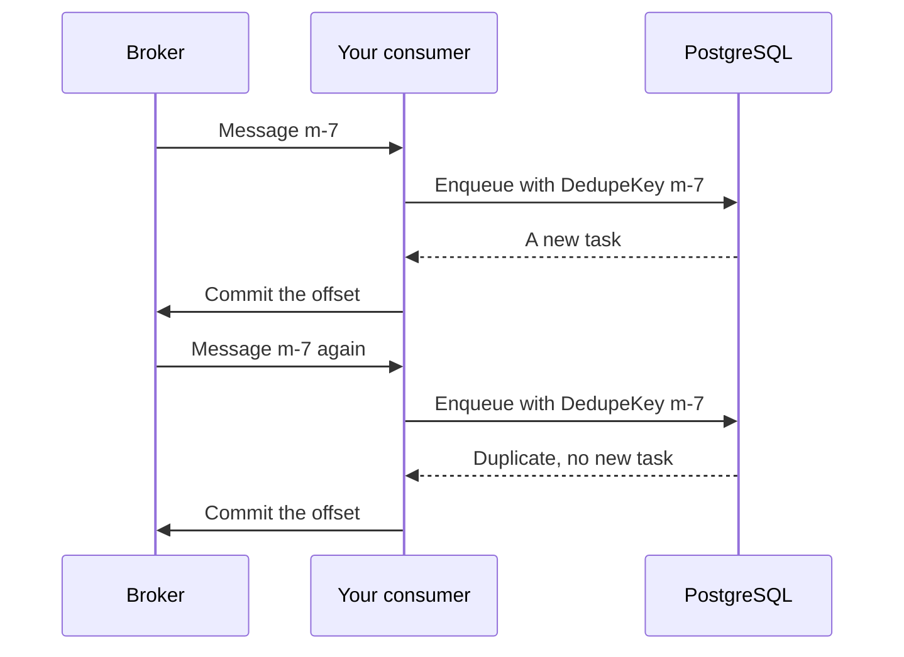

# Consume from a broker

This recipe shows how to act on messages from Kafka, NATS, or RabbitMQ: each
message becomes a task, and a message that arrives twice doesn't make a
second task.

**Your situation:** "Our billing service reads order events from Kafka. The
broker can deliver a message twice, for example after our consumer
restarts. Each event must create one invoice."

## The preferred way

Use the [inbox](../concepts/glossary.md#inbox) pattern. For each message,
enqueue one task with the message ID as its
[dedupe key](../concepts/glossary.md#dedupe-key). Commit the broker offset
only after the enqueue.

```go
// ApplyOrderEvent applies one event from the orders topic.
type ApplyOrderEvent struct {
    Event json.RawMessage `json:"event"`
}

func (ApplyOrderEvent) Kind() string { return "billing.apply_order_event" }

// consume runs for every message that the broker delivers.
func (c *Consumer) consume(ctx context.Context, msg Message) error {
    _, err := c.client.Enqueue(ctx, ApplyOrderEvent{Event: msg.Value}, &taskmill.EnqueueOptions{
        DedupeKey:    msg.ID,             // the same message again: no second task
        DedupeWindow: 8 * 24 * time.Hour, // longer than the broker keeps messages
    })
    if err != nil {
        return err // no commit: the broker delivers the message again
    }
    return c.reader.Commit(ctx, msg) // only after the task exists
}
```

This is what happens when the broker delivers the same message twice:



## Why

- **A message never gets lost.** You commit only after the task exists. If
  the consumer crashes before the commit, the broker delivers the message
  again.
- **A repeated message makes no second task.** The enqueue returns the
  existing task, with `Duplicate` set, instead of an error. This works even
  when two consumers enqueue the same message at the same moment.
- **The work runs as a task.** It gets retries with backoff, a dead task for
  a person when it can't succeed, and a place in the dashboard. The consumer
  only enqueues, so it stays fast.
- **The handler still runs at least once.** Make it safe to run twice, as
  [Do work once](do-work-once.md) shows.

## Which message ID?

The ID must stay the same when the broker delivers the message again.

| The messages come from | Use as the ID |
|---|---|
| taskmill's [outbox](../guides/outbox.md) in another service | `Delivery.ID`, which the publisher sends, for example in a header. It is a UUIDv7 that stays the same across retries. |
| Another producer | An ID that the producer sets, such as a message ID header. For Kafka, the topic, partition, and offset together also work. |

## Other options

| Option | Choose it when | The cost |
|---|---|---|
| `EnqueueMany` for a batch of messages, then one commit | You read messages in batches | None: a failed call means the broker sends the batch again, and the keys catch the repeats |
| `EnqueueTx` in your own transaction | The consumer also writes to your database | Keep the transaction short: other enqueues with the same key wait for it |
| A `GroupKey` per order as well | One order's events must apply in order | A dead event halts that order's later events ([Keep order per key](keep-order-per-key.md)) |
| Do the work in the consumer, with no task | The work is quick, and safe to repeat | No retries with backoff, no dead tasks, no dashboard; a slow message holds up the others |

## Watch out

- **Make `DedupeWindow` longer than the broker can redeliver a message,**
  such as Kafka's retention. The window counts from the enqueue. After it
  ends, the same message ID makes a new task.
- **Canceling or deleting a task frees its key right away.** A later
  redelivery of that message then makes a new task.
- **A key belongs to one queue and one kind.** If you rename the kind or move
  it to another queue, the old keys no longer catch repeats. See
  [Change a task safely](change-a-task-safely.md).

## See also

- [Avoid duplicate tasks](../guides/deduplication.md): dedupe keys and windows in detail
- [Publish events with the outbox](../guides/outbox.md): the sending side
- [`EnqueueOptions.DedupeKey`](https://pkg.go.dev/github.com/code19m/taskmill#EnqueueOptions) on pkg.go.dev

**Next:** [Change a task safely](change-a-task-safely.md)
