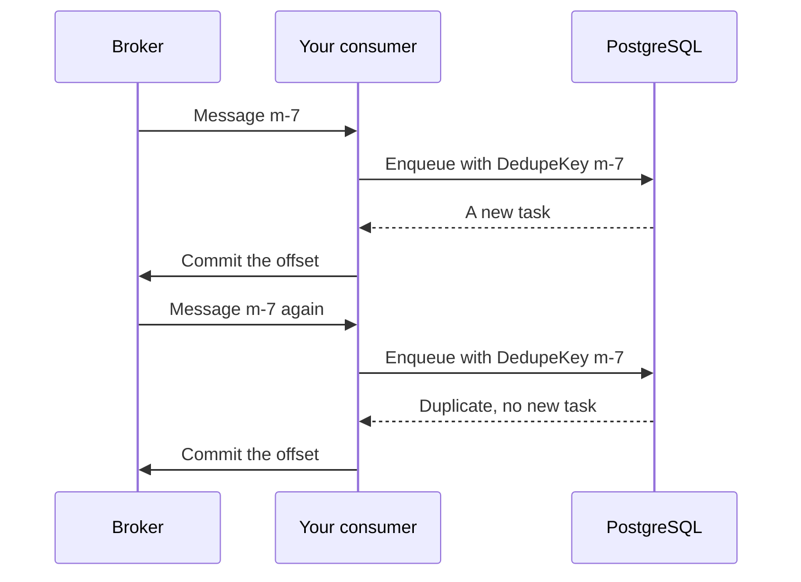

# Consume from a broker

**Situation.** "Our billing service reads order events from Kafka. The
broker can deliver a message twice, for example after our consumer
restarts. Each event must create one invoice."

## The recommended way

Use the [inbox](../concepts/glossary.md#inbox): enqueue one task per
message, with the message ID as its
[dedupe key](../concepts/glossary.md#dedupe-key). Commit the broker offset
only after the enqueue:

```go
func (c *Consumer) consume(ctx context.Context, msg Message) error {
    _, err := c.client.Enqueue(ctx, ApplyOrderEvent{Event: msg.Value}, &taskmill.EnqueueOptions{
        DedupeKey:    msg.ID,             // the same message again: no second task
        DedupeWindow: 8 * 24 * time.Hour, // longer than the broker keeps messages
    })
    if err != nil {
        return err // no commit: the broker delivers the message again
    }
    return c.reader.Commit(ctx, msg) // only after the task exists
}
```

This is what happens when the broker delivers a message twice:



## Why

- **No message gets lost.** You commit only after the task exists. If the
  consumer crashes before the commit, the broker sends the message again.
- **A repeated message makes no second task,** even when two consumers
  enqueue it at the same moment. The enqueue returns the existing task, with
  `Duplicate` set.
- **The work gets retries, dead tasks, and the dashboard.** The consumer
  only enqueues, so it stays fast. The handler still runs at least once:
  make it safe to run twice ([Do work once](do-work-once.md)).

The message ID must stay the same when the broker delivers the message
again. From taskmill's [outbox](../guides/outbox.md), use `Delivery.ID`.
From another producer, use an ID that the producer sets. For Kafka, the
topic, partition, and offset together also work.

## Other options

| Option | When it fits | The cost |
|---|---|---|
| `EnqueueMany` for a batch of messages, then one commit | You read messages in batches | None: if the call fails, the broker sends the batch again |
| A `GroupKey` per order as well | One order's events must apply in order | A dead event halts that order's later events ([Keep order per key](keep-order-per-key.md)) |
| Do the work in the consumer, with no task | The work is quick, and safe to repeat | No retries, no dead tasks, no dashboard. A slow message blocks the others |

## Watch out

- **Make `DedupeWindow` longer than the broker may redeliver,** such as
  Kafka's retention. The window counts from the enqueue. After it ends, the
  same message ID makes a new task.
- **Canceling or deleting a task frees its key right away.** If the message
  arrives again later, it makes a new task.
- **A key belongs to one queue and one kind.** If you rename the kind or
  move it to another queue, old keys no longer catch repeats.

## See also

- [Avoid duplicate tasks](../guides/deduplication.md): dedupe keys and windows in detail
- [Publish events with the outbox](../guides/outbox.md): the sending side
- [`EnqueueOptions`](https://pkg.go.dev/github.com/code19m/taskmill#EnqueueOptions) on pkg.go.dev

**Next:** [Change a task safely](change-a-task-safely.md)
