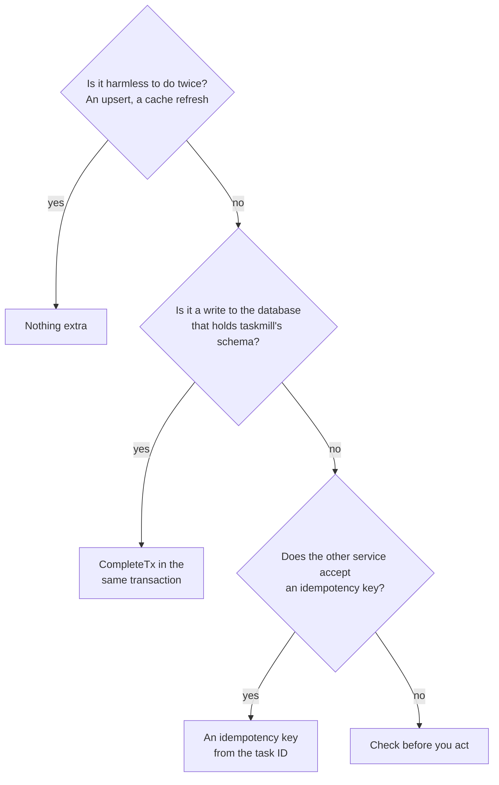

# Do work once

A task can run twice. This recipe shows how to make its effects happen once
anyway: a payment, a row in your database, or the next task.

**Your situation:** "My task charges a card and marks the order paid. A
worker can crash right after the charge, and then the task runs again. The
customer must pay only once."

## Which should I use?

Ask these questions for each effect of your task.



A task often has several effects. Then use one answer for each, as the
handler below does.

## The preferred way

This handler charges the card with an idempotency key. Then, in one
transaction, it marks the order paid, enqueues the receipt, and completes
the task.

```go
type Charger struct {
    pool     *pgxpool.Pool
    client   *taskmill.Client
    payments Payments // your payment provider's API
}

func (c *Charger) Handle(ctx context.Context, t *taskmill.Task[ChargeOrder]) error {
    // 1. Outside effect: the provider charges each key once.
    //    The task ID stays the same on every attempt.
    key := "shop/taskmill/" + strconv.FormatInt(t.ID, 10)
    if err := c.payments.Charge(ctx, t.Args.OrderID, key); err != nil {
        return err // retried with backoff
    }

    // 2. Database effects: they commit together with the task's completion.
    return pgx.BeginFunc(ctx, c.pool, func(tx pgx.Tx) error {
        if _, err := tx.Exec(ctx, "UPDATE orders SET paid_at = now() WHERE id = $1", t.Args.OrderID); err != nil {
            return err
        }
        // The next step exists only if this one completes.
        if _, err := c.client.EnqueueTx(ctx, taskmill.Pgx(tx), SendReceipt{OrderID: t.Args.OrderID}, nil); err != nil {
            return err
        }
        return t.CompleteTx(ctx, taskmill.Pgx(tx)) // ErrLeaseLost rolls it all back
    })
}
```

## Why

- taskmill runs every task [at least once](../concepts/glossary.md#at-least-once).
  A worker can crash after the work but before it records the result. Then
  another worker runs the task again.
  [Guarantees](../concepts/guarantees.md) lists every case.
- The task ID is the same on every attempt. So the provider sees the same
  key each time, and charges only once.
- A task ID is unique only inside one taskmill schema, and the provider has
  other clients. So the key also names your service and your schema:
  `shop/taskmill/42`.
- `CompleteTx` completes the task inside your transaction. The update, the
  receipt task, and the completion commit together, or not at all. If
  another attempt took the task over, `CompleteTx` returns `ErrLeaseLost`,
  and the whole transaction rolls back. So there is one receipt task, never two.

## Other options

| Option | Choose it when | The cost |
|---|---|---|
| Nothing extra | Doing it twice is harmless: an upsert, setting a value, a cache refresh | None |
| `CompleteTx` alone | Every effect is a write to the same database | None: the writes happen exactly once |
| A key from your own data, such as `charge-order-42` | The action must happen once per order, even if two tasks for one order exist | You can't charge the same order a second time on purpose |
| Check before you act | The other side has no idempotency key, and a rare repeat is fine, as for an email | A crash between the act and its record still repeats the act |

To check before you act, record what you did, and look at that record
first:

```go
func (s *ReceiptSender) Handle(ctx context.Context, t *taskmill.Task[SendReceipt]) error {
    var sent bool
    err := s.pool.QueryRow(ctx, "SELECT receipt_sent_at IS NOT NULL FROM orders WHERE id = $1", t.Args.OrderID).Scan(&sent)
    if err != nil || sent {
        return err // nil if an earlier attempt sent it
    }
    if err := s.mailer.Send(ctx, t.Args.OrderID); err != nil {
        return err
    }
    _, err = s.pool.Exec(ctx, "UPDATE orders SET receipt_sent_at = now() WHERE id = $1", t.Args.OrderID)
    return err
}
```

## Watch out

- **Call the outside service before the transaction, not inside it.** A
  rollback can't undo a charge. And a transaction that stays open while you
  wait for the network slows down the whole queue
  ([Database](../production/database.md)).
- **Providers keep keys for a limited time,** often a day. A task that runs
  again later, such as a dead task that someone retries a week later, may
  charge again. Check what old dead tasks already did before you retry them.
- **`CompleteTx` needs a transaction.** Pass a `pgx.Tx` or a `*sql.Tx`, not a
  pool. Return its error, so that your transaction rolls back.

## See also

- [Use your own transactions](../guides/transactions.md): `EnqueueTx` and `CompleteTx` in detail
- [Guarantees](../concepts/guarantees.md): when a task can run twice
- [`Task.CompleteTx`](https://pkg.go.dev/github.com/code19m/taskmill#Task.CompleteTx) on pkg.go.dev

**Next:** [Call a rate-limited API](call-a-rate-limited-api.md)
