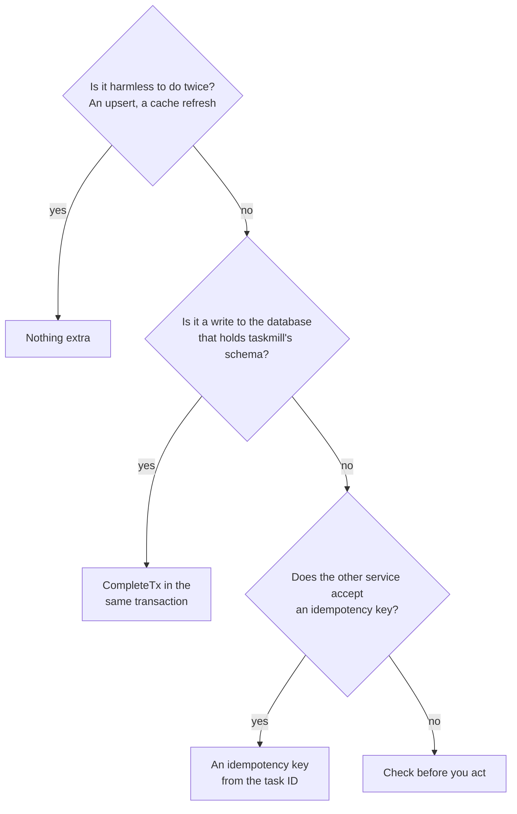

# Do work once

**Situation.** "My task charges a card and marks the order paid. A worker
can crash right after the charge, and then the task runs again. The customer
must pay only once."

## Which should I use?

A task can run twice. Ask these questions for each effect of your task:



Most tasks have several effects. Use one answer for each, as the handler
below does.

## The recommended way

Charge the card with an idempotency key made from the task ID. Then, in one
transaction, mark the order paid, enqueue the receipt, and complete the task:

```go
func (c *Charger) Handle(ctx context.Context, t *taskmill.Task[ChargeOrder]) error {
    // 1. The outside effect: the provider charges each key only once.
    key := "shop/taskmill/" + strconv.FormatInt(t.ID, 10)
    if err := c.payments.Charge(ctx, t.Args.OrderID, key); err != nil {
        return err // retried with backoff
    }

    // 2. The database effects: they commit together with the completion.
    return pgx.BeginFunc(ctx, c.pool, func(tx pgx.Tx) error {
        if _, err := tx.Exec(ctx, "UPDATE orders SET paid_at = now() WHERE id = $1", t.Args.OrderID); err != nil {
            return err
        }
        if _, err := c.client.EnqueueTx(ctx, taskmill.Pgx(tx), SendReceipt{OrderID: t.Args.OrderID}, nil); err != nil {
            return err
        }
        return t.CompleteTx(ctx, taskmill.Pgx(tx)) // ErrLeaseLost rolls it all back
    })
}
```

## Why

- A task runs [at least once](../concepts/glossary.md#at-least-once). A
  worker can crash after the work, before it saves the result. Then the task
  runs again. [Guarantees](../concepts/guarantees.md) lists every case.
- The task ID is the same on every attempt, so the provider sees the same
  key and charges only once. A task ID is unique only inside one taskmill
  schema, so the key also names your service and schema.
- `CompleteTx` commits the update, the receipt task, and the completion
  together, or not at all. If another attempt took the task over, it returns
  `ErrLeaseLost`, and everything rolls back. So there is never a second
  receipt task.

## Other options

| Option | When it fits | The cost |
|---|---|---|
| Nothing extra | Doing it twice is harmless: an upsert, a cache refresh | None |
| A key from your own data, such as `charge-order-42` | The action must happen once per order, even if two tasks exist for one order | You can't charge the same order again on purpose |
| Check before you act | The other side has no idempotency key, and a rare repeat is fine, as for an email | A crash between the action and its record still repeats the action |

To check before you act, save what you did, and read it first:

```go
func (s *ReceiptSender) Handle(ctx context.Context, t *taskmill.Task[SendReceipt]) error {
    var sent bool
    err := s.pool.QueryRow(ctx, "SELECT receipt_sent_at IS NOT NULL FROM orders WHERE id = $1", t.Args.OrderID).Scan(&sent)
    if err != nil || sent {
        return err // nil if an earlier attempt sent it
    }
    if err := s.mailer.Send(ctx, t.Args.OrderID); err != nil {
        return err
    }
    _, err = s.pool.Exec(ctx, "UPDATE orders SET receipt_sent_at = now() WHERE id = $1", t.Args.OrderID)
    return err
}
```

## Watch out

- **Call the outside service before the transaction, not inside it.** A
  rollback can't undo a charge. And a transaction that waits for the network
  slows down the whole queue ([Database](../production/database.md)).
- **Providers keep keys for a limited time,** often a day. If someone
  retries a dead task a week later, it may charge again. Check what a dead
  task already did before you retry it.
- **`CompleteTx` needs a transaction:** a `pgx.Tx` or a `*sql.Tx`, not a
  pool. Return its error, so that your transaction rolls back.

## See also

- [Use your own transactions](../guides/transactions.md): `EnqueueTx` and `CompleteTx` in detail
- [Guarantees](../concepts/guarantees.md): when a task can run twice
- [`Task.CompleteTx`](https://pkg.go.dev/github.com/code19m/taskmill#Task.CompleteTx) on pkg.go.dev

**Next:** [Call a rate-limited API](call-a-rate-limited-api.md)
