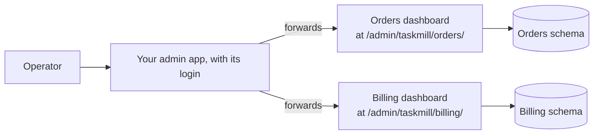

# One dashboard for many services

**Situation.** "We have five services, each with its own taskmill schema.
Our operators want one admin app, with one login, for all of them. Some
people may only look. Others may retry and delete tasks."

## Which should I use?

| Your setup | Use | Why |
|---|---|---|
| The services are written in Go | **Each service mounts its [dashboard](../concepts/glossary.md#dashboard) with `ui.New`,** on an internal address. The admin app forwards a path to each | Each dashboard runs its own service's taskmill version |
| A service isn't written in Go | `taskmill-ui` next to that service, with `TASKMILL_UI_PREFIX` and `TASKMILL_SCHEMA`. The admin app forwards the same way | No Go code needed |
| All schemas are in one database, and the admin app is in Go | The admin app mounts one `ui.New` per schema itself | Fewer moving parts, but its taskmill version must fit every schema |

## The recommended way

Each service serves its own dashboard. The admin app forwards one path to
each, behind its own login:



**In each service,** mount two handlers: one that can act, and one that is
read-only. Pick one per request, from a header that the admin app sets:

```go
const prefix = "/admin/taskmill/orders"
operate, err := ui.New(client, &ui.Config{Prefix: prefix, Logger: logger})
// ...
view, err := ui.New(client, &ui.Config{Prefix: prefix, Logger: logger, ReadOnly: true})
// ...
// On an address that only the admin app reaches.
mux.Handle(prefix+"/", http.HandlerFunc(func(w http.ResponseWriter, r *http.Request) {
    if r.Header.Get("X-Dashboard-Role") == "operator" {
        operate.ServeHTTP(w, r)
        return
    }
    view.ServeHTTP(w, r) // read-only unless the admin app says otherwise
}))
```

**In the admin app,** forward the path unchanged, set the role, and log who
acted:

```go
ordersURL, err := url.Parse("http://orders.internal:9090") // no path: forward it unchanged
// ...
orders := httputil.NewSingleHostReverseProxy(ordersURL)
mux.Handle("/admin/taskmill/orders/", requireAdmin(http.HandlerFunc(func(w http.ResponseWriter, r *http.Request) {
    role := "viewer"
    if canOperate(r) {
        role = "operator"
    }
    r.Header.Set("X-Dashboard-Role", role) // replaces any value the browser sent
    if r.Method == http.MethodPost {       // every action is a POST
        logger.InfoContext(r.Context(), "dashboard action", "user", userOf(r), "path", r.URL.Path)
    }
    orders.ServeHTTP(w, r)
})))
```

## Why

- **Forward the path unchanged.** The dashboard strips its `Prefix` itself,
  and builds its links with it. So don't use `http.StripPrefix`, and give
  the proxy a URL without a path.
- **Each dashboard runs its service's taskmill version,** so it always fits
  its schema, and each service upgrades on its own.
- **`ReadOnly` applies to a whole handler.** Two handlers, picked per
  request, give viewers and operators different rights. A missing header
  means read-only, which is the safe default.
- **Every action is a `POST` through the admin app,** so the admin app can
  log the user. Each service's `ui.Config.Logger` also logs the action and
  its target, and for a bulk action, how many tasks it changed.

## Show one overview of all services

For one page of key numbers, let each service report its queues, and show
them together in the admin app:

```go
// In each service, on its internal address.
mux.HandleFunc("GET /internal/queues", func(w http.ResponseWriter, r *http.Request) {
    queues, err := client.Queues(r.Context())
    if err != nil {
        http.Error(w, "list queues failed", http.StatusServiceUnavailable)
        return
    }
    _ = json.NewEncoder(w).Encode(queues) // counts per state, and lag
})
```

## Other options

| Option | When it fits | The cost |
|---|---|---|
| `taskmill-ui` next to each service | Not all your code is Go | One more deployment per service. It has one shared login, so its own logs can't say who acted |
| The admin app mounts a `ui.New` per schema | All schemas share one database, and you upgrade them together | Its taskmill version must be no newer than the oldest schema, and at most one release older than the newest |
| A dashboard per service, each with its own login | Each team runs only its own service | No single place to look |

## Watch out

> [!WARNING]
> The service's dashboard address has no login of its own. Make sure only
> the admin app can reach it. Anyone else who reaches it can set the role
> header too.

- **Pin `taskmill-ui` to your services' taskmill version.** A newer one
  fails on an older schema with `ErrSchemaOutdated`.
- **Counts in `Client.Queues` stop at 10,000 per state.** Lag has no limit,
  so compare services by lag.

## See also

- [The dashboard](../guides/dashboard.md): mounting, `taskmill-ui`, and adding the user to action logs
- [Split work across services](split-across-services.md): one schema per service
- [`ui.Config`](https://pkg.go.dev/github.com/code19m/taskmill/ui#Config) on pkg.go.dev

**Next:** [Use your own migration tool](use-your-migration-tool.md)
