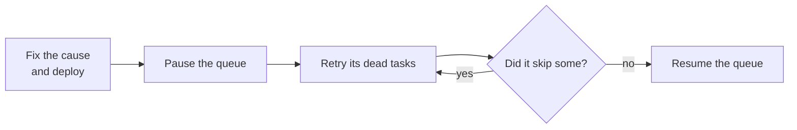

# Recover from an incident

**Situation.** "A bug in last night's release made 5,000 receipt tasks fail
until they were dead. We have deployed a fix. Now we want to run them again,
without hurting the new work."

## The recommended way

Fix the cause, pause the queue, retry its dead tasks, and resume the queue:



**In the dashboard:**

1. Find the cause in a dead task's errors. Deploy the fix to every worker.
2. On the overview, choose **Pause** for the queue. Running tasks finish,
   and no new ones start.
3. Open the task list. Filter by the queue and the state *dead*, and by the
   kind if other kinds died for other reasons. Choose **Retry all**. If the
   page says that other work held some tasks, try again for those.
4. Choose **Resume** for the queue when you are ready for the load.

**From code,** for example in an admin command:

```go
// retryDead retries the dead tasks of one queue, after the cause is fixed.
func retryDead(ctx context.Context, client *taskmill.Client, queue string) error {
    if err := client.PauseQueue(ctx, queue); err != nil { // 1. hold the retried tasks
        return err
    }
    params := &taskmill.BulkParams{Filter: taskmill.TaskFilter{
        Queues: []string{queue},
        States: []taskmill.State{taskmill.StateDead}, // not the canceled ones
    }}
    for range 5 { // 2. retry; run again for the tasks that other work held
        res, err := client.RetryMatching(ctx, params)
        if err != nil {
            return err
        }
        log.Printf("retried %d tasks, skipped %d", res.Changed, res.Skipped)
        if res.Skipped == 0 {
            break
        }
    }
    return client.ResumeQueue(ctx, queue) // 3. let them run
}
```

## Why

- **A retried task is ready to run right away,** with a fresh set of
  attempts. Thousands of them would compete with new work. The pause lets
  you choose when they run.
- **While the queue is paused, a retried task can't die again.** So running
  `RetryMatching` again for the skipped tasks never retries a task twice.
- **FIFO groups stay in order.** Retrying the dead task that halts a
  [group](../concepts/glossary.md#halted-group) lets the group continue, and
  a bulk retry keeps each group's order.
- **Each task keeps its ID.** So an idempotency key made from the task ID
  still protects what the task did before it died
  ([Do work once](do-work-once.md)).

## Other options

| Option | When it fits | The cost |
|---|---|---|
| Retry without a pause | There are few tasks, or the queue is quiet | The retried tasks compete with new ones |
| A low `MaxRunning` instead of the pause, removed later | New work must keep running during the recovery | Everything in the queue runs slower meanwhile |
| `DeleteMatching` | The dead tasks' work is no longer needed | No record is kept, and you can't undo it |
| Leave the dead tasks | The work is no longer useful | They stay until the dead-task retention ends: 30 days by default |

## Watch out

- **Filter by the state `dead`.** `RetryMatching` retries dead and canceled
  tasks. Without the state, it also runs tasks that someone canceled on
  purpose.
- **A pause stops new work in the queue too.** Its lag grows, and lag alerts
  can fire. Keep the pause short.
- **Check that the fix works first.** Retry one task, and check that it
  completes. Tasks that fail again for the same reason get a fresh set of
  attempts: by default, about 13 more hours of retries.

## See also

- [Manage tasks from code](../guides/operations-api.md): bulk actions in detail
- [Keep order per key](keep-order-per-key.md): fix one halted group
- [`Client.RetryMatching` example](https://pkg.go.dev/github.com/code19m/taskmill#example-Client.RetryMatching) on pkg.go.dev

**Next:** [Split work across services](split-across-services.md)
