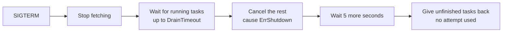

# Run long tasks

This recipe shows which time limits to set when tasks take minutes or hours,
and what happens to a running task when you deploy or scale down.

**Your situation:** "Our report task takes 5 to 10 minutes. With the
defaults, it fails after a minute, and every deploy seems to start it
over."

## Which should I use?

| Your tasks take | What to set | Why |
|---|---|---|
| Up to a minute | Nothing: the defaults fit | A deploy waits about 20 seconds for running tasks. A task cut off then starts over on another worker, which is cheap for short tasks |
| A few minutes | `Timeout` above the slowest run, and a longer `DrainTimeout` and grace period | Deploys and scale-downs then wait for most tasks to finish |
| Longer than you want a deploy to wait | Split the work into smaller tasks | A deploy then loses at most one small piece |

## The preferred way

Set the handler's `Timeout` a little above the task's slowest normal run.
Raise the worker's `DrainTimeout` so that most runs finish during a deploy:

```go
taskmill.AddHandler(&handlers, &ReportBuilder{}, &taskmill.HandlerOptions{
    Timeout: 15 * time.Minute, // a little above the slowest normal run
})
worker, err := taskmill.NewWorker(client, &taskmill.WorkerConfig{
    Handlers:     &handlers,
    DrainTimeout: 5 * time.Minute, // so most runs finish during a deploy
})
```

Then give the process at least `DrainTimeout` plus 10 seconds to stop. In
Kubernetes, that is `terminationGracePeriodSeconds: 310` for this worker.

## Why

- **`Timeout` stops a stuck attempt,** so it frees its place in the worker.
  It is 1 minute by default, and you can't turn it off. When it passes, the
  handler's context is canceled. An error returned then counts as a failed
  attempt, retried later. Returning `nil` still completes the task.
- **The lease does not limit a task's length.** The worker renews its
  [lease](../concepts/glossary.md#lease) every few seconds while the task
  runs.
- **A deploy or a scale-down stops a worker the same way.**

This is what a worker does after `SIGTERM`:



A task given back starts over on another worker, from the beginning. A
handler that returns `nil` after the cancel still completes its task.

## Split work that takes hours

Process one page of work per task. Each task enqueues the next page in the
same transaction that completes it:

```go
// ExportOrders exports orders in pages: one task per page.
type ExportOrders struct {
    AfterID int64 `json:"after_id"` // the last order of the previous page
}

func (e *Exporter) Handle(ctx context.Context, t *taskmill.Task[ExportOrders]) error {
    lastID, err := e.exportPage(ctx, t.Args.AfterID) // 1,000 orders: about a minute
    if err != nil {
        return err
    }
    if lastID == 0 {
        return nil // no orders left: the export is done
    }
    // A short transaction: the next page exists only if this one completes.
    return pgx.BeginFunc(ctx, e.pool, func(tx pgx.Tx) error {
        if _, err := e.client.EnqueueTx(ctx, taskmill.Pgx(tx), ExportOrders{AfterID: lastID}, nil); err != nil {
            return err
        }
        return t.CompleteTx(ctx, taskmill.Pgx(tx))
    })
}
```

A deploy then waits for one page at most, and a failure retries one page,
not the whole export. Make each page safe to run twice, as
[Do work once](do-work-once.md) shows.

## Other options

| Option | Choose it when | The cost |
|---|---|---|
| A `DrainTimeout` as long as the longest run | Runs take up to half an hour, and you deploy rarely | Every deploy and scale-down waits that long |
| Save progress when the context's cause is `ErrShutdown`, then return an error | The work can resume from saved progress | You store the progress yourself. The task goes back without using an attempt |
| Accept restarts | Work is cheap to redo | Wasted work at each deploy |
| A queue of its own for long tasks | Long tasks must not take all the places that short tasks need | One more queue to run and watch |

## Watch out

- **Respect the context.** A handler that ignores its canceled context keeps
  running after the worker gave its task back. Another worker may then run
  the same task at the same time.
- **The grace period must be at least `DrainTimeout` plus 10 seconds.** If the
  platform kills the worker sooner, its running tasks wait for their leases
  to run out, and their attempts count as failed.
- **Scale-downs drain too.** An autoscaler that removes a worker stops its
  long tasks after `DrainTimeout`. See [Autoscaling](../production/autoscaling.md).

## See also

- [Workers and queues](../guides/workers-and-queues.md): shutdown in detail
- [Kubernetes](../production/kubernetes.md): the grace period and probes
- [`HandlerOptions`](https://pkg.go.dev/github.com/code19m/taskmill#HandlerOptions) and [`WorkerConfig.DrainTimeout`](https://pkg.go.dev/github.com/code19m/taskmill#WorkerConfig) on pkg.go.dev

**Next:** [Recover from an incident](recover-from-an-incident.md)
