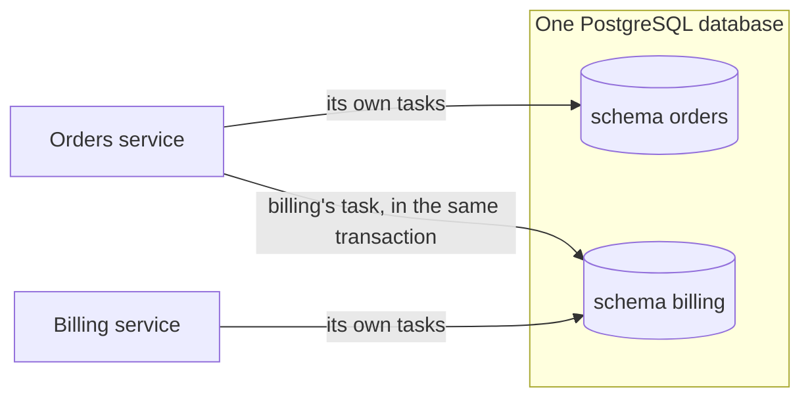

# Split work across services

**Situation.** "We have an orders service and a billing service, and both
use taskmill. When an order is placed, billing must create an invoice. Do
the services share one taskmill schema?"

## Which should I use?

| Your services | Use | Why |
|---|---|---|
| Share one PostgreSQL database | **One [schema](../concepts/glossary.md#schema) per service.** Enqueue for another service with a `Client` for its schema | The order and the invoice task commit in one transaction |
| Each have their own database | One schema per service. The [outbox](../guides/outbox.md) on the sending side, the [inbox](consume-from-a-broker.md) on the receiving side | No transaction spans two databases |
| Are parts of one app, such as a web process and a worker built from the same code | One schema for the app | It is one app, with one set of tasks |

## The recommended way

Each service migrates and uses its own schema. The orders service also
creates a `Client` for billing's schema, only to enqueue billing's tasks:



```go
// In the orders service: its own schema, and a client for billing's schema.
if err := taskmill.Migrate(ctx, pool, &taskmill.MigrateConfig{Schema: "orders"}); err != nil {
    return err
}
orders, err := taskmill.NewClient(ctx, pool, &taskmill.ClientConfig{Schema: "orders"})
// ...
billing, err := taskmill.NewClient(ctx, pool, &taskmill.ClientConfig{Schema: "billing"})
// ...

err = pgx.BeginFunc(ctx, pool, func(tx pgx.Tx) error {
    if err := saveOrder(ctx, tx, order); err != nil {
        return err
    }
    if _, err := orders.EnqueueTx(ctx, taskmill.Pgx(tx), SendReceipt{OrderID: order.ID}, nil); err != nil {
        return err
    }
    _, err := billing.EnqueueTx(ctx, taskmill.Pgx(tx), billingtasks.CreateInvoice{OrderID: order.ID}, nil)
    return err // billing's task commits with the order
})
```

`billingtasks` is a small Go package of billing's task types, with their
kinds and defaults. It is a contract between the two services. Change it as
[Change a task safely](change-a-task-safely.md) says: billing's workers
first.

## Why one schema per service

- **Each service keeps its own schedules.** In a shared schema, only the
  [maintainer's](../concepts/glossary.md#maintainer) schedules run. If it
  has schedules of its own, it even deletes the others after a day. They
  stop with no error.
- **Each service runs only its own tasks.** In a shared schema, a worker
  takes tasks of any kind from its queues. If both services use the
  `default` queue, each one fetches the other's tasks and snoozes them. Those
  tasks wait longer, and can die after an hour.
- **Each service upgrades on its own.** Otherwise retention, the dashboard,
  and the taskmill version are shared too.

## Check versions and privileges

- **Upgrade taskmill in billing first.** If the orders service's taskmill is
  newer than billing's schema, its `NewClient` for billing fails with
  `ErrSchemaOutdated`. Older code on a newer schema works for one release
  ([Compatibility](../reference/compatibility.md)).
- **If the services use different database roles,** the orders role needs
  these rights to enqueue into billing's schema:

  ```sql
  GRANT USAGE ON SCHEMA billing TO orders;
  GRANT SELECT ON billing.migrations TO orders;
  GRANT SELECT, INSERT ON billing.tasks TO orders;
  GRANT SELECT, INSERT, UPDATE ON billing.groups, billing.dedupe_keys TO orders;
  GRANT USAGE ON SEQUENCE billing.tasks_id_seq TO orders;
  ```

  These tables are internal, so a later release may need more. The error
  `permission denied for table …` then names the table.

## Other options

| Option | When it fits | The cost |
|---|---|---|
| A database per service, with the outbox and the inbox | Your services must not share a database | A broker between them, and no shared transaction |
| A task in orders that calls billing's HTTP API | Billing already has an API for this | The task may call twice, so billing's API must accept an idempotency key |
| One shared schema for all services | Never, for separate services | Schedules stop, tasks wait or die, and every upgrade is shared |

## Watch out

- **Run no worker on the client for billing's schema.** It only enqueues. A
  worker there would join billing's maintainer election. While it leads,
  billing's schedules don't run.
- **Services in one database pay a little for each other.** PostgreSQL wakes
  every listening connection in the database for each notification,
  whatever its schema. With 100 schemas and 500 workers, the maintainers'
  heartbeats cost about a quarter of a CPU.

## See also

- [Set up the database and client](../guides/setup.md): the `Schema` option
- [Publish events with the outbox](../guides/outbox.md): for a database per service
- [`ClientConfig`](https://pkg.go.dev/github.com/code19m/taskmill#ClientConfig) on pkg.go.dev

**Next:** [One dashboard for many services](one-dashboard-for-many-services.md)
