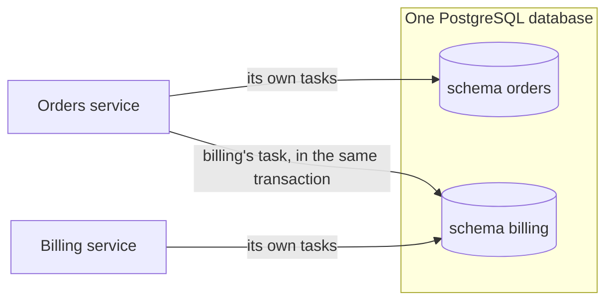

# Split work across services

This recipe shows how several services use taskmill side by side, and how
one service gives work to another.

**Your situation:** "We have an orders service and a billing service. Both
use taskmill. When an order is placed, billing must create an invoice. Do
the services share one taskmill schema?"

## Which should I use?

| Your services | Use | Why |
|---|---|---|
| Share one PostgreSQL database | One [schema](../concepts/glossary.md#schema) per service. Enqueue for another service with a `Client` for its schema | The order and billing's task commit in one transaction |
| Each have their own database | One schema per service. The outbox on the sending side, the inbox on the receiving side | No transaction spans two databases |
| Are parts of one app, such as a web process and a worker from the same code | One schema for the app | It is one app, with one set of tasks |

## The preferred way

Each service migrates and uses its own schema. The orders service also
creates a `Client` for billing's schema, only to enqueue billing's tasks:



```go
// The orders service migrates and uses its own schema.
if err := taskmill.Migrate(ctx, pool, &taskmill.MigrateConfig{Schema: "orders"}); err != nil {
    return err
}
orders, err := taskmill.NewClient(ctx, pool, &taskmill.ClientConfig{Schema: "orders"})
// ...

// A client for billing's schema, only to enqueue billing's tasks.
// The billing service migrates that schema and runs its workers.
billing, err := taskmill.NewClient(ctx, pool, &taskmill.ClientConfig{Schema: "billing"})
```

```go
err := pgx.BeginFunc(ctx, pool, func(tx pgx.Tx) error {
    if err := saveOrder(ctx, tx, order); err != nil {
        return err
    }
    if _, err := orders.EnqueueTx(ctx, taskmill.Pgx(tx), SendReceipt{OrderID: order.ID}, nil); err != nil {
        return err
    }
    // A task for billing, in the same transaction.
    _, err := billing.EnqueueTx(ctx, taskmill.Pgx(tx), billingtasks.CreateInvoice{OrderID: order.ID}, nil)
    return err
})
```

`billingtasks` is a small Go package that the billing service shares: its
task types, with their kinds and defaults. It is a contract between the two
services. Change it as [Change a task safely](change-a-task-safely.md) says:
billing's workers first.

## Why one schema per service

- **Each service keeps its own schedules.** In a shared schema, only the
  [maintainer's](../concepts/glossary.md#maintainer) schedules run. A
  maintainer with schedules of its own even deletes the others' stored
  schedules after a day. So another service's schedules stop, with no
  error.
- **Each service runs only its own tasks.** In a shared schema, a worker
  takes tasks of any kind from its queues. With a `default` queue in both
  services, each service's workers also fetch the other's tasks and snooze
  them. Those tasks wait longer, and can die after an hour.
- **Each service upgrades on its own.** Retention, the dashboard, and the
  taskmill version would otherwise be shared too.

## Check versions and privileges

- **The orders service's taskmill version must not be newer than billing's
  schema.** Otherwise its `NewClient` for billing fails with
  `ErrSchemaOutdated`. So upgrade taskmill in billing first. One release
  older is supported.
- **If the services use different database roles,** the orders role needs
  rights on billing's schema to enqueue. These grants are enough:

  ```sql
  GRANT USAGE ON SCHEMA billing TO orders;
  GRANT SELECT ON billing.migrations TO orders;
  GRANT SELECT, INSERT ON billing.tasks TO orders;
  GRANT SELECT, INSERT, UPDATE ON billing.groups, billing.dedupe_keys TO orders;
  GRANT USAGE ON SEQUENCE billing.tasks_id_seq TO orders;
  ```

  These tables are internal, so a later release may need more. The error
  `permission denied for table …` then names the table.

## Other options

| Option | Choose it when | The cost |
|---|---|---|
| A database per service, with the [outbox](../guides/outbox.md) and the [inbox](consume-from-a-broker.md) | Your services must not share a database | A broker between them; no shared transaction |
| One shared schema for all services | Never, for separate services | Schedules stop, tasks wait or die as unknown kinds, and every upgrade is shared |
| A task in orders that calls billing's HTTP API | Billing already has an API for this | Two hops: the task may call twice, so billing's API must accept an idempotency key |

## Watch out

- **Services in one database pay a little for each other.** PostgreSQL wakes
  every listening connection in a database for each notification, whatever
  its schema. Each maintainer sends a heartbeat every few seconds. With 100
  schemas and 500 workers, that costs the database about a quarter of a CPU.
- **Each service's dashboard shows only its own schema.** For one view of
  all of them, see [One dashboard for many services](one-dashboard-for-many-services.md).
- **Run no worker on the client for billing's schema.** It only enqueues. A
  worker there would join billing's maintainer election, and while it leads,
  billing's schedules would not run.

## See also

- [Set up the database and client](../guides/setup.md): the `Schema` option
- [Publish events with the outbox](../guides/outbox.md): for a database per service
- [`ClientConfig`](https://pkg.go.dev/github.com/code19m/taskmill#ClientConfig) on pkg.go.dev

**Next:** [One dashboard for many services](one-dashboard-for-many-services.md)
