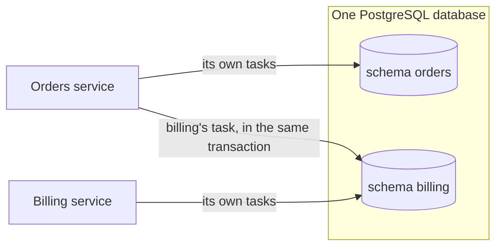

# Split work across services

**Situation.** "We have an orders service and a billing service, and both
use taskmill. When an order is placed, billing must create an invoice. Do
the services share one taskmill schema?"

## Which should I use?

| Your services | Use | Why |
|---|---|---|
| Share one PostgreSQL database | **One [schema](../concepts/glossary.md#schema) per service.** Enqueue for another service with a `Client` for its schema | The order and the invoice task commit in one transaction |
| Each have their own database | One schema per service. The [outbox](../guides/outbox.md) on the sending side, the [inbox](consume-from-a-broker.md) on the receiving side | No transaction spans two databases |
| Are parts of one app, such as a web process and a worker built from the same code | One schema for the app | It is one app, with one set of tasks. Modules of the app follow [Organize tasks by module](organize-tasks-by-module.md) |
| Are not all written in Go | An HTTP endpoint or a broker in front of the Go service's tasks | Handlers are Go only: see [Work with other languages](work-with-other-languages.md) |

One database has a cost: the services share its load and its failures, and
services that enqueue into each other's schemas must stay within one
taskmill release of each other
([Check versions and privileges](#check-versions-and-privileges)). If that
coupling is too tight, give each service its own database.

## The recommended way

Each service migrates and uses its own schema. The orders service also
creates a `Client` for billing's schema, only to enqueue billing's tasks:



```go
// In the orders service: its own schema, and a client for billing's schema.
if err := taskmill.Migrate(ctx, pool, &taskmill.MigrateConfig{Schema: "orders"}); err != nil {
    return err
}
orders, err := taskmill.NewClient(ctx, pool, &taskmill.ClientConfig{Schema: "orders", Logger: logger})
// ...
billing, err := taskmill.NewClient(ctx, pool, &taskmill.ClientConfig{Schema: "billing"}) // only to enqueue
```

Then enqueue billing's task in the transaction that saves the order:

```go
func placeOrder(ctx context.Context, pool *pgxpool.Pool, orders, billing *taskmill.Client, email string) (int64, error) {
    var orderID int64
    err := pgx.BeginFunc(ctx, pool, func(tx pgx.Tx) error {
        err := tx.QueryRow(ctx, "INSERT INTO orders (email) VALUES ($1) RETURNING id", email).Scan(&orderID)
        if err != nil {
            return err
        }
        if _, err := orders.EnqueueTx(ctx, taskmill.Pgx(tx), SendReceipt{OrderID: orderID}, nil); err != nil {
            return err
        }
        _, err = billing.EnqueueTx(ctx, taskmill.Pgx(tx), billingtasks.CreateInvoice{OrderID: orderID}, nil)
        return err // billing's task commits with the order
    })
    return orderID, err
}
```

[The example program](../../examples/services) runs both services.

## Agree on the contract

Billing's tasks are a contract between the two services: each task's kind,
its queue, its JSON fields, and its other defaults. Billing publishes them
in a package of task types only, `billingtasks`, as a module does in
[Organize tasks by module](organize-tasks-by-module.md). Orders imports that
package, and nothing else of billing.

If orders can't import billing's Go code, it declares its own copy of each
type: the same `Kind`, the same JSON fields, and the same `EnqueueDefaults`.
Change the contract as [Change a task safely](change-a-task-safely.md) says:
billing's workers first.

> [!WARNING]
> A copy without billing's queue in `EnqueueDefaults` enqueues into the
> `default` queue. By default, billing's workers read only the queues of
> their kinds, so the task may never run, and no error says so.

## Why one schema per service

- **Each service keeps its own schedules.** In a shared schema, only the
  [maintainer's](../concepts/glossary.md#maintainer) schedules run. If it
  has schedules of its own, it even deletes the others after a day. They
  stop, and the maintainer logs an error when they keep differing.
- **Each service runs only its own tasks.** In a shared schema, a worker
  takes tasks of any kind from its queues. If both services use the
  `default` queue, each one fetches the other's tasks and snoozes them. Those
  tasks wait longer, and can die after an hour.
- **Each service upgrades on its own.** Otherwise retention, the dashboard,
  and the taskmill version are shared too.

## Check versions and privileges

- **Keep every service within one taskmill release of the others.**
  Older code works on a newer schema for one release only
  ([Compatibility](../reference/compatibility.md#old-code-on-a-newer-schema)).
- **Migrate a schema before a newer taskmill enqueues into it.** If the
  orders service's taskmill is newer than billing's schema, its `NewClient`
  for billing fails with `ErrSchemaOutdated`. So upgrade billing first.
  When each service also enqueues into the other's schema, migrate both
  schemas first, for example with a migration Job of each. Then roll out the
  services in any order.
- **If the services use different database roles,** give the orders role
  only what an enqueue needs in billing's schema:

  ```sql
  GRANT USAGE ON SCHEMA billing TO orders;
  GRANT SELECT ON billing.migrations TO orders;
  GRANT INSERT (id, queue, kind, state, priority, run_at, group_key, payload, metadata, max_attempts),
      SELECT (id) ON billing.tasks TO orders;
  GRANT SELECT, INSERT, UPDATE ON billing.groups, billing.dedupe_keys TO orders;
  GRANT USAGE ON SEQUENCE billing.tasks_id_seq TO orders;
  ```

  This is the smallest set that works for every enqueue call and option:
  a test of taskmill applies it from this page. The orders role can add
  tasks. It can't read a payload, and it can't change, cancel, or delete a
  task. It writes only the columns that an enqueue writes, so it can't write
  a task's lease, attempts, or errors: no task of its making looks leased or
  finished.

  Billing still trusts the orders service. With these grants, the role can:

  - **Enqueue any task,** in any number, into any queue.
  - **Write a row with SQL of its own,** past what the client checks: any
    priority, any `max_attempts`, a payload over the size limit, or a task
    of a FIFO group that the group's row does not count. Such a task runs
    beside the group's head.
  - **Choose a task's ID.** Rows with IDs ahead of the sequence make later
    enqueues fail with a duplicate key, for every producer, until the
    sequence has passed them. The grant needs the column: an enqueue
    reserves each ID before it inserts the task, so that its result and a
    dedupe key can name the task.
  - **Read the rows of `groups` and `dedupe_keys`,** of every service that
    enqueues into billing. It sees each FIFO group's queue, key, and count of
    tasks, and the task that halts it. It sees each dedupe key as a SHA-256
    hash, with no secret, and its task's ID: so it can test a guessed key,
    such as an email address. Keep personal data out of these keys, or
    trust the role with it.
  - **Change the rows of `groups` and `dedupe_keys`.** A wrong count stops
    that FIFO group, or breaks its order: the other groups run as before. A
    changed key blocks a dedupe key, or admits a duplicate.

  These tables are internal, so a later release may need more: a table, or a
  column of `tasks`. The error `permission denied for table …` then names
  the table.

## Follow a task across services

Give the client for billing's schema the same `EnqueueMiddleware` as your
own client: `tel.EnqueueMiddleware` from the
[otel module](../guides/observability.md#add-traces-and-metrics-with-opentelemetry).
It stores the trace context in each task's metadata. Billing's workers, with
`tel.Middleware` and the same propagator, then continue the trace of the
request that placed the order. The metrics carry no schema: tell the
services apart by the label of each service, such as Prometheus's `job`.

## Test it

Give each schema its own `taskmilltest.NewClient`, and check billing's task
with billing's type:

```go
orders := taskmilltest.NewClient(t, pool, nil)  // a schema for the orders service
billing := taskmilltest.NewClient(t, pool, nil) // and one for billing's
orderID, err := placeOrder(t.Context(), pool, orders, billing, "ada@example.com")
// ...
// Enqueued decodes the payload into billing's type, as billing's worker does.
invoices := taskmilltest.Enqueued[billingtasks.CreateInvoice](t, billing)
```

So the test fails on a payload that billing's worker can't decode. A JSON
field that billing's type lacks is dropped, and a field that the payload
lacks reads as zero, so check the values too.

## Other options

| Option | When it fits | The cost |
|---|---|---|
| A database per service, with the outbox and the inbox | Your services must not share a database | A broker between them, and no shared transaction |
| A task in orders that calls billing's HTTP API | Billing already has an API for this | The task may call twice, so billing's API must accept an idempotency key |
| One shared schema for all services | Never, for separate services | Schedules stop, tasks wait or die, and every upgrade is shared |

## Watch out

- **Run no worker on the client for billing's schema.** It only enqueues. A
  worker there could become billing's maintainer. While it is, billing's
  schedules don't run.
- **Services in one database pay a little for each other.** PostgreSQL wakes
  every listening connection in the database for each notification,
  whatever its schema. With 100 schemas and 500 workers, the maintainers'
  [heartbeats](../concepts/glossary.md#heartbeat) cost about a quarter of a
  CPU.

## See also

- [Set up the database and client](../guides/setup.md): the `Schema` option
- [Publish events with the outbox](../guides/outbox.md): for a database per service
- [`ClientConfig`](https://pkg.go.dev/github.com/code19m/taskmill#ClientConfig) on pkg.go.dev

**Next:** [Work with other languages](work-with-other-languages.md)
