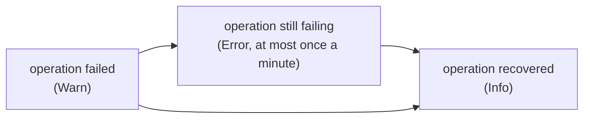

# Log messages

Every line that taskmill logs: its level, what it means, and what to do.
Search this page for the message you see.

## Where logs go

taskmill logs through `log/slog`. Without a logger, it logs nothing.

| Part | Logger | Default |
|---|---|---|
| A client, and the workers built on it | `ClientConfig.Logger` | Nothing is logged |
| `Migrate` | `MigrateConfig.Logger` | Nothing is logged |
| The dashboard, from the `ui` package | `ui.Config.Logger` | Nothing is logged |
| The `taskmill-ui` command | Text lines on standard error, at Info and above | — |

> [!TIP]
> Pass your application's logger to all three configs, and run at Info. Send
> Error lines to a person. Watch Warn lines that repeat.

## Levels

Each message has one level, chosen by what it asks of you.

| Level | Meaning | What you do |
|---|---|---|
| Error | Something needs a person: a task is dead, an operation has failed for a minute, or a privilege is missing. | Act on each one. |
| Warn | Something failed or looks wrong, but taskmill goes on and recovers by itself. | Act if it repeats or lasts. |
| Info | Lifecycle: a worker starts or stops, the maintainer changes, a migration runs, an operation recovers, someone acts in the dashboard. | Nothing. |
| Debug | Routine events of single tasks, such as a retry. | Turn it on to follow one kind's retries. |

## Attributes

The same key always means the same thing.

| Key | Value |
|---|---|
| `task_id`, `kind`, `queue`, `attempt` | The task, its kind and queue, and the attempt number |
| `worker_id` | The worker. Every line from a worker has it |
| `error` | What went wrong |
| `duration` | How long something took |
| `operation`, `failures` | A repeated operation, and how often it failed (see below) |
| `tasks` | How many tasks a line is about |
| `retry_in` | The wait before the next attempt |
| `released` | Tasks given back to their queue at shutdown |
| `queues`, `kinds`, `group`, `partition` | Names of queues, kinds, a FIFO group, a history partition |
| `max_conns`, `timeout` | Settings named by the line |
| `version`, `name` | A migration, or the version of `taskmill-ui` |
| `action`, `target`, `skipped`, `path`, `page` | The dashboard's actions and requests |
| `addr`, `prefix`, `read_only` | The settings of `taskmill-ui` |

No line shows a task's payload or metadata. A connection error shows what pgx
reports, such as the host, user, and database, but never the password.

**Keep secrets out of your errors.** A handler's error is logged as the
handler returned it, so a token or a card number in an error ends up in your
logs.

## Operations that repeat

A worker repeats some operations all the time, such as fetching tasks. While
the database is down, they fail at every try. To keep the log small, each
operation logs only three lines about one incident:

The `operation` attribute names it. `failures` counts the failures of the
incident, and `duration` runs from its first failure to its last. An
incident lasts while failures come less than a minute apart, even with some
successes between them.

| Operation | What it does | How often | If it keeps failing, check |
|---|---|---|---|
| `fetch tasks` | Takes tasks of the queue in `queue` | Every poll, and on each wake-up | The database |
| `renew leases` | Renews the leases of running tasks | Every third of `LeaseDuration` | The database, and the pool size |
| `record check-in` | Notes in the database that the worker is alive, at its [check-in](../concepts/glossary.md#check-in) | Every third of `LeaseDuration` | The database |
| `record results` | Saves the results of finished attempts | After each attempt | The database |
| `load queue settings` | Reads pauses and limits of the queues | Every 10 seconds | The database |
| `record activity` | Writes the counts for the charts | Every 10 seconds | The database |
| `listen for notifications` | Keeps the connection that receives notifications. Idle queues poll every `PollInterval` meanwhile | On failure, again after 1 to 30 seconds | `ListenConfig`, and any proxy in between |
| `elect maintainer` | Takes or keeps the maintainer role | Every 1 to 2 seconds | The database |
| `promote due tasks` | Makes delayed tasks and retries available | As they come due | The database |
| `wake queues` | Notifies queues whose tasks wait, and sends the heartbeat | Every second | The database |
| `rescue expired leases` | Fails the attempts of workers that lost their leases | Every second | The database |
| `run schedules` | Enqueues due schedule runs | Every second | The database |
| `refresh statistics` | Counts tasks for `Client.Queues` | Every 10 seconds | The database |
| `apply retention` | Prepares history partitions, and deletes old history and rows | Every minute | That the role that runs workers owns the taskmill tables |
| `delete removed schedules` | Deletes stored schedules that are gone from the code | Every minute | The database |

`elect maintainer` runs on every worker that takes part in the election.
The seven operations after it run only on the maintainer.

## Messages

Messages are grouped by the part that logs them. Attributes are in
backticks.

### Repeated operations

| Message | Level | What it means | What to do |
|---|---|---|---|
| `operation failed` | Warn | An operation started to fail. `error` says why. The worker tries again by itself. | Nothing yet. |
| `operation still failing` | Error | It has failed for a minute or more. | Fix what `error` names, often the database or a privilege. See the table above. |
| `operation recovered` | Info | It works again. | Nothing. |

### Worker lifecycle

| Message | Level | What it means | What to do |
|---|---|---|---|
| `worker started` | Info | `Run` started, and serves `queues`. | Nothing. |
| `the worker does not serve the default queue of these registered kinds` | Warn | The worker has handlers for `kinds`, but does not read their default queues. Their tasks wait for another worker. | Add the queues to `WorkerConfig.Queues`, or run a worker that reads them. |
| `worker stopping; waiting for running tasks` | Info | `Run`'s context ended. It waits up to `timeout` for `tasks` running tasks. | Nothing. |
| `handler ignored shutdown; releasing its task` | Warn | A handler did not return within 5 seconds after its context was canceled. Its task goes back to the queue and runs again. The handler may still be running. | Make the handler return when its context ends. |
| `worker stopped` | Info | `Run` returned. `released` tasks went back to their queues. | Nothing. |
| `unregister worker failed` | Warn | The stopped worker could not remove itself from the list of workers. It stays listed for 5 minutes. | Nothing, unless it repeats: then check the database. |
| `worker was removed as stale; registering again` | Warn | The worker did not report to the database for 5 minutes, for example while its machine slept, so the maintainer removed it. It registers again and goes on. | Find out what paused the process. |

### Tasks and attempts

| Message | Level | What it means | What to do |
|---|---|---|---|
| `attempt failed; retrying` | Debug | The handler failed. The task runs again in `retry_in`. Also has `attempt`, `error`, and `duration`. | Nothing. |
| `attempt failed; the task is dead` | Error | The task failed for good: no attempts left, `Permanent`, a payload that did not decode, or no handler for an hour. Also logged when the last attempt's worker lost its lease. | Fix the cause. Then retry the task, or delete it. A dead task halts its FIFO group. |
| `no handler for task kind; snoozing` | Warn | This worker has no handler for `kind`. The task waits up to an hour for a worker that has one, without using attempts. Later snoozes of the same task log at Debug. | Normal during a rolling deploy. Otherwise, give every worker of the queue the same handlers. |
| `the pool was full, so renewing leases waited; raise MaxConns, or give handlers a pool of their own` | Warn | All `max_conns` connections of the pool were in use, so renewing leases waited `duration` for one. Usually handlers that share the pool hold them. If renewals keep waiting, leases run out and tasks run twice. Logged at most once a minute. | Raise the pool's `MaxConns`, for example with `pool_max_conns` in the URL. Or give handlers a pool of their own. See [Database](../production/database.md#size-the-connection-pool). |
| `attempt lost its lease; canceling it` | Warn | The worker could not renew the lease in time. The task may already run on another worker. | Check the database and the pool size. |
| `result discarded: the attempt lost its lease` | Debug | An attempt ended after it lost its lease. Its result does not count. | Nothing. |
| `record attempt failed; the task is rescued when its lease expires` | Warn | The result of the attempt could not be saved in time. Once the lease runs out, the maintainer rescues the task. | Check the database. |
| `complete tasks failed; they are rescued when their leases expire` | Warn | `tasks` successful attempts could not be saved. Those tasks run again. | Check the database. |
| `handler failed after completing its task; it stays completed` | Warn | The handler returned an error after its `CompleteTx` transaction committed. | Return nil once the transaction has committed. |
| `enqueue middleware failed after the tasks were enqueued` | Warn | An enqueue middleware returned `error` after `tasks` tasks committed. The enqueue succeeded, but the middleware's work, such as a span, may be missing. | Fix the middleware. |
| `fifo group missing` | Error | A task's FIFO group in `queue` and `group` has no row. This should never happen. | Please [report it](https://github.com/code19m/taskmill/issues). |

### The maintainer

| Message | Level | What it means | What to do |
|---|---|---|---|
| `elected maintainer` | Info | This worker now does the shared work. | Nothing. |
| `no longer maintainer` | Info | Another worker took over, or the election failed. Incidents of the maintainer's operations end here, without `operation recovered`. | Nothing. |
| `resign maintainer failed; another worker leads when the lease expires` | Warn | A stopping maintainer could not hand over. The next one starts within about 12 seconds. | Nothing, unless it repeats. |
| `rescued tasks whose workers lost their leases` | Warn | `tasks` attempts failed because their workers stopped renewing their leases: a worker crashed, was killed, or lost the database. The tasks are retried. Those with no attempts left become dead. | If it repeats, look for crashed or killed workers, and check the grace period at shutdown and the pool size. |
| `dropped expired history` | Info | Retention dropped the history `partition`. | Nothing. |

### Notifications

| Message | Level | What it means | What to do |
|---|---|---|---|
| `notifications disabled; polling only` | Error | The worker cannot listen. `ListenConfig` was not created with `pgx.ParseConfig`, or the connection goes through a pooler in transaction mode, such as PgBouncer. The worker polls every `PollInterval` instead: tasks start later, and the database works more. | Point `ListenConfig` at a direct connection, made with `pgx.ParseConfig`. See [Connection poolers](../production/connection-poolers.md). |
| `maintainer heartbeats arrive; idle queues poll once a minute` | Info | The maintainer's heartbeats reach this worker, at start or after a gap. | Nothing. |
| `maintainer heartbeats do not arrive; idle queues poll every PollInterval` | Warn | No heartbeat came for 15 seconds. No maintainer runs (every worker has `NoMaintainer`, or the maintainer crashed and its lease has not run out yet), the maintainer runs an older version during an upgrade, or notifications don't reach this worker. The worker logs it again only after the heartbeats came back. | Check that a maintainer runs: `Client.Workers`, or the `taskmill.stats.age` gauge. Point `ListenConfig` at the primary of the same database. |
| `notification failed` | Warn | A wake-up for `queue` was not sent. Its tasks start a little later, when the maintainer wakes the queue or a worker polls. | Nothing, unless it repeats: then check the database. |

### History and migrations

| Message | Level | What it means | What to do |
|---|---|---|---|
| `task history has no partition for today; completed tasks skip history` | Error | Neither the workers, when they started, nor the maintainer could create today's history partition. Tasks still complete, but without history. | Make the role that runs workers own the taskmill tables. See [Database](../production/database.md). |
| `applied migration` | Info | `Migrate` applied migration `version` (`name`) in `duration`. | Nothing. |
| `prepare history partitions failed` | Warn | `Migrate` found the schema up to date, or a worker started, but could not create the missing history partitions. `error` says why. The worker still starts, and the maintainer tries again. | If `task history has no partition` follows, fix the table owner. |

### Dashboard

| Message | Level | What it means | What to do |
|---|---|---|---|
| `web interface action` | Info | Someone did `action` on `target` in the dashboard. A bulk action also has `tasks`, how many tasks it changed, and `skipped`, how many other work held. | Nothing. To log who did it, see [One dashboard for many services](../recipes/one-dashboard-for-many-services.md). |
| `web interface request failed` | Warn | A page or an action at `path` failed, often because the database is out of reach. | Check the database, if it repeats. |
| `web interface request timed out` | Warn | The database did not answer within 10 seconds. The page says "Taking too long". | Check the database's load. |
| `read activity failed` | Warn | The overview's charts could not read their history, and show none. | Check the database, if it repeats. |
| `read filter choices failed` | Warn | The task list could not read the choices of a filter, named by `target`. | Check the database, if it repeats. |
| `search groups failed` | Warn | The search for FIFO groups in a filter failed. | Check the database, if it repeats. |
| `render page failed` | Error | A page template failed: `page` names it. | Please [report it](https://github.com/code19m/taskmill/issues). |

### The `taskmill-ui` command

| Message | Level | What it means | What to do |
|---|---|---|---|
| `taskmill-ui listening` | Info | The command serves the dashboard on `addr`, with its `version`, `prefix`, and `read_only` setting. | Nothing. |
| `the dashboard has no password: set TASKMILL_UI_PASSWORD, unless something in front of it authenticates` | Warn | Anyone who reaches the address can use the dashboard. | Set `TASKMILL_UI_PASSWORD`, unless a proxy in front of it asks for a login. |
| `taskmill-ui stopped` | Error | The command could not start or serve, and exited. `error` says why: for example, the schema is not migrated yet, or a setting is wrong. | Fix what `error` names. If the schema is not migrated yet, let your application run `Migrate`, then start the command again. |

## See also

- [Monitoring](../production/monitoring.md): which lines and metrics to alert on
- [Troubleshooting](../production/troubleshooting.md): from a symptom to its fix
- [Observability](../guides/observability.md): how to set up logs, traces, and metrics

**Next:** [Metrics and traces](metrics.md)
